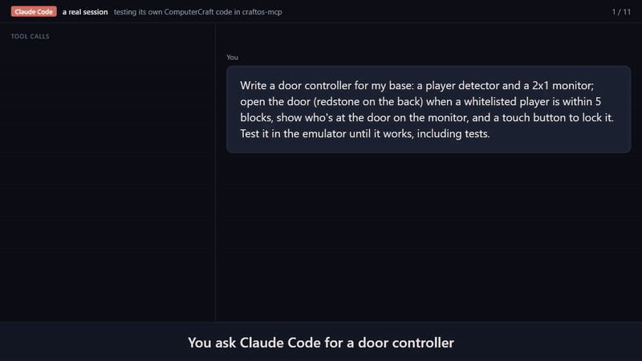
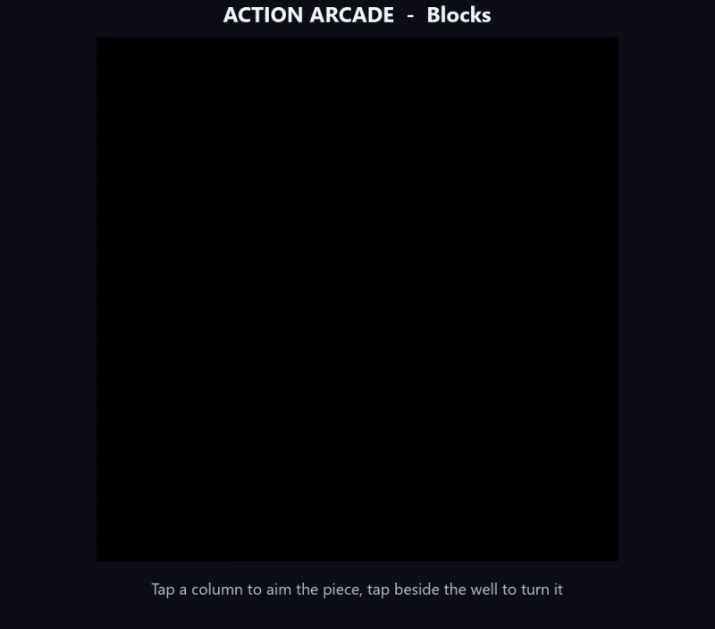
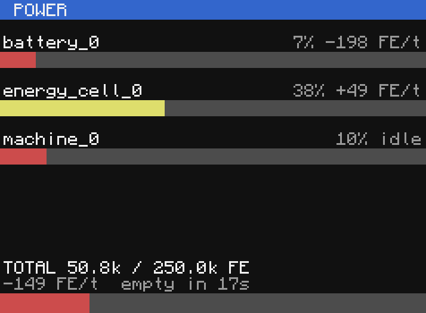

# craftos-mcp

> **Minecraft 1.18.2 is complete. 1.20.1 is partly there:** pick it and you get CC:Tweaked 1.121.0's behaviour and
> 1.20.1 turtle data, but the mods' peripherals still behave like their 1.18.2 versions for now. 1.21.1 is next. See
> [Choose your Minecraft version](#choose-your-minecraft-version).

**Let your coding agent test the ComputerCraft code it writes.** AI agents write CC:Tweaked Lua they have never run,
and the bugs turn up on your server. craftos-mcp is a CC:Tweaked emulator the agent drives itself over
[MCP](https://modelcontextprotocol.io): it runs the program, reads the terminal and every monitor, taps buttons,
changes the world around the computer (a player walks up, a chest fills, a train arrives, a reactor heats up, an hour
passes), writes and runs tests, and fixes what broke until it works. All without Minecraft.

```json
{
  "mcpServers": {
    "craftos": { "command": "npx", "args": ["-y", "craftos-mcp", "serve"] }
  }
}
```

That one entry works in Claude Code, Cursor, VS Code and any other MCP client; the first start downloads the engine
and builds the ROM by itself. The world it simulates is what CC programs depend on: several computers on modems with
real rednet, turtles in a block world, and peripherals from Create, Mekanism, Advanced Peripherals and more.

No agent? The same emulator works for people too:

- **In a window**, like CraftOS-PC: `craftos-mcp window` ([Without an AI agent](#without-an-ai-agent)).
- **In your browser**: `craftos-mcp app` opens computers, monitors and the world side by side.
- **From the command line and CI**: `craftos-mcp test tests/` runs your `*.test.lua` files.

The engine passes 1190 of 1191 of CC:Tweaked's own tests at 1.101.3 (and 1362 of 1363 at 1.121.0), and the ROM is
built from the real CC:Tweaked jar. [How exact is it](docs/accuracy.md) says, area by area, what was measured in game
and what was written from source.



_A real Claude Code session, unscripted: asked for a door controller with tests, it ran its program in the emulator,
caught a monitor that never stopped redrawing and a player at the range edge who could not get in, fixed both, and
finished with its tests passing. Then the same file went onto a computer in real Minecraft and worked there with no code
changes, just a player name added to its whitelist ([the diff](docs/media/showcase/ingame-door-diff.txt),
[the clip](docs/media/showcase/ingame-door.mp4)). The [full transcript](docs/media/showcase/agent-demo-transcript.md)
is next to the [video](docs/media/showcase/agent-demo.mp4)._

Some games built and tested with it are **[playable in your browser](https://rogiedoji.com/craftos)**, no install,
and there's a [highlight reel](docs/media/showcase/sizzle.mp4) of them.

## What it does

- **Run and test**: run a program in a fresh computer and get the terminal and every monitor back as text, PNGs or
  golden snapshots; run `*.test.lua` files with the built-in `ccunit` harness.
- **Interactive sessions**: type, press keys, touch monitors, send events, wait for text. `craftos_ui` reads every
  screen as buttons and text runs with colours, so an agent can drive a UI without screenshots.
- **Monitors** at any wall size and text scale, with real touch events.
- **Several computers at once**: wireless, ender and wired modems with real rednet, ranges and wired names.
- **Turtles** in a block world built from vanilla 1.18.2 data: the whole turtle API with its tick timing, digging
  with loot-table drops, placing, inventories, refuelling, upgrades and crafting. What a turtle places comes alive:
  computers boot, disk drives take floppies, monitors join into walls.
- **CC's generic peripherals**: chests, barrels and any modded block as an inventory, fluid tank and energy store,
  with `pushItems`, `pullItems`, `pushFluid` and levels that move over time.
- **Peripherals from other mods**, written from each mod's source and checked against its jar, each one an addon
  you switch on only if your pack has it (see [Choose your mods](#choose-your-mods)):
  - Advanced Peripherals 0.7.31r: player, energy and environment detectors, chat box, redstone integrator, NBT
    storage, AR controller, ME and RS bridges.
  - Mekanism 10.2.5: QIO, the Quantum Entangloporter, the boiler and induction matrix; with Mekanism Generators, the
    fission reactor, turbine and fusion reactor, running tick by tick (a reactor left alone melts down).
  - Create 0.5.1: train stations with schedules and trains on the clock, gauges, speed controllers, sequenced
    gearshifts and the display link; Create Crafts & Additions 1.0.0's motor, accumulator, relay and digital adapter.
  - Tom's Peripherals 1.2.1: the GPU with its full drawing API, pixel-exact and in screenshots, keyboard, redstone
    port and watchdog.
  - Bigger Reactors 0.6.0 and Extreme Reactors 2.0.71: reactors and turbines with their real heat, fuel and rotor
    physics.
- **Determinism**: seed `math.random`, run the clock faster, or jump it forward so timers fire instantly.
- **Your way in**: a desktop window, a browser app (also the MCP server's live viewer at <http://127.0.0.1:7878>),
  a command line, and an in-computer `sim` command to change the world by typing (`sim join Alice`).

## Games

Three game cabinets in plain CC:Tweaked Lua, each with a world file and tests that play real games through taps on
the monitors. They're examples of what you can build and test here, and they use nothing but CC:Tweaked's own APIs.

| Cabinet                                             | Games                                                                                                                      | Shows off                                    |
| --------------------------------------------------- | -------------------------------------------------------------------------------------------------------------------------- | -------------------------------------------- |
| [Board](workspace/examples/games/board/README.md)   | Ultimate Tic-Tac-Toe, Four in a Row, Reversi, Checkers, Dots and Boxes, Mancala, Fleet, Codebreaker; three computer levels | touch monitor walls, two players at one wall |
| [Action](workspace/examples/games/action/README.md) | Snake, Blocks, Bricks, Lander, Mines                                                                                       | fast redraws, real-time touch                |
| [Versus](workspace/examples/games/versus/README.md) | Paddle, Trails, Artillery                                                                                                  | two computers in one match over rednet       |

|                                                                                                  |                                                                                                                           |
| ------------------------------------------------------------------------------------------------ | ------------------------------------------------------------------------------------------------------------------------- |
|  |  |
| Blocks, steered by tapping the wall                                                              | Paddle across two computers on rednet (3x speed)                                                                          |

Each cabinet's README says how to open it. The board games, for example:

```sh
craftos-mcp window workspace/examples/games/board/arcade.world.json --dir workspace --monitor left:6x6 --monitor right:6x6
# then, in the computer: examples/games/board/arcade
```

`node scripts/make-showcase.mjs` records the videos again from real runs.

## Examples

[`workspace/examples/`](workspace/examples/README.md) also has complete programs for the mods above, each with a world
and a test that proves it works: a Mekanism reactor controller, a Create train departure board, an energy monitor for
any modded battery, a Tom's Peripherals GPU demo, an Extreme Reactors rod controller, an Advanced Peripherals player
greeter and a rednet chat between two computers. These pictures are rendered from real runs (`node
scripts/make-demo-gif.mjs` makes them again).


_The [reactor controller](workspace/examples/mekanism/reactor.lua) on a simulated Mekanism reactor, with the clock sped
up: it scrams the reactor before it is damaged, and RESET restarts it once it has cooled. The
[test](workspace/examples/mekanism/reactor.test.lua) checks exactly that._

|                                                                                 |                                                                            |
| ------------------------------------------------------------------------------- | -------------------------------------------------------------------------- |
|                      |                      |
| Train departure board: platform, train, status and schedule for each station    | GPU demo: a spinning cube, a sine ribbon and ripples where you right-click |
|        |              |
| Power monitor: any block with an energy store, with rates and a low-power alarm | The reactor controller after it has scrammed on temperature                |

## Setup

You need Node.js 22 or newer.

### From npm (Windows and Linux x64)

```sh
npx -y craftos-mcp serve                        # the MCP server, for any agent
claude mcp add craftos -- npx -y craftos-mcp serve
npx craftos-mcp test                            # or window, app, run, info: see the command line below
```

The package holds no engine or ROM. The first command fetches the engine from this repository's release, builds the
ROMs from the real CC:Tweaked jars and the GPU fonts, and keeps them in `%LOCALAPPDATA%\craftos-mcp` or
`~/.cache/craftos-mcp` (`CRAFTOS_HOME` moves it); that takes a few seconds to a minute, once per version. `serve`
answers its client straight away and lets the tools that run computers wait for it. The workspace is the folder you
run it in. `craftos-mcp setup --force` does the setup again.

### Quick start from a clone

```sh
git clone https://github.com/Akkiruk/craftos-mcp
cd craftos-mcp
npm run setup
```

`npm run setup` installs the packages, builds the tools, builds the ROM from the real CC:Tweaked jar (and Tom's
Peripherals' fonts), downloads the prebuilt engine for your OS from the latest release, checks everything and prints
the line that connects your agent. Run it again any time: finished steps are skipped. If the release has no engine for
your OS it tells you how to build one (below).

### Claude Code plugin

One install gives Claude Code the `cc-tweaked-dev` skill and the `craftos` MCP server:

```text
/plugin marketplace add Akkiruk/craftos-mcp
/plugin install craftos-mcp@craftos-mcp
```

Claude Code keeps a copy of this repository for the plugin, which has no engine or ROM yet, so the first time the
server starts it runs the setup above in the background (a few minutes: it downloads the jar and the engine). If
`/mcp` shows the server as failed on that first try, wait a minute and reconnect; setup carries on without it. Progress
is in `.cache/setup.log` inside the plugin's folder. The plugin asks which mods your pack has (the addon list below),
and the server's workspace is the folder you start Claude Code in.

### The command line

`craftos-mcp` runs without an agent, so it works in scripts and CI. Run it from your Lua project folder (`--dir`
changes that):

```sh
craftos-mcp test                         # every *.test.lua below here, ccunit harness; exits 1 on a failure
craftos-mcp test tests/ --addons create --timescale 10
craftos-mcp run clock.lua --monitor top:2x2 --screenshot shot.png   # terminal and monitors as text, PNGs saved
craftos-mcp run sort.lua --world worlds/chests.json --timeout 20 -- --verbose
craftos-mcp info                         # engine, ROM and addons status
craftos-mcp serve                        # the MCP server over stdio
```

Inside a clone use `npx craftos-mcp ...`, or `node apps/cli/dist/index.js ...`. `craftos-mcp help <command>` lists the
options. A `--world` is a JSON file or the name of one in `worlds/`; `--addons` is `all`, `none` or ids separated by
commas.

### Doing it by hand

#### 1. The engine

Download the prebuilt engine for your OS from the
[latest release](../../releases/latest) and unzip it over the repository, or build it yourself:

- **Windows**: Visual Studio 2022 (or its Build Tools) with C++, CMake, Ninja and a [vcpkg](https://vcpkg.io)
  checkout in `VCPKG_ROOT`. Then `engine\build.cmd`.
- **Linux**: a C++17 compiler, CMake, Ninja and vcpkg in `VCPKG_ROOT`. Then `engine/build.sh`.

macOS is not supported yet.

#### 2. The ROM

CC:Tweaked's license does not allow its ROM to be redistributed with this project, so you build it on your own
machine. This downloads CC:Tweaked 1.101.3 from Modrinth, checks its hash, and builds `rom/cc-1.101.3`:

```sh
node scripts/build-rom.mjs --download
```

If you already have the jar: `node scripts/build-rom.mjs path/to/cc-tweaked-1.18.2-1.101.3.jar rom/cc-1.101.3`.

The same step downloads Tom's Peripherals 1.18.2-1.2.1 (MIT) and builds the GPU's fonts from it, since they are not
shipped here either (`node scripts/build-toms-fonts.mjs` does it alone).

#### 3. The tools

```sh
npm install
npm run build
```

#### 4. Connect your agent

Claude Code:

```sh
claude mcp add craftos -- node /path/to/craftos-mcp/apps/mcp-server/dist/index.js
```

VS Code: `.vscode/mcp.json` is already set up for this folder. Other MCP clients: run
`node apps/mcp-server/dist/index.js` over stdio. Then call `craftos_info`; it lists anything that is missing.

Point `CRAFTOS_WORKSPACE` at your own Lua project to work on it in place. Other settings: `CRAFTOS_ENGINE`,
`CRAFTOS_ROM`, `CRAFTOS_RUNTIME_ROOT`, `CRAFTOS_VIEWER_PORT` (`off` turns the viewer off).

## Without an AI agent

`craftos-mcp window` opens the computer in a desktop window, with the same simulated world an agent gets:

```sh
craftos-mcp window worlds/generic-storage-demo.json --monitor top:3x2   # from your Lua project folder
craftos-mcp window create-demo --dir path/to/project                    # a world from worlds/ by name
```

The computer's files are your folder (`--dir`, default the current one), live: edit in your own editor, then hold
Ctrl+R in the window to reboot. Monitors open as windows of their own and a click is a touch; a world can list them
under `"monitors"`. A world's speakers play real sound. F12 copies a screenshot to the clipboard. Turtle worlds and several computers on
one network do not open in a window yet.

Inside the computer, the `sim` program changes the world, as `craftos_sim_command` does for an agent. It is the
emulator's own: a real CC:Tweaked computer has no `sim`.

```text
sim join Alice                      sim leave Alice
sim chat Alice hello                sim advance 60          (jump the clock 60 seconds)
sim item chest_0 1 minecraft:diamond 5
sim state                           (players, peripherals, chat)
sim createTrainArrive station=Create_Station_0 train=Express   (any command a mod's simulation knows)
sim help                            (all of them)
```

### In your browser

`craftos-mcp app` starts a local web page and opens it:

```sh
craftos-mcp app --dir path/to/project            # --port 7878 by default; --no-open just prints the address
```

**New computer** makes one: a normal, advanced, pocket or turtle computer, a world from `worlds/` or your own JSON,
the mods your pack has, monitors and their sizes, and a program to run (or just the shell). Set **Computers** above 1
for a network, each with a modem. Every computer gets a tab. Its terminal takes the keyboard, paste and mouse; the
Ctrl+T, Ctrl+R and Ctrl+S buttons hold the keys for a second as CC needs (your browser keeps Ctrl+T for itself).
Monitors and Tom's Peripherals GPU screens update live, and a click is a touch on that cell or pixel; **UI** outlines
what the screens show as buttons. On the side: the world (players join, leave and chat, the clock jumps, items go
into slots, and the whole sim state as a tree), a box for any sim command with the list of the ones this world knows,
and the computer's files, which you can edit, or copy your project in again, and reboot.

It listens on 127.0.0.1 only. The MCP server's live viewer (<http://127.0.0.1:7878>) is the same page, so you can
watch and help while an agent works.

## Choose your Minecraft version

| Version            | CC:Tweaked | State                                                                                                |
| ------------------ | ---------- | ---------------------------------------------------------------------------------------------------- |
| `1.18.2` (default) | 1.101.3    | Complete: CC itself, turtles, modems and every mod below                                             |
| `1.20.1`           | 1.121.0    | CC itself and turtles (1.20.1 block data) as in 1.121.0; the mods still act as their 1.18.2 versions |
| `1.21.1`           | 1.121.0    | CC itself as in 1.121.0; turtle data and mods not done yet                                           |

Pick one per world with `"version": "1.20.1"`, for the MCP server with `CRAFTOS_VERSION`, or on the command line with
`--mc 1.20.1`. Each CC:Tweaked version needs its ROM: `node scripts/build-rom.mjs --download 1.20.1`, or
`npm run setup -- --mc all` for every version. A mod that does not exist on the chosen version (Bigger Reactors on
1.21.1) is refused with a message.

## Choose your mods

Every mod besides CC:Tweaked is an addon. Switch on only the ones your pack has, so a program cannot come to rely on
a peripheral your server does not have. Set `CRAFTOS_ADDONS` for the MCP server (the `.vscode/mcp.json` here lists
them all: delete the ones you do not use), or give one world its own list with `addons`:

```json
{
  "addons": ["create", "mekanism"],
  "peripherals": [{ "name": "station_0", "type": "Create_Station" }]
}
```

| Id                     | Mod                                              |
| ---------------------- | ------------------------------------------------ |
| `advanced-peripherals` | Advanced Peripherals 0.7.31r                     |
| `mekanism`             | Mekanism 10.2.5                                  |
| `mekanism-generators`  | Mekanism Generators 10.2.5 (needs `mekanism`)    |
| `create`               | Create 0.5.1.i                                   |
| `create-additions`     | Create Crafts & Additions 1.0.0 (needs `create`) |
| `toms-peripherals`     | Tom's Peripherals 1.18.2-1.2.1                   |
| `bigger-reactors`      | Bigger Reactors 1.18.2-0.6.0-beta.1.4            |
| `extreme-reactors`     | Extreme Reactors 1.18.2-2.0.71                   |

`"all"` and `"none"` work too. With no setting at all, everything is on. A world that uses a block from an addon that
is off fails before the computer boots and names the addon; `craftos_info` lists what is on.

## Tools

| Tool                                                                                  | Purpose                                                                              |
| ------------------------------------------------------------------------------------- | ------------------------------------------------------------------------------------ |
| `craftos_info`                                                                        | Engine, ROM and workspace status                                                     |
| `craftos_write_file`, `craftos_read_file`, `craftos_list_files`                       | Workspace files (copied to the root of each computer)                                |
| `craftos_run`                                                                         | Run a program in a fresh computer: terminal and monitor text, PNGs, golden snapshots |
| `craftos_test`                                                                        | Run `*.test.lua` files with the `ccunit` harness                                     |
| `craftos_session_create`, `craftos_type`, `craftos_key`, `craftos_touch_monitor`, ... | Interactive computers                                                                |
| `craftos_ui`, `craftos_act`, `craftos_settle`, `craftos_expect`, `craftos_script`     | Read screens as data, act and wait until the program is done, assert                 |
| `craftos_network_create`, `craftos_network_update`                                    | Several computers with modems                                                        |
| `craftos_sim_command`, `craftos_sim_state`                                            | Change and read the simulated world during a session                                 |
| `craftos_seed`, `craftos_advance`, `craftos_trace`, `craftos_screenshot`              | Determinism, the virtual clock, what the program saw, pictures                       |

For an agent, `.claude/skills/cc-tweaked-dev/SKILL.md` is a short guide to using these well.

## Your own modpack

The turtle world ships with vanilla Minecraft, Forge and CC:Tweaked data. To give it every block, item, recipe and
loot table in your modpack, generate the data from your own instance:

```sh
python -I tools/turtledata/extract.py --instance "<your instance>/minecraft"
```

## Layout

```text
engine/        Forked CraftOS-PC 2 (MIT, see engine/UPSTREAM.md)
packages/      rawterm (engine protocol, PNG renderer), runner (runs, tests, sessions, networks, browser app), protocol
apps/          The craftos-mcp command line (window, app, test, run, info, serve) and the MCP server
rom-overlay/   The simulation layered over the CC:Tweaked ROM (peripherals, modems, turtles)
web/           The browser build: the engine as WebAssembly and a player for pages (web/README.md)
scripts/       Setup, ROM builder, CC:Tweaked conformance runner, the video recorder
tools/         Data extraction for turtles
worlds/        Example worlds
docs/          Architecture, security model, peripherals, turtles, conformance
```

## Known limits

- Minecraft 1.18.2 is complete; on 1.20.1 and 1.21.1 the mods are still their 1.18.2 versions (see
  [Choose your Minecraft version](#choose-your-minecraft-version)). Older versions (1.16.5, 1.12.2) are not supported.
- Only the mods listed above are simulated, and each from its source: where a mechanic is too large to copy (Create's
  stress network and track graph, multiblock formation) it is a fixture instead. Each mod's doc ends with what is not
  simulated or not confirmed. Pocket computer upgrades and most of Advanced Peripherals' turtle upgrades are not simulated (the geo scanner and chunky turtle are).
- A pattern that never finishes inside one C function (a pathological `string.find`) cannot be aborted by the
  engine; the runner's timeout ends the process instead.
- The virtual clock can run faster, but it is not a fully deterministic scheduler.
- Lua runs in a scratch directory per run, but the engine is not sandboxed by the OS. Only run code you trust; see
  [docs/security.md](docs/security.md).

## Credits

The engine is a fork of [CraftOS-PC 2](https://github.com/MCJack123/craftos2) by JackMacWindows (MIT).
[CC:Tweaked](https://tweaked.cc) is by SquidDev and contributors; this project does not include it, and builds its ROM
on your machine from the official jar. Not affiliated with Mojang or Microsoft.

## License

MIT, see [LICENSE](LICENSE). The engine keeps CraftOS-PC's MIT license ([engine/LICENSE](engine/LICENSE)). See
[NOTICE.md](NOTICE.md) for third-party parts.
