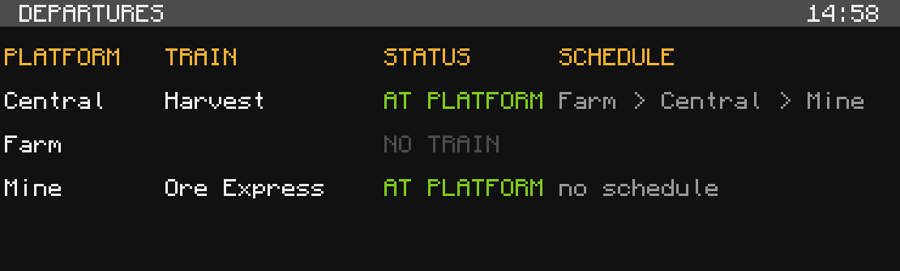

# craftos-mcp

**Let your coding agent test the ComputerCraft code it writes.** AI agents write CC:Tweaked Lua they have never run,
and the bugs turn up on your server. craftos-mcp is a CC:Tweaked emulator the agent drives itself over
[MCP](https://modelcontextprotocol.io): it runs the program, reads the terminal and every monitor, taps buttons,
changes the world around the computer (a player walks up, a chest fills, a train arrives, a reactor heats up, an hour
passes), writes and runs tests, and fixes what broke until it works. All without Minecraft.

The world it simulates is what CC programs depend on: several computers on modems with real rednet, turtles in a
block world, and peripherals from Create, Mekanism, Advanced Peripherals and more. 58 of the community's libraries,
programs and operating systems, from Basalt and Pine3D to Opus, LevelOS and Phoenix, install and run in it as they do
in the game: [the list](docs/compatibility.md). The engine passes 1189 of 1190 of CC:Tweaked's own tests at 1.101.3
(and 1361 of 1362 at 1.121.0), and the ROM is built from the real CC:Tweaked jar. [How exact is it](docs/accuracy.md)
says, area by area, what was measured in game and what was written from source.


_A real Claude Code session, unscripted: asked for a door controller with tests, it ran its program in the emulator,
caught a monitor that never stopped redrawing and a player at the range edge who could not get in, fixed both, and
finished with its tests passing. Then the same file went onto a computer in real Minecraft and worked there with no code
changes, just a player name added to its whitelist ([the diff](docs/media/showcase/ingame-door-diff.txt),
[the clip](docs/media/showcase/ingame-door.mp4)). The [full transcript](docs/media/showcase/agent-demo-transcript.md)
is next to the [video](docs/media/showcase/agent-demo.mp4)._

Some games built and tested with it are **[playable in your browser](https://rogiedoji.com/craftos)**, no install,
and there's a [highlight reel](docs/media/showcase/sizzle.mp4) of them.

## Quick start

You need Node.js 22 or newer, on Windows x64, Linux x64, or macOS 11+ (Apple silicon or Intel). The first start downloads the
engine and builds the CC:Tweaked ROM by itself, once (a minute or so); the server answers straight away and the tools
that run computers wait for it. The computers' files are the folder the server starts in.

### Claude Code

```sh
claude mcp add craftos -- npx -y craftos-mcp serve                 # Linux, WSL
claude mcp add craftos -- cmd /c npx -y craftos-mcp serve          # Windows (native)
```

Or install the plugin, which adds the `cc-tweaked-dev` skill too:

```text
/plugin marketplace add Akkiruk/craftos-mcp
/plugin install craftos-mcp@craftos-mcp
```

The plugin's first start runs the setup in the background (a few minutes). If `/mcp` shows the server as failed on
that first try, wait a minute and reconnect. Progress is in `.cache/setup.log` inside the plugin's folder.

### VS Code with Copilot

Install the [extension](https://marketplace.visualstudio.com/items?itemName=Rogiedoji.craftos-mcp) (also on
[Open VSX](https://open-vsx.org/extension/Rogiedoji/craftos-mcp)). It gives Copilot's agent mode the server, adds Run in
CraftOS for any `.lua` file, and lists your `*.test.lua` files in the Testing view. Without the extension, put this in
`.vscode/mcp.json`:

```json
{
  "servers": {
    "craftos": {
      "type": "stdio",
      "command": "npx",
      "args": ["-y", "craftos-mcp", "serve"]
    }
  }
}
```

### Cursor

Cursor has no MCP API for extensions, so the server goes in `.cursor/mcp.json` in your project (or
`~/.cursor/mcp.json` for every project). The extension offers to write it for you, in Cursor and in Windsurf, or add
it yourself:

```json
{
  "mcpServers": {
    "craftos": { "command": "npx", "args": ["-y", "craftos-mcp", "serve"] }
  }
}
```

The extension also gives Cursor Run in CraftOS and the Testing view.

### Windsurf, Claude Desktop, Codex and others

The same `mcpServers` entry as Cursor goes in Windsurf's `~/.codeium/windsurf/mcp_config.json` and Claude Desktop's
`claude_desktop_config.json`. Codex takes it in `~/.codex/config.toml`:

```toml
[mcp_servers.craftos]
command = "npx"
args = ["-y", "craftos-mcp", "serve"]
```

Any other MCP client: run `npx -y craftos-mcp serve` over stdio. On Windows, if a client cannot start `npx`, give it
`cmd` with the arguments `/c npx -y craftos-mcp serve`.

### No AI at all

```sh
npx craftos-mcp window                 # the computer in a desktop window, like CraftOS-PC
npx craftos-mcp app                    # computers, monitors and the world side by side in your browser
npx craftos-mcp test                   # every *.test.lua below here; exits 1 on a failure
```

See [Without an AI agent](#without-an-ai-agent).

## Your first program and test, in two minutes

Ask your agent for something ("a door that opens for players on a whitelist, with a status monitor and tests"), or
do it by hand. `door.lua`:

```lua
local mon = peripheral.find("monitor")
mon.clear()
mon.setCursorPos(1, 1)
mon.write("CLOSED")
print("door ready")
```

`door.test.lua`:

```lua
ccunit.test("starts closed", function()
  local r = ccunit.run("door.lua", { seconds = 1 })
  ccunit.contains(r.screen, "door ready")
  ccunit.eq(ccunit.screen("top")[1], "CLOSED")
end)
```

```sh
npx craftos-mcp run door.lua --monitor top:2x1      # the terminal and the monitor, as text
npx craftos-mcp test --monitor top:2x1              # PASS door.test.lua (1 tests)
```

An agent does the same with `craftos_run` and `craftos_test`. A program that fails comes back with
`error {kind, message, file, line}`, so the agent sees where without reading the screen.

## What it does

- **Run and test**: run a program in a fresh computer and get the terminal and every monitor back as text, PNGs or
  golden snapshots; run `*.test.lua` files with the built-in `ccunit` harness (below).
- **Interactive sessions**: type, press keys, touch monitors, send events, wait for text. `craftos_ui` reads every
  screen as buttons and text runs with colours, so an agent can drive a UI without screenshots.
- **Monitors** at any wall size and text scale, with real touch events.
- **Several computers at once**: wireless, ender and wired modems with real rednet, ranges and wired names.
- **Turtles** in a block world built from vanilla Minecraft data: the whole turtle API with its tick timing, digging
  with loot-table drops, placing, inventories, refuelling, upgrades and crafting. What a turtle places comes alive:
  computers boot, disk drives take floppies, monitors join into walls.
- **CC's generic peripherals**: chests, barrels and any modded block as an inventory, fluid tank and energy store,
  with `pushItems`, `pullItems`, `pushFluid` and levels that move over time.
- **Peripherals from other mods**, written from each mod's source and checked against its jar, each one an addon
  you switch on only if your pack has it (see [Choose your mods](#choose-your-mods)):
  - Advanced Peripherals 0.7.31r: player, energy and environment detectors, chat box, redstone integrator, NBT
    storage, AR controller, ME and RS bridges.
  - Mekanism 10.2.5: QIO, the Quantum Entangloporter, the boiler and induction matrix; with Mekanism Generators, the
    fission reactor, turbine and fusion reactor, running tick by tick (a reactor left alone melts down).
  - Create 0.5.1: train stations with schedules and trains on the clock, gauges, speed controllers, sequenced
    gearshifts and the display link; Create Crafts & Additions 1.0.0's motor, accumulator, relay and digital adapter.
  - Tom's Peripherals 1.2.1: the GPU with its full drawing API, pixel-exact and in screenshots, keyboard, redstone
    port and watchdog.
  - Bigger Reactors 0.6.0 and Extreme Reactors 2.0.71: reactors and turbines with their real heat, fuel and rotor
    physics.
  - Mobs with a computer in them (Minecraft 1.20.1): CC: Androids 1.3.0 androids that walk, mine, fight and carry;
    CC: Drones 0.0.1, CC: Drones+ 0.2.0 and AC-Drones alpha 7 drones that fly on the game's own physics. The
    computer is the mob, in the block world a turtle lives in.
- **Determinism**: seed `math.random`, run the clock faster, or jump it forward so timers fire instantly.
- **Checks before boot**: a misspelt world key, a peripheral type the sim cannot build, a missing program or test
  file comes back at once with "did you mean".
- **Your way in**: a desktop window, a browser app (also the MCP server's live viewer at <http://127.0.0.1:7878>),
  a command line, and an in-computer `sim` command to change the world by typing (`sim join Alice`).

### ccunit

Every `*.test.lua` file has the global `ccunit`:

| Call                                                     | Does                                                                          |
| -------------------------------------------------------- | ----------------------------------------------------------------------------- |
| `test(name, fn [, {timeout = s}])`                       | one test; with a timeout it fails instead of hanging the file                 |
| `eq`, `neq`, `near(a, b [, within])`, `truthy`, `raises` | checks; `eq` compares tables deeply                                           |
| `contains(haystack, needle)`                             | text in a string, a value in a list, or text on one of a screen's lines       |
| `skip(name)`                                             | listed as skipped                                                             |
| `run(program, {args, seconds \| script})`                | runs a program as the shell would and returns `{ok, done, screen}`            |
| `screen([monitor])`, `touch(monitor, x, y)`              | a monitor's (or the terminal's) lines after `run`; a player tapping a monitor |

Each file runs in its own fresh computer. Results are kept as each test ends, so a file that hangs keeps the tests it
finished and names the one it was in.

## Games

Three game cabinets and an RPG in plain CC:Tweaked Lua, each with a world file and tests that play real games through
taps on the monitors. They're examples of what you can build and test here, and they use nothing but CC:Tweaked's own
APIs.

| Cabinet                                                     | Games                                                                                                                      | Shows off                                    |
| ----------------------------------------------------------- | -------------------------------------------------------------------------------------------------------------------------- | -------------------------------------------- |
| [Board](workspace/examples/games/board/README.md)           | Ultimate Tic-Tac-Toe, Four in a Row, Reversi, Checkers, Dots and Boxes, Mancala, Fleet, Codebreaker; three computer levels | touch monitor walls, two players at one wall |
| [Action](workspace/examples/games/action/README.md)         | Snake, Blocks, Bricks, Lander, Mines                                                                                       | fast redraws, real-time touch                |
| [Versus](workspace/examples/games/versus/README.md)         | Paddle, Trails, Artillery                                                                                                  | two computers in one match over rednet       |
| [BLIGHTMARE](workspace/examples/games/blightmare/README.md) | a first-person RPG in eleven acts: towns, a world map, turn-based fights, bosses, saves                                    | 2 MB of game packed onto a 1 MB disk         |


BLIGHTMARE, played by touch ([the whole showcase](docs/media/showcase/blightmare.mp4))

|                                                                                                  |                                                                                                                           |
| ------------------------------------------------------------------------------------------------ | ------------------------------------------------------------------------------------------------------------------------- |
|  |  |
| Blocks, steered by tapping the wall                                                              | Paddle across two computers on rednet (3x speed)                                                                          |

Each cabinet's README says how to open it. The board games, for example:

```sh
craftos-mcp window workspace/examples/games/board/arcade.world.json --dir workspace --monitor left:6x6 --monitor right:6x6
# then, in the computer: examples/games/board/arcade
```

`node scripts/make-showcase.mjs` records the videos again from real runs.

## Examples

[`workspace/examples/`](workspace/examples/README.md) also has complete programs for the mods above, each with a world
and a test that proves it works: a Mekanism reactor controller, a Create train departure board, an energy monitor for
any modded battery, a Tom's Peripherals GPU demo, an Extreme Reactors rod controller, an Advanced Peripherals player
greeter and a rednet chat between two computers. These pictures are rendered from real runs (`node
scripts/make-demo-gif.mjs` makes them again).


_The [reactor controller](workspace/examples/mekanism/reactor.lua) on a simulated Mekanism reactor, with the clock sped
up: it scrams the reactor before it is damaged, and RESET restarts it once it has cooled. The
[test](workspace/examples/mekanism/reactor.test.lua) checks exactly that._

|                                                                                 |                                                                            |
| ------------------------------------------------------------------------------- | -------------------------------------------------------------------------- |
|                      |                      |
| Train departure board: platform, train, status and schedule for each station    | GPU demo: a spinning cube, a sine ribbon and ripples where you right-click |
|        |              |
| Power monitor: any block with an energy store, with rates and a low-power alarm | The reactor controller after it has scrammed on temperature                |

## Without an AI agent

`craftos-mcp window` opens the computer in a desktop window, with the same simulated world an agent gets:

```sh
craftos-mcp window worlds/generic-storage-demo.json --monitor top:3x2   # from your Lua project folder
craftos-mcp window create-demo --dir path/to/project                    # a world from worlds/ by name
```

The computer's files are your folder (`--dir`, default the current one), live: edit in your own editor, then hold
Ctrl+R in the window to reboot. Monitors open as windows of their own and a click is a touch; a world can list them
under `"monitors"`. A world's speakers play real sound. F12 copies a screenshot to the clipboard. Turtle worlds and
several computers on one network do not open in a window yet.

Inside the computer, the `sim` program changes the world, as `craftos_sim_command` does for an agent. It is the
emulator's own: a real CC:Tweaked computer has no `sim`.

```text
sim join Alice                      sim leave Alice
sim chat Alice hello                sim advance 60          (jump the clock 60 seconds)
sim item chest_0 1 minecraft:diamond 5
sim state                           (players, peripherals, chat)
sim createTrainArrive station=Create_Station_0 train=Express   (any command a mod's simulation knows)
sim help                            (all of them)
```

### In your browser

`craftos-mcp app` starts a local web page and opens it:

```sh
craftos-mcp app --dir path/to/project            # --port 7878 by default; --no-open just prints the address
```

**New computer** makes one: a normal, advanced, pocket or turtle computer, a world from `worlds/` or your own JSON,
the mods your pack has, monitors and their sizes, and a program to run (or just the shell). Set **Computers** above 1
for a network, each with a modem. Every computer gets a tab. Its terminal takes the keyboard, paste and mouse; the
Ctrl+T, Ctrl+R and Ctrl+S buttons hold the keys for a second as CC needs (your browser keeps Ctrl+T for itself).
Monitors and Tom's Peripherals GPU screens update live, and a click is a touch on that cell or pixel; **UI** outlines
what the screens show as buttons. On the side: the world (players join, leave and chat, the clock jumps, items go
into slots, and the whole sim state as a tree), a box for any sim command with the list of the ones this world knows,
and the computer's files, which you can edit, or copy your project in again, and reboot.

It listens on 127.0.0.1 only. The MCP server's live viewer (<http://127.0.0.1:7878>) is the same page, so you can
watch and help while an agent works.

### The command line

`craftos-mcp` runs without an agent, so it works in scripts and CI. Run it from your Lua project folder (`--dir`
changes that):

```sh
craftos-mcp test                         # every *.test.lua below here, ccunit harness; exits 1 on a failure
craftos-mcp test tests/ --addons create --timescale 10
craftos-mcp test --json                  # the whole result as JSON
craftos-mcp test --reporter junit --out results.xml   # JUnit XML for CI test views; the human report stays on screen
craftos-mcp test --reporter github       # ::error annotations on the failing lines (on by itself in GitHub Actions)
craftos-mcp run clock.lua --monitor top:2x2 --screenshot shot.png   # terminal and monitors as text, PNGs saved
craftos-mcp run sort.lua --world worlds/chests.json --timeout 20 -- --verbose
craftos-mcp info                         # engine, ROM and addons status
craftos-mcp setup                        # the first-run setup again (--force to redo it)
craftos-mcp serve                        # the MCP server over stdio
```

Inside a clone use `node apps/cli/dist/index.js ...`. `craftos-mcp help <command>` lists the options. A `--world` is a
JSON file or the name of one in `worlds/`; `--addons` is `all`, `none` or ids separated by commas.

World files have a JSON Schema, [`schemas/world.schema.json`](schemas/world.schema.json), generated from the emulator's
own types: put `"$schema": "https://raw.githubusercontent.com/Akkiruk/craftos-mcp/main/schemas/world.schema.json"` in a
world, or map `*.world.json` to it in your editor, for completion, hover docs and checking of every field and
peripheral type ([`schemas/INTEGRATION.md`](schemas/INTEGRATION.md)).

## Choose your Minecraft version

| Version            | CC:Tweaked | State                                                                                                   |
| ------------------ | ---------- | ------------------------------------------------------------------------------------------------------- |
| `1.21.1` (default) | 1.121.0    | CC itself as in 1.121.0 (Lua 5.2 with `goto`); turtle data and the mods are still their 1.18.2 versions |
| `1.20.1`           | 1.121.0    | CC itself and turtles (1.20.1 block data) as in 1.121.0; the mods still act as their 1.18.2 versions    |
| `1.18.2`           | 1.101.3    | Complete: CC itself (Lua 5.1, no `goto`), turtles, modems and every mod below                           |

The default is the newest version there is. Pick another per world with `"version": "1.18.2"`, for the MCP server
with `CRAFTOS_VERSION`, or on the command line with `--mc 1.18.2`; use the one your server runs. The npm package sets
up every version's ROM on its first run. In a clone, `npm run setup` builds the default's and `npm run setup -- --mc
all` every one (`node scripts/build-rom.mjs --download 1.18.2` builds one). A mod that has no release for the chosen
version (Bigger Reactors on 1.21.1) is refused with the versions it does have and how to pick one.

## Choose your mods

Every mod besides CC:Tweaked is an addon. Switch on only the ones your pack has, so a program cannot come to rely on
a peripheral your server does not have. Set `CRAFTOS_ADDONS` for the MCP server, or give one world its own list with
`addons`:

```json
{
  "addons": ["create", "mekanism"],
  "peripherals": [{ "name": "station_0", "type": "Create_Station" }]
}
```

| Id                           | Mod                                                               |
| ---------------------------- | ----------------------------------------------------------------- |
| `advanced-peripherals`       | Advanced Peripherals 0.7.31r                                      |
| `mekanism`                   | Mekanism 10.2.5                                                   |
| `mekanism-generators`        | Mekanism Generators 10.2.5 (needs `mekanism`)                     |
| `create`                     | Create 0.5.1.i                                                    |
| `create-additions`           | Create Crafts & Additions 1.0.0 (needs `create`)                  |
| `toms-peripherals`           | Tom's Peripherals 1.18.2-1.2.1                                    |
| `bigger-reactors`            | Bigger Reactors 1.18.2-0.6.0-beta.1.4                             |
| `extreme-reactors`           | Extreme Reactors 1.18.2-2.0.71                                    |
| `unlimited-peripheral-works` | UnlimitedPeripheralWorks 1.9.2 (1.20.1, 1.21.1)                   |
| `metaphysics`                | Metaphysics 0.0.6 (1.20.1)                                        |
| `some-peripherals`           | Some Peripherals 0.0.12 (1.18.2)                                  |
| `cloud-solutions`            | SirEdvin's Cloud Solutions 0.3.4 (1.20.1, 1.21.1)                 |
| `cccbridge`                  | CC:C Bridge 1.5.1 (needs `create`)                                |
| `create-cc-logistics`        | Create: CC Total Logistics 0.3.7 (1.20.1, 1.21.1; needs `create`) |
| `cc-liftlink`                | CC: LiftLink 1.0.3 (1.20.1, 1.21.1; needs `create`)               |
| `cc-vs`                      | CC: VS 0.5.1 (Valkyrien Skies ship APIs; 1.18.2, 1.20.1)          |
| `cc-shops`                   | CC Shops 0.0.1 (Simple Shops; 1.18.2, 1.20.1)                     |
| `cc-androids`                | CC: Androids 1.3.0 (1.20.1)                                       |
| `cc-drones`                  | CC: Drones 0.0.1 (1.20.1)                                         |
| `cc-drones-plus`             | CC: Drones+ 0.2.0 (1.20.1)                                        |
| `ac-drones`                  | AC-Drones 1.20.1-alpha-7 (1.20.1)                                 |
| `advanced-math`              | Advanced Math 0.3.7 (a datapack: ROM APIs and modules)            |
| `lectern-hub`                | CC: Lectern Hub 1.0.0-1.115.0 (1.20.1)                            |
| `crickets-peripherals`       | Cricket's Peripherals 0.1.1 (1.21.1)                              |
| `cctech`                     | CCTech 0.1.6 (1.18.2: tapes and magnetic cards)                   |
| `embedded-computer`          | Embedded Computer 0.6.0 (1.20.1), 1.3.0 (1.21.1)                  |
| `lakes-cc-additions`         | Lake's CC Additions 1.7.0 (1.20.1)                                |
| `sc-peripherals`             | SwitchCraft Peripherals 1.20.1-1.10.5 (3D and poster printers)    |
| `ccsecureboot`               | CCSecureBoot 1.0.2 (1.20.1, 1.21.1)                               |
| `ccx`                        | CCX 6.1.1 (1.20.1: PCIe hub, USB port)                            |
| `directgpu`                  | CC: DirectGPU 1.0.25 (1.21.1: 2D displays)                        |
| `cide`                       | CIDE 1.1.0 (1.21.1: its debugger API and runner)                  |
| `plethora`                   | Plethora Peripherals 1.20.1-1.13.0 (1.20.1 only)                  |
| `cc-link`                    | CC: Link 6.2.1 (1.20.1 only)                                      |
| `finer-peripherals`          | Finer Peripherals 1.20.1-0.6.1 (1.20.1 only)                      |
| `ducky-peripherals`          | Ducky Peripherals 1.0.2 / 1.20.1-1.3.1                            |
| `more-peripherals`           | More Peripherals 1.20.1-1.13.0 (1.20.1 only)                      |
| `classic-peripherals`        | Classic Peripherals 0.5.1 / 0.6.6 (not 1.18.2)                    |

`"all"` and `"none"` work too. With no setting at all, everything the version has is on. A world that uses a block
from an addon that is off fails before the computer boots and names the addon; `craftos_info` lists what is on.

## Tools

| Tool                                                                                  | Purpose                                                                              |
| ------------------------------------------------------------------------------------- | ------------------------------------------------------------------------------------ |
| `craftos_info`, `craftos_help`                                                        | Engine, ROM and workspace status; the guide, the world schema, ccunit, saved worlds  |
| `craftos_write_file`, `craftos_read_file`, `craftos_list_files`                       | Workspace files (copied to the root of each computer)                                |
| `craftos_run`                                                                         | Run a program in a fresh computer: terminal and monitor text, PNGs, golden snapshots |
| `craftos_test`                                                                        | Run `*.test.lua` files with the `ccunit` harness                                     |
| `craftos_session_create`, `craftos_type`, `craftos_key`, `craftos_touch_monitor`, ... | Interactive computers                                                                |
| `craftos_ui`, `craftos_act`, `craftos_settle`, `craftos_expect`, `craftos_script`     | Read screens as data, act and wait until the program is done, assert                 |
| `craftos_network_create`, `craftos_network_update`                                    | Several computers with modems                                                        |
| `craftos_sim_command`, `craftos_sim_state`                                            | Change and read the simulated world during a session                                 |
| `craftos_seed`, `craftos_advance`, `craftos_trace`, `craftos_screenshot`              | Determinism, the virtual clock, what the program saw, pictures                       |

The server also gives its client short instructions on how to work, resources (`craftos://guide`,
`craftos://schema/world`, `craftos://worlds/<name>`, `craftos://docs/<name>`, `craftos://examples/<path>`) and prompts
(`new-program`, `add-tests`, `debug-ui`). `CRAFTOS_TOOLS=core` offers a lean set of 17 tools instead of all 30, for
clients that pay for every tool in every request; what the rest do is covered by the core ones (`craftos_act` types and
taps, `craftos_expect` waits for text, `craftos_ui` reads the terminal). For Claude Code,
`.claude/skills/cc-tweaked-dev/SKILL.md` is a longer guide.

## Settings

| Variable                                 | Default                                              | Meaning                                                                    | Extension setting              |
| ---------------------------------------- | ---------------------------------------------------- | -------------------------------------------------------------------------- | ------------------------------ |
| `CRAFTOS_WORKSPACE`                      | the folder the server starts in                      | The computers' files                                                       | `craftos-mcp.workspace`        |
| `CRAFTOS_VERSION`                        | the newest Minecraft version                         | `1.21.1`, `1.20.1` or `1.18.2`, or `{"mc": ..., "cc": ..., "loader": ...}` | `craftos-mcp.minecraftVersion` |
| `CRAFTOS_ADDONS`                         | every addon the version has                          | `all`, `none` or addon ids separated by commas                             | `craftos-mcp.addons`           |
| `CRAFTOS_TOOLS`                          | `all`                                                | `core` for the lean tool set                                               |                                |
| `CRAFTOS_HOME`                           | `%LOCALAPPDATA%\craftos-mcp`, `~/.cache/craftos-mcp` | Where the npm package keeps the engine, ROMs, jars and scratch folders     |                                |
| `CRAFTOS_VIEWER_PORT`                    | `7878`                                               | The live viewer's port; `off` turns it off                                 |                                |
| `CRAFTOS_ENGINE_URL`                     | this repository's release                            | Where the first run gets the engine zip: a URL or a local file             |                                |
| `CRAFTOS_ENGINE`, `CRAFTOS_ROM`          | the set-up ones                                      | An engine binary, or one ROM folder for every version                      |                                |
| `CRAFTOS_WORLDS`, `CRAFTOS_RUNTIME_ROOT` | `worlds/`, the scratch folder                        | Saved worlds; where each run's scratch folder goes                         |                                |
| `HTTPS_PROXY`                            |                                                      | The first run's downloads go through this proxy                            |                                |

## Troubleshooting

**The first run failed.** `npx craftos-mcp setup` runs it again and shows every step; `npx craftos-mcp info` says
what is still missing. The failure names the host it could not reach and why (`could not reach github.com:
ENOTFOUND github.com`). The MCP server tries the setup again on a later tool call, so once the cause is fixed there is
no need to restart it.

**Offline, or behind a proxy.** Set `HTTPS_PROXY` (craftos-mcp turns on Node's proxy support for the download). With
no network at all, download the engine zip for your OS from the [latest release](../../releases/latest) and the
CC:Tweaked jars elsewhere, then set `CRAFTOS_ENGINE_URL` to the zip's path and put the jars in `<CRAFTOS_HOME>/jars`
(their names and hashes are pinned in `packages/runner/src/versions.ts`) before `npx craftos-mcp setup`.

**macOS refuses to start the engine.** The macOS engine is not signed or notarized. `npm run setup` and the npm package
download it themselves, which leaves no quarantine mark, so it just runs. A zip you download with a browser is
quarantined; clear the mark once with `xattr -dr com.apple.quarantine engine/build`.

**Every call is slow, or times out.** Each computer gets its own copy of the workspace, as a real one has its own
disk. The copy leaves out `.git`, `node_modules`, `.runtime`, `.claude`, `.cache` and whatever `.gitignore` ignores,
and stops with an error past 20,000 files or 128 MB. If the server starts in a big project (a repo root), set
`CRAFTOS_WORKSPACE` to the folder with your Lua programs, or give the world a deploy list such as
`"deploy": [{"from": "lua"}]` so only that folder is copied. `craftos_info` warns when the workspace is too big.

**The tools are gone after a crash.** If the server process died, most clients drop its tools until it is restarted:
in VS Code run **MCP: List Servers**, pick craftos and **Restart**; in Claude Code use `/mcp`. Sessions do not survive
a restart; make them again with `craftos_session_create`.

**Claude Code on Windows says the server failed.** Native Windows needs `cmd /c` in front of `npx`:
`claude mcp add craftos -- cmd /c npx -y craftos-mcp serve`.

**Port 7878 is in use.** Another server (another editor window, say) has the live viewer. Set `CRAFTOS_VIEWER_PORT` to
another port, or `off`.

**The engine will not start, or vanishes.** Antivirus can quarantine `craftos.exe` in `CRAFTOS_HOME`. Allow it, then
run `npx craftos-mcp setup --force`.

**A world is refused.** The message says which key or peripheral is wrong and suggests the nearest real one.
`craftos_help {topic: "world"}` (or the `craftos://schema/world` resource) has every field.

## From a clone

```sh
git clone https://github.com/Akkiruk/craftos-mcp
cd craftos-mcp
npm run setup
```

`npm run setup` installs the packages, builds the tools, builds the ROM from the real CC:Tweaked jar (and Tom's
Peripherals' fonts), downloads the prebuilt engine for your OS from the latest release, checks everything and prints
the line that connects your agent. Run it again any time: finished steps are skipped.

By hand instead:

1. **The engine**: download it for your OS from the [latest release](../../releases/latest) and unzip it over the
   repository, or build it: on Windows Visual Studio 2022 (or its Build Tools) with C++, CMake, Ninja and a
   [vcpkg](https://vcpkg.io) checkout in `VCPKG_ROOT`, then `engine\build.cmd`; on Linux a C++17 compiler, CMake,
   Ninja and vcpkg, then `engine/build.sh`; on macOS (11 or newer, Apple silicon or Intel) the Xcode command line
   tools, CMake, Ninja and vcpkg, then `engine/build.sh` (the Homebrew packages it needs are listed at its top).
2. **The ROM**: CC:Tweaked's license does not allow its ROM to be redistributed with this project, so you build it on
   your own machine. `node scripts/build-rom.mjs --download` downloads the default version's CC:Tweaked jar from
   Modrinth, checks its hash and builds `rom/cc-1.121.0`; `--download 1.18.2` builds `rom/cc-1.101.3`. If you already
   have the jar: `node scripts/build-rom.mjs path/to/cc-tweaked.jar rom/cc-1.121.0`. The same step downloads Tom's
   Peripherals 1.18.2-1.2.1 (MIT) and builds the GPU's fonts from it (`node scripts/build-toms-fonts.mjs` does it
   alone).
3. **The tools**: `npm install`, then `npm run build`.
4. **Your agent**: `claude mcp add craftos -- node /path/to/craftos-mcp/apps/mcp-server/dist/index.js`, or run
   `node apps/mcp-server/dist/index.js` over stdio from any client. `.vscode/mcp.json` is already set up for this
   folder, on Minecraft 1.18.2 with every addon that version has (delete the ones your pack lacks). Then call `craftos_info`; it lists anything that is missing.

## Your own modpack

The turtle world ships with vanilla Minecraft, Forge and CC:Tweaked data. To give it every block, item, recipe and
loot table in your modpack, generate the data from your own instance:

```sh
python -I tools/turtledata/extract.py --instance "<your instance>/minecraft"
```

## Layout

```text
engine/        Forked CraftOS-PC 2 (MIT, see engine/UPSTREAM.md)
packages/      rawterm (engine protocol, PNG renderer), runner (runs, tests, sessions, networks, browser app), protocol
apps/          The craftos-mcp command line (window, app, test, run, info, serve), the MCP server, the VS Code extension
rom-overlay/   The simulation layered over the CC:Tweaked ROM (peripherals, modems, turtles)
web/           The browser build: the engine as WebAssembly and a player for pages (web/README.md)
scripts/       Setup, ROM builder, CC:Tweaked conformance runner, the video recorder
tools/         Data extraction for turtles
worlds/        Example worlds
docs/          Architecture, security model, peripherals, turtles, conformance
```

## Known limits

- Minecraft 1.18.2 is the complete one; on 1.20.1 and 1.21.1 the mods are still their 1.18.2 versions (see
  [Choose your Minecraft version](#choose-your-minecraft-version)). Older versions (1.16.5, 1.12.2) are not supported.
- Only the mods listed above are simulated, and each from its source: where a mechanic is too large to copy (Create's
  stress network and track graph, multiblock formation) it is a fixture instead. Each mod's doc ends with what is not
  simulated or not confirmed. Pocket computer upgrades and most of Advanced Peripherals' turtle upgrades are not
  simulated (the geo scanner and chunky turtle are).
- The ROM's message of the day is off, so screens are the same every run (`"motd": true` in a world turns it on).
- A pattern that never finishes inside one C function (a pathological `string.find`) cannot be aborted by the
  engine; the runner's timeout ends the process instead.
- The virtual clock can run faster, but it is not a fully deterministic scheduler.
- Lua runs in a scratch directory per run, but the engine is not sandboxed by the OS. Only run code you trust; see
  [docs/security.md](docs/security.md).

## Credits

The engine is a fork of [CraftOS-PC 2](https://github.com/MCJack123/craftos2) by JackMacWindows (MIT).
[CC:Tweaked](https://tweaked.cc) is by SquidDev and contributors; this project does not include it, and builds its ROM
on your machine from the official jar. Not affiliated with Mojang or Microsoft.

## License

MIT, see [LICENSE](LICENSE). The engine keeps CraftOS-PC's MIT license ([engine/LICENSE](engine/LICENSE)). See
[NOTICE.md](NOTICE.md) for third-party parts.
