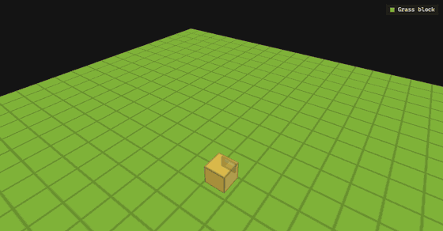
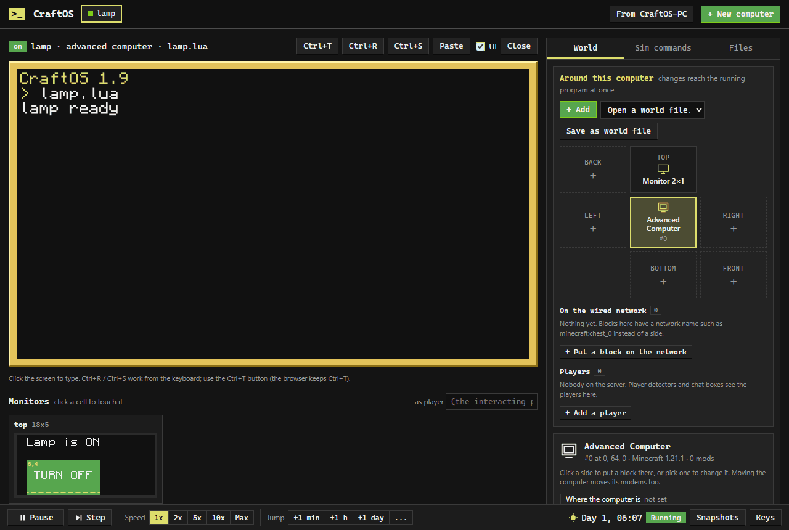
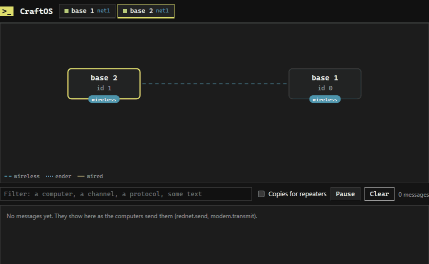
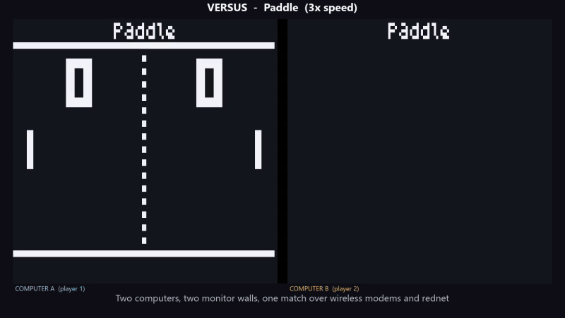
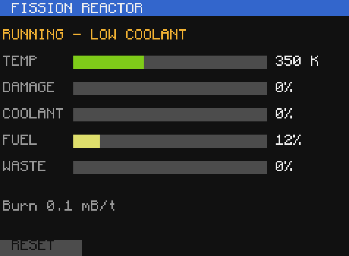
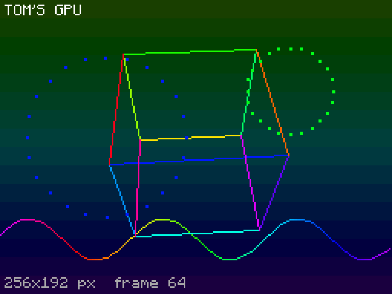
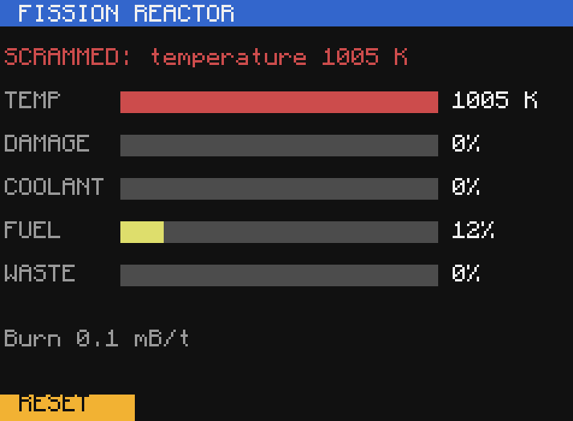

# craftos-mcp

**Run and test your ComputerCraft programs without starting Minecraft.** craftos-mcp is a CC:Tweaked emulator for
people who write CC Lua: computers, monitors you can tap, turtles that dig and build in a block world, rednet between
several computers, and blocks from Create, Mekanism, Advanced Peripherals and more. Pause the clock, jump a day ahead,
save the whole world and put it back. Write tests for your programs and run them with one command. It works by hand,
like CraftOS-PC, and an AI coding agent can drive it too ([below](#use-it-with-an-ai-agent)).



The ROM is built from the real CC:Tweaked jar, and the engine passes 1189 of 1190 of CC:Tweaked's own tests at 1.101.3
(and 1361 of 1362 at 1.121.0). 58 of the community's libraries, programs and operating systems, from Basalt and
Pine3D to Opus, LevelOS and Phoenix, install and run in it as they do in the game: [the list](docs/compatibility.md).
[How exact is it](docs/accuracy.md) says, area by area, what was measured in game and what was written from source.

Some games built and tested with it are **[playable in your browser](https://rogiedoji.com/craftos)**, no install.

## Start in a minute

### The app: download it and press Run

No Node.js and no terminal. Get the file for your computer from the
[latest release](https://github.com/Akkiruk/craftos-mcp/releases/latest):

| Your computer                 | Download                                  | Then                                                                                                                                                                 |
| ----------------------------- | ----------------------------------------- | -------------------------------------------------------------------------------------------------------------------------------------------------------------------- |
| Windows 10 or 11              | `CraftOS-<version>-windows-x64-setup.exe` | Run it. It installs for you alone (no admin rights) and puts **CraftOS** in the Start menu. If Windows says it does not know the app: **More info**, **Run anyway**. |
| Mac, Apple silicon (M1 on)    | `CraftOS-<version>-macos-arm64.dmg`       | Open it and drag CraftOS onto Applications. For the first start, see the note below.                                                                                 |
| Mac, Intel                    | `CraftOS-<version>-macos-x64.dmg`         | The same.                                                                                                                                                            |
| Linux, any distribution       | `CraftOS-<version>-linux-x64.AppImage`    | `chmod +x CraftOS-*.AppImage`, then run it.                                                                                                                          |
| Linux, Debian, Ubuntu or Mint | `CraftOS-<version>-linux-x64.deb`         | `sudo apt install ./CraftOS-*.deb`, then CraftOS is in your applications menu.                                                                                       |

First start on a Mac: the app is not signed with a paid Apple developer id, so macOS stops it once. Right-click (or
Control-click) CraftOS in Applications, choose **Open**, then **Open** again. On macOS 15 and newer: open it once and
dismiss the warning, then go to System Settings, Privacy & Security, find "CraftOS was blocked" near the bottom and
click **Open Anyway**. After that it opens like any app.

CraftOS opens on its home screen. **Open a folder** that holds your Lua programs (or **New project** for a folder with
a first program and a first test), pick your Minecraft version, tick the mods your modpack has, and press **Run**: the
computer opens in the window, with its monitors, the world around it and its files. **Run tests** runs every
`*.test.lua` in the folder. Your choices are kept in `craftos.json` in that folder, which the command line and an AI
agent read too. The first Run downloads CC:Tweaked's own files from its official page, once (under a minute); they
cannot ship inside the app. More in [the desktop app guide](docs/guide/desktop-app.md).

### With npm

You need Node.js 22 or newer, on Windows x64, Linux x64, or macOS 11+ (Apple silicon or Intel). Run these from a
terminal in the folder with your Lua files. That folder is the computer's disk.

```sh
npx craftos-mcp window                    # the computer in a desktop window, like CraftOS-PC
npx craftos-mcp window --monitor top:3x2  # with a monitor on top, 3 blocks wide and 2 high, in its own window
npx craftos-mcp app                       # computers, monitors, turtles and the world side by side in your browser
npx craftos-mcp run door.lua              # run one program and print what the screen showed
npx craftos-mcp test                      # every *.test.lua below here; exits 1 on a failure
```

The first one gets the engine and builds the CC:Tweaked ROM of your Minecraft version, once, in about a minute; it
says so in four short lines (`craftos-mcp setup --verbose` shows every step). `npm install -g craftos-mcp` once and
you can leave out `npx`.

## A short tour

Each step is one small program. [Getting started](docs/guide/getting-started.md) has every file in full.

- **Run a program.** Put `hello.lua` in your folder and run `npx craftos-mcp run hello.lua`: it prints what the screen
  showed. In the window or the app, type `hello` at the prompt.
- **A monitor.** `npx craftos-mcp run sign.lua --monitor top:3x2` gives the computer a monitor 3 blocks wide and 2
  high, and prints the monitor's text too. A world file (`{"monitors": [{"name": "top", "blocksWide": 3, "blocksHigh":
2}]}`) keeps it there.
- **A button.** In the app (`npx craftos-mcp app`), **+ New computer** with a monitor, run your program, and click
  the monitor: a click is a player's tap, a `monitor_touch` event. **UI** shows each button and where it starts.

  

- **Test it.** `lamp.test.lua` runs the program, taps the button with `ccunit.touch("top", 4, 4)` and checks the
  monitor says `Lamp is ON`. `npx craftos-mcp test --monitor top:2x1` prints `PASS lamp.test.lua (2 tests)`.
- **Rednet between two computers.** In the app set **Computers** to 2: each gets a wireless modem and a tab. One runs
  `rednet.receive()`, the other `rednet.broadcast(...)`, and the **Network** view shows each message go across.

  

- **A turtle that builds.** Give a turtle a world with ground, fuel and a stack of blocks, and watch it build in the
  **Blocks** view in 3D (the picture at the top). `npx craftos-mcp run tower.lua --world tower.world.json --timescale 5`
  runs it on the command line, five times faster than the game.
- **A block from a mod.** Advanced Peripherals' player detector, a Create station or a Mekanism reactor is one line in
  a world file. Move a player in the **World** panel and a door program opens for them. Switch on only the mods your
  pack has.
- **Pause and jump time.** The bar along the bottom of the app pauses every computer, steps one tick, runs 2 to 10
  times faster, or jumps a minute, an hour or a Minecraft day ahead, so a `sleep(600)` is over in a click.
- **Snapshots.** Save the whole world under a name, change things, and **Restore** puts it back. **Export** gives you
  a `.craftos-world` file to share.

## The guide

[docs/guide](docs/guide/README.md) has a page for each part:
[getting started](docs/guide/getting-started.md), [the desktop app](docs/guide/desktop-app.md),
[the browser app](docs/guide/browser-app.md), [the window](docs/guide/window.md),
[worlds and world files](docs/guide/worlds.md), [testing with ccunit](docs/guide/testing.md),
[mods](docs/guide/mods.md), [time and snapshots](docs/guide/time-and-snapshots.md),
[coming from CraftOS-PC](docs/coming-from-craftos-pc.md) and [troubleshooting](docs/guide/troubleshooting.md).

## Use it with an AI agent

AI agents write CC:Tweaked Lua they have never run, and the bugs turn up on your server. craftos-mcp lets the agent
test its code itself over [MCP](https://modelcontextprotocol.io): it runs the program, reads the terminal and every
monitor, taps buttons, changes the world around the computer (a player walks up, a chest fills, a train arrives, a
reactor heats up, an hour passes), writes and runs tests, and fixes what broke until it works.


_A real Claude Code session, unscripted: asked for a door controller with tests, it ran its program in the emulator,
caught a monitor that never stopped redrawing and a player at the range edge who could not get in, fixed both, and
finished with its tests passing. Then the same file went onto a computer in real Minecraft and worked there with no code
changes, just a player name added to its whitelist ([the diff](docs/media/showcase/ingame-door-diff.txt),
[the clip](docs/media/showcase/ingame-door.mp4)). The [full transcript](docs/media/showcase/agent-demo-transcript.md)
is next to the [video](docs/media/showcase/agent-demo.mp4)._

The server needs Node.js 22 or newer. Its first start downloads the engine and builds the CC:Tweaked ROM by itself,
once (a minute or so); the server answers straight away and the tools that run computers wait for it. The computers'
files are the folder the server starts in. While an agent works, you can watch and help in the live viewer at
<http://127.0.0.1:7878>, which is the browser app.

### Claude Code

```sh
claude mcp add craftos -- npx -y craftos-mcp serve                 # Linux, WSL
claude mcp add craftos -- cmd /c npx -y craftos-mcp serve          # Windows (native)
```

Or install the plugin, which adds the `cc-tweaked-dev` skill too:

```text
/plugin marketplace add Akkiruk/craftos-mcp
/plugin install craftos-mcp@craftos-mcp
```

The plugin's first start runs the setup in the background (a few minutes). If `/mcp` shows the server as failed on
that first try, wait a minute and reconnect. Progress is in `.cache/setup.log` inside the plugin's folder.

### VS Code with Copilot

Install the [extension](https://marketplace.visualstudio.com/items?itemName=Rogiedoji.craftos-mcp) (also on
[Open VSX](https://open-vsx.org/extension/Rogiedoji/craftos-mcp)). It gives Copilot's agent mode the server, adds Run in
CraftOS for any `.lua` file, and lists your `*.test.lua` files in the Testing view. Without the extension, put this in
`.vscode/mcp.json`:

```json
{
  "servers": {
    "craftos": {
      "type": "stdio",
      "command": "npx",
      "args": ["-y", "craftos-mcp", "serve"]
    }
  }
}
```

### Cursor

Cursor has no MCP API for extensions, so the server goes in `.cursor/mcp.json` in your project (or
`~/.cursor/mcp.json` for every project). The extension offers to write it for you, in Cursor and in Windsurf, or add
it yourself:

```json
{
  "mcpServers": {
    "craftos": { "command": "npx", "args": ["-y", "craftos-mcp", "serve"] }
  }
}
```

The extension also gives Cursor Run in CraftOS and the Testing view.

### Windsurf, Claude Desktop, Codex and others

The same `mcpServers` entry as Cursor goes in Windsurf's `~/.codeium/windsurf/mcp_config.json` and Claude Desktop's
`claude_desktop_config.json`. Codex takes it in `~/.codex/config.toml`:

```toml
[mcp_servers.craftos]
command = "npx"
args = ["-y", "craftos-mcp", "serve"]
```

Any other MCP client: run `npx -y craftos-mcp serve` over stdio. On Windows, if a client cannot start `npx`, give it
`cmd` with the arguments `/c npx -y craftos-mcp serve`.

### Your agent's first program and test

Ask your agent for something ("a door that opens for players on a whitelist, with a status monitor and tests"). It
writes files like these. `door.lua`:

```lua
local mon = peripheral.find("monitor")
mon.clear()
mon.setCursorPos(1, 1)
mon.write("CLOSED")
print("door ready")
```

`door.test.lua`:

```lua
ccunit.test("starts closed", function()
  local r = ccunit.run("door.lua", { seconds = 1 })
  ccunit.contains(r.screen, "door ready")
  ccunit.eq(ccunit.screen("top")[1], "CLOSED")
end)
```

```sh
npx craftos-mcp run door.lua --monitor top:2x1      # the terminal and the monitor, as text
npx craftos-mcp test --monitor top:2x1              # PASS door.test.lua (1 test)
```

The agent runs them with `craftos_run` and `craftos_test`, the same as these commands. A program that fails comes back with
`error {kind, message, file, line}`, so the agent sees where without reading the screen.

## What it does

- **Run and test**: run a program in a fresh computer and get the terminal and every monitor back as text, PNGs or
  golden snapshots; run `*.test.lua` files with the built-in `ccunit` harness (below).
- **Interactive sessions**: type, press keys, touch monitors, send events, wait for text. `craftos_ui` reads every
  screen as buttons and text runs with colours, so an agent can drive a UI without screenshots.
- **Monitors** at any wall size and text scale, with real touch events.
- **Several computers at once**: wireless, ender and wired modems with real rednet, ranges and wired names.
- **Turtles** in a block world built from vanilla Minecraft data: the whole turtle API with its tick timing, digging
  with loot-table drops, placing, inventories, refuelling, upgrades and crafting. What a turtle places comes alive:
  computers boot, disk drives take floppies, monitors join into walls.
- **CC's generic peripherals**: chests, barrels and any modded block as an inventory, fluid tank and energy store,
  with `pushItems`, `pullItems`, `pushFluid` and levels that move over time.
- **Peripherals from other mods**, written from each mod's source and checked against its jar, each one an addon
  you switch on only if your pack has it (see [Choose your mods](#choose-your-mods)):
  - Advanced Peripherals 0.7.31r: player, energy and environment detectors, chat box, redstone integrator, NBT
    storage, AR controller, ME and RS bridges.
  - Mekanism 10.2.5: QIO, the Quantum Entangloporter, the boiler and induction matrix; with Mekanism Generators, the
    fission reactor, turbine and fusion reactor, running tick by tick (a reactor left alone melts down).
  - Create 0.5.1: train stations with schedules and trains on the clock, gauges, speed controllers, sequenced
    gearshifts and the display link; Create Crafts & Additions 1.0.0's motor, accumulator, relay and digital adapter.
  - Tom's Peripherals 1.2.1: the GPU with its full drawing API, pixel-exact and in screenshots, keyboard, redstone
    port and watchdog.
  - Bigger Reactors 0.6.0 and Extreme Reactors 2.0.71: reactors and turbines with their real heat, fuel and rotor
    physics.
  - Mobs with a computer in them (Minecraft 1.20.1): CC: Androids 1.3.0 androids that walk, mine, fight and carry;
    CC: Drones 0.0.1, CC: Drones+ 0.2.0 and AC-Drones alpha 7 drones that fly on the game's own physics. The
    computer is the mob, in the block world a turtle lives in.
- **Determinism**: seed `math.random`, run the clock faster, or jump it forward so timers fire instantly.
- **Checks before boot**: a misspelt world key, a peripheral type the sim cannot build, a missing program or test
  file comes back at once with "did you mean".
- **Your way in**: a desktop window, a browser app (also the MCP server's live viewer at <http://127.0.0.1:7878>),
  a command line, and an in-computer `sim` command to change the world by typing (`sim join Alice`).

### ccunit

Every `*.test.lua` file has the global `ccunit`:

| Call                                                     | Does                                                                          |
| -------------------------------------------------------- | ----------------------------------------------------------------------------- |
| `test(name, fn [, {timeout = s}])`                       | one test; with a timeout it fails instead of hanging the file                 |
| `eq`, `neq`, `near(a, b [, within])`, `truthy`, `raises` | checks; `eq` compares tables deeply                                           |
| `contains(haystack, needle)`                             | text in a string, a value in a list, or text on one of a screen's lines       |
| `skip(name)`                                             | listed as skipped                                                             |
| `run(program, {args, seconds \| script})`                | runs a program as the shell would and returns `{ok, done, screen}`            |
| `screen([monitor])`, `touch(monitor, x, y)`              | a monitor's (or the terminal's) lines after `run`; a player tapping a monitor |

Each file runs in its own fresh computer. Results are kept as each test ends, so a file that hangs keeps the tests it
finished and names the one it was in.

To tap a button, give `run` a `script`: it runs next to the program, and the run ends when it returns. A `touch`
after `run` has returned reaches nothing, because the program has stopped by then.

```lua
ccunit.test("a tap turns it on", function()
  ccunit.run("button.lua", { script = function()
    sleep(0.5)                  -- let the program draw
    ccunit.touch("top", 3, 2)   -- monitor, column, row
    sleep(0.5)                  -- let it react
  end })
  ccunit.contains(ccunit.screen("top"), "ON")
end)
```

The monitor comes from `--monitor top:2x1` on the command line, or from `"monitors"` in a world file next to the
test (`button.world.json` for `button.test.lua` in VS Code, `--world` or craftos.json's `world` on the command line).

## Games

Three game cabinets and an RPG in plain CC:Tweaked Lua, each with a world file and tests that play real games through
taps on the monitors. They're examples of what you can build and test here, and they use nothing but CC:Tweaked's own
APIs.

| Cabinet                                                     | Games                                                                                                                      | Shows off                                    |
| ----------------------------------------------------------- | -------------------------------------------------------------------------------------------------------------------------- | -------------------------------------------- |
| [Board](workspace/examples/games/board/README.md)           | Ultimate Tic-Tac-Toe, Four in a Row, Reversi, Checkers, Dots and Boxes, Mancala, Fleet, Codebreaker; three computer levels | touch monitor walls, two players at one wall |
| [Action](workspace/examples/games/action/README.md)         | Snake, Blocks, Bricks, Lander, Mines                                                                                       | fast redraws, real-time touch                |
| [Versus](workspace/examples/games/versus/README.md)         | Paddle, Trails, Artillery                                                                                                  | two computers in one match over rednet       |
| [BLIGHTMARE](workspace/examples/games/blightmare/README.md) | a first-person RPG in eleven acts: towns, a world map, turn-based fights, bosses, saves                                    | 2 MB of game packed onto a 1 MB disk         |


BLIGHTMARE, played by touch ([the whole showcase](docs/media/showcase/blightmare.mp4))

|                                                                                                  |                                                                                                                           |
| ------------------------------------------------------------------------------------------------ | ------------------------------------------------------------------------------------------------------------------------- |
|  |  |
| Blocks, steered by tapping the wall                                                              | Paddle across two computers on rednet (3x speed)                                                                          |

Each cabinet's README says how to open it. The board games, for example:

```sh
craftos-mcp window workspace/examples/games/board/arcade.world.json --dir workspace --monitor left:6x6 --monitor right:6x6
# then, in the computer: examples/games/board/arcade
```

`node scripts/make-showcase.mjs` records the videos again from real runs.

## Examples

[`workspace/examples/`](workspace/examples/README.md) also has complete programs for the mods above, each with a world
and a test that proves it works: a Mekanism reactor controller, a Create train departure board, an energy monitor for
any modded battery, a Tom's Peripherals GPU demo, an Extreme Reactors rod controller, an Advanced Peripherals player
greeter and a rednet chat between two computers. These pictures are rendered from real runs (`node
scripts/make-demo-gif.mjs` makes them again).



_The [reactor controller](workspace/examples/mekanism/reactor.lua) on a simulated Mekanism reactor, with the clock sped
up: it scrams the reactor before it is damaged, and RESET restarts it once it has cooled. The
[test](workspace/examples/mekanism/reactor.test.lua) checks exactly that._

|                                                                                 |                                                                            |
| ------------------------------------------------------------------------------- | -------------------------------------------------------------------------- |
|                      |                      |
| Train departure board: platform, train, status and schedule for each station    | GPU demo: a spinning cube, a sine ribbon and ripples where you right-click |
|        |              |
| Power monitor: any block with an energy store, with rates and a low-power alarm | The reactor controller after it has scrammed on temperature                |

## Without an AI agent

Everything below in short; the [guide](docs/guide/README.md) has it at a slower pace, with pictures.

### The desktop app

CraftOS, the app from [Start in a minute](#the-app-download-it-and-press-run), is the emulator with its own runtime
and engine inside, so there is nothing else to install.

- **Home screen.** Recent projects on the left; **Open a folder** and **New project**. For the open project: the
  Minecraft version (1.21.1, 1.20.1 or 1.18.2, each with its CC:Tweaked version), the program to run, and every mod as
  a checklist with a line on what it adds. A mod that needs another one switches it on too; a mod with no release for
  the chosen Minecraft version is left out of the list.
- **Run** starts a computer with your folder's files and shows it in the window. It is the page from
  [In your browser](#in-your-browser), so everything there works: more computers, monitors, the world, sim commands,
  the files. **Home** shuts the computers down and goes back; **Run again** starts over with the files as they are now.
- **Run tests** runs every `*.test.lua` (or the `tests` globs in `craftos.json`) and lists what passed and failed.
- **Your choices** go into `craftos.json` in the project folder (`minecraft`, `addons`, and `run` for the program), so
  `craftos-mcp` on the command line and an AI agent use the same ones. Opening a folder writes nothing until you change
  a choice or press Run.
- **CC:Tweaked's files** are downloaded from its official page the first time a Minecraft version is used and kept in
  your per-user folder (`%LOCALAPPDATA%\craftos-mcp` on Windows, `~/.cache/craftos-mcp` elsewhere). Settings has
  **Get every version now** for working without internet later.
- **Updates.** On Windows and from the AppImage the app downloads a new version by itself and offers **Restart to
  update**. On macOS and from the .deb it tells you a new version is out and opens the download page. Settings can
  switch the check off.
- **Uninstall.** Windows: Settings, Apps, CraftOS, Uninstall. macOS: drag CraftOS from Applications to the Bin. Linux:
  delete the AppImage, or `sudo apt remove craftos-desktop`. Your projects are never touched.

The installers are built by the release workflow from `apps/desktop` (Electron). To build one yourself, in a clone
with the engine built: `cd apps/desktop && npm ci && npm run dist`.

### In a window

`craftos-mcp window` opens the computer in a desktop window, with the same simulated world an agent gets:

```sh
craftos-mcp window worlds/generic-storage-demo.json --monitor top:3x2   # from your Lua project folder
craftos-mcp window create-demo --dir path/to/project                    # a world from worlds/ by name
```

The computer's files are your folder (`--dir`, default the current one), live, the way CraftOS-PC keeps a computer's
folder: what a program saves appears there, and what you save there in your own editor the computer sees at once
(hold Ctrl+R in the window to start a program again). Its `.git` and `node_modules` show as empty and the computer
cannot change them. `--copy` gives it a scratch copy instead, gone when the window closes. Monitors open as windows of
their own and a click is a touch; a world can list them under `"monitors"`. A world's speakers play real sound. F12
copies a screenshot to the clipboard; F2 saves one and F3 records a GIF, in `Pictures/craftos-mcp` (or
`CRAFTOS_SCREENSHOTS`), and the command prints where each one went.

A turtle world opens the turtle in its window, and every computer or turtle it places and turns on gets a window of
its own. The browser opens beside it on the turtle's blocks in 3D (`--no-browser` to skip it):

```sh
craftos-mcp window hut.world.json                          # a world with a "turtle" entry, or blocks
```

Several computers on one network open a window each, and rednet works between them. Give one world file per
computer, or one world and `--computers`:

```sh
craftos-mcp window sender.world.json receiver.world.json   # windows titled "sender" and "receiver"
craftos-mcp window --computers 2                           # computer1 and computer2, each with a wireless modem
```

They share your folder (a file one saves, the others see), except that a computer with a `computer/<id>` folder
there uses that one, as CraftOS-PC lays them out; `--own-folders` makes one for each. The command prints which folder
each computer uses. Closing a computer's window turns it off, and closing the last one ends the command. `--browser`
opens the browser app on them too, for the messages flying between them, the world and the clock.

The clock has the same keys as the browser app: Alt+P pause or resume, Alt+. one tick, Alt+] faster, Alt+[ slower,
Alt+J / Alt+H / Alt+N a minute / an hour / a Minecraft day ahead; the title shows `[Paused]` or the speed.
`--speed 5` starts it five times faster.

What stands around the computer comes from a world file, a small JSON file you keep next to your program. This one
has a monitor on top, a chest, a wireless modem, a disk drive and a speaker:

```json
{
  "monitors": [{ "name": "top", "blocksWide": 3, "blocksHigh": 2 }],
  "peripherals": [
    {
      "name": "left",
      "type": "minecraft:chest",
      "items": { "1": { "name": "minecraft:coal", "count": 16 } }
    },
    { "name": "back", "type": "modem" },
    { "name": "right", "type": "drive" },
    { "name": "bottom", "type": "speaker" }
  ]
}
```

```sh
craftos-mcp window base.world.json        # the same file: --world for run and test, World JSON in the browser app
```

A **printer** is `{ "name": "right", "type": "printer", "ink": 64, "paper": 64 }`: black dye in its ink slot and
paper in its paper slots, as in the game (any dye gives its own colour, through `items`). Its pages come out as
`computercraft:printed_page` items that a chest can pull, and the browser app shows each page printed under the
computer's screens.

A name is a side (`top`, `left`, ...) or a wired network name (`chest_0`). A wrong key or type is refused before the
computer starts, with the nearest real one. Mod blocks are the same list with the mod's type (`playerDetector`,
`Create_Station`, ...): each mod's page under [docs/](docs/) has its types and fields, and
[`worlds/`](worlds/README.md) has a ready world per mod. In VS Code a `*.world.json` opens in the World Editor, where
you add blocks by clicking instead.

A **turtle** needs a world too, or it hangs in empty air with nothing to dig. `mine.world.json`:

```json
{
  "turtle": {
    "x": 0,
    "y": 64,
    "z": 0,
    "facing": "north",
    "fuel": 500,
    "right": "minecraft:diamond_pickaxe"
  },
  "ground": {
    "y": 63,
    "name": "minecraft:stone",
    "top": "minecraft:grass_block"
  },
  "fills": [
    { "from": [-2, 64, -5], "to": [2, 66, -1], "name": "minecraft:stone" }
  ],
  "blocks": [{ "x": 0, "y": 64, "z": -2, "name": "minecraft:coal_ore" }]
}
```

```sh
craftos-mcp run dig.lua --world mine.world.json    # or the app: New computer, Turtle, paste it as the World JSON
```

[docs/turtle.md](docs/turtle.md) has every field. **Two computers on rednet**: in the app set **Computers** to 2;
each gets a modem and a tab.

Coming from **CraftOS-PC**? The keys are the same (hold Ctrl+T, Ctrl+R, Ctrl+S; F12 copies a screenshot), and your
programs run unchanged unless they call CraftOS-PC's own `periphemu`, `config` or `mounter`, which a real computer
does not have either. `craftos-mcp import craftos-pc` brings your computers over, and
[Coming from CraftOS-PC](#coming-from-craftos-pc) has the rest. In short:

| CraftOS-PC                                     | Here                                                                                  |
| ---------------------------------------------- | ------------------------------------------------------------------------------------- |
| `attach left monitor`                          | the same in the shell, live; or `--monitor left:2x2`, or `"monitors"` in a world file |
| `attach left chest`, `periphemu.create(...)`   | `"peripherals"` in a world file                                                       |
| `attach 1 computer` for a second computer      | the app: **Computers** 2                                                              |
| the computer's files in `%appdata%\CraftOS-PC` | the folder you start it in (`--dir`), live in the window, a copy in the app           |
| `mount`                                        | not needed: your project folder is the computer's disk                                |
| no turtle, no mod peripherals                  | turtles in a block world, and the mods under [Choose your mods](#choose-your-mods)    |

Inside the computer, the `sim` program changes the world, as `craftos_sim_command` does for an agent. It is the
emulator's own: a real CC:Tweaked computer has no `sim`.

```text
sim join Alice                      sim leave Alice
sim chat Alice hello                sim advance 60          (jump the clock 60 seconds)
sim item chest_0 1 minecraft:diamond 5
sim state                           (players, peripherals, chat)
sim createTrainArrive station=Create_Station_0 train=Express   (any command a mod's simulation knows)
sim help                            (all of them)
```

### In your browser

`craftos-mcp app` starts a local web page and opens it:

```sh
craftos-mcp app --dir path/to/project            # --port 7878 by default; --no-open just prints the address
```

**New computer** makes one: a normal, advanced, pocket or turtle computer, a world from `worlds/` or your own JSON,
the mods your pack has, monitors and their sizes, and a program to run (or just the shell). Set **Computers** above 1
for a network, each with a modem. Every computer gets a tab. Its terminal takes the keyboard, paste and mouse; the
Ctrl+T, Ctrl+R and Ctrl+S buttons hold the keys for a second as CC needs (your browser keeps Ctrl+T for itself).
Monitors and Tom's Peripherals GPU screens update live, and a click is a touch on that cell or pixel; **UI** outlines
what the screens show as buttons. On the side: the world (players join, leave and chat, the clock jumps, items go
into slots, and the whole sim state as a tree), a box for any sim command with the list of the ones this world knows,
and the computer's files, which you can edit.

A computer's files are your project folder itself, live: what a program saves (with `edit` or anything else) lands in
the folder and stays after the computer is closed, and what you save there in your own editor the computer sees at
once. **Files** in the New computer form can give each computer its own folder in the project instead
(`computer/<id>`, as CraftOS-PC keeps them; handy for a network), or a scratch copy that goes when the computer is
closed. `craftos-mcp app --copy` makes the copy the default. Without that choice the computers of a network share
the folder.

The bar along the bottom controls time for every computer at once, and shows the world's time of day:

- **Pause** stops every computer and the clock. A computer in the middle of something finishes that first, so a pause
  never ends in "Too long without yielding". **Resume** carries on where it stood: a timer due in 3 seconds is still
  due 3 seconds later, as in the game when the server pauses.
- **Step** runs one tick (1/20 of a second) and stops again: the timers due in it fire and every computer handles them.
- **Speed** runs the clock 2, 5 or 10 times faster. **Max** goes as fast as it can: whenever every computer is waiting,
  the clock skips straight to the next timer, so a `sleep(600)` passes at once.
- **Jump** moves the clock a minute, a Minecraft day (20 minutes) or an hour (three Minecraft days) ahead. The timers
  on the way fire one at a time, in order, and the programs run between them, so a `sleep(600)` loop harvests six
  times in an hour's jump; **...** takes any amount (`90s`, `5m`, `2h`, `1d`, `40t` for ticks) or a time of day (`18:00`).
- **Snapshots** saves the whole world under a name: every computer's label, players, items, chat, peripherals, a
  turtle's blocks, the time of day, and every computer's files. **Restore** puts it all back and reboots the computers
  into it (computers made since then are closed). For a computer on your project folder itself that means your real
  files: changed ones are written back and ones made since are removed, a copy of each goes to
  `runtime/restore-backups` first, and the Restore box says so before it starts. **Export** downloads a `.craftos-world` file to share; **Import** takes one
  in, and `craftos-mcp app --snapshot setup.craftos-world` opens with it.

Keys: Alt+P pause or resume, Alt+. one tick, Alt+] faster, Alt+[ slower, Alt+\ normal speed, Alt+J / Alt+H / Alt+N a
minute / an hour / a Minecraft day ahead, Alt+S snapshots.

Above the screen, a bar picks what you look at (a view shows when the computer has something for it):

- **Side by side**: every computer at once, each with its monitors. Click one to type on it, drag a tile's right
  edge to resize it, and hide or show computers from the list on top. A computer a turtle placed and turned on gets
  a tile too.
- **Blocks**: the world around a turtle, live. It shows the turtle and the way it faces, each block it digs or
  places, and its last 300 steps. **3D** turns with a drag and zooms with the wheel; **Follow turtle** keeps it in
  the middle, **See through** finds a turtle that is underground, **Cut above turtle** leaves out what is over it.
  **Layers** is the same world one layer at a time from above. Point at a block to read its name and place.
- **Network**: the computers of a network with their modems (wireless, ender, wired) and what can reach what. Each
  message runs along its link as it is sent, and the list below has every one: who sent it, who heard it, the
  channel or rednet target, the protocol and the start of the message. Click a row for the whole message. Type in
  the filter to narrow the list, **Pause** to read it while the computers keep talking.

Try them with `examples/turtle/hut` (make a turtle with the world in `examples/turtle/hut.world.json`) and with
`examples/rednet/chat <name>` or `examples/games/versus/versus` on two computers.

**Around this computer**, at the top of the World tab, builds the world with the mouse while the program runs. Click
a side to put something there: a search box finds any block the emulator knows, CC:Tweaked's first, then chests,
tanks and batteries, then each mod's blocks under its name. Blocks named like `minecraft:chest_0` go on the wired
network, and players join the server. Pick one to change it: a monitor's size and whether it is advanced (normal
monitors show greys and take no touches), what is in a chest slot by slot, energy and fluid levels, where a player
stands, and every other setting the world file has. Each change reaches the running computer at once, the way the
game sends it: `peripheral` when a block is placed, `peripheral_detach` when it is broken, `monitor_resize` when a
wall grows, and a list under the sides says what the computer saw. **Save as world file** writes it all to a
`.world.json`; **Open a world file** loads one, from your PC or your project, and the computer gets every block in it.

It listens on 127.0.0.1 only. The MCP server's live viewer (<http://127.0.0.1:7878>) is the same page, so you can
watch and help while an agent works. The computers you start there are yours: the agent's `craftos_session_list`
shows them apart, under `others`, and `craftos_session_destroy` leaves them running unless it passes `force`.

### The command line

`craftos-mcp` runs without an agent, so it works in scripts and CI. Run it from your Lua project folder (`--dir`
changes that):

```sh
craftos-mcp init                         # write craftos.json: a few questions (--yes takes the defaults)
craftos-mcp test                         # every *.test.lua below here, ccunit harness; exits 1 on a failure
craftos-mcp test tests/ --addons create --timescale 10
craftos-mcp test --watch                 # again on every .lua change, only the test files it touches
craftos-mcp test --json                  # the whole result as JSON
craftos-mcp test --reporter junit --out results.xml   # JUnit XML for CI test views; the human report stays on screen
craftos-mcp test --reporter github       # ::error annotations on the failing lines (on by itself in GitHub Actions)
craftos-mcp run clock.lua --monitor top:2x2 --screenshot shot.png   # terminal and monitors as text, PNGs saved
craftos-mcp run sort.lua --world worlds/chests.json --timeout 20 -- --verbose
craftos-mcp import craftos-pc            # bring your CraftOS-PC computers over as a project (--list to look first)
craftos-mcp doctor                       # check everything and say how to fix what is wrong (--json for scripts)
craftos-mcp info                         # engine, ROM and addons status
craftos-mcp setup                        # first-run setup again (--force redoes it, --all: every ROM, --verbose: each step)
craftos-mcp cache list                   # the versions in CRAFTOS_HOME; cache prune keeps this one and the one before
craftos-mcp serve                        # the MCP server over stdio
```

Inside a clone use `node apps/cli/dist/index.js ...`. `craftos-mcp help <command>` lists the options. A `--world` is a
JSON file or the name of one in `worlds/`; `--addons` is `all`, `none` or ids separated by commas.

### craftos.json

A project can keep its settings in a `craftos.json` at its root, so nobody has to remember the flags. `craftos-mcp
init` writes one:

```json
{
  "$schema": "https://raw.githubusercontent.com/Akkiruk/craftos-mcp/main/schemas/craftos.schema.json",
  "workspace": "src",
  "minecraft": "1.20.1",
  "addons": ["advanced-peripherals", "create"],
  "tests": ["tests/**/*.test.lua"],
  "world": "base.world.json",
  "run": "startup.lua"
}
```

Every command, the MCP server, the VS Code extension and the desktop app read it, found from the folder you are in
upwards (it stops at the folder with `.git`). `workspace` and `world` are relative to the file; `tests` globs are
relative to the workspace and pick the files `craftos-mcp test` and `craftos_test` run when you name none; `run` is
the program the desktop app's Run button starts (the app writes `minecraft`, `addons` and `run` itself). Whatever you say
explicitly still wins: a flag (`--dir`, `--mc`, `--addons`, `--world`) or an environment variable beats
craftos.json, and craftos.json beats the defaults. In VS Code a setting you set beats it too. The schema is
[`schemas/craftos.schema.json`](schemas/craftos.schema.json); `CRAFTOS_PROJECT_FILE` names another file, or `off` for
none.

### Long calls

`craftos_test` and `craftos_run` send MCP progress notifications when the client asks for them (a file finished, or
the seconds a program has run), so clients that wait on progress keep waiting. `craftos_test` has a time budget for
the whole call (`budgetMs`, default 10 minutes, `CRAFTOS_CALL_BUDGET_MS`): when it runs out the files still running
stop with the tests they finished, and the reply lists the ones that never started under `notRun`.

World files have a JSON Schema, [`schemas/world.schema.json`](schemas/world.schema.json), generated from the emulator's
own types: put `"$schema": "https://raw.githubusercontent.com/Akkiruk/craftos-mcp/main/schemas/world.schema.json"` in a
world, or map `*.world.json` to it in your editor, for completion, hover docs and checking of every field and
peripheral type ([`schemas/INTEGRATION.md`](schemas/INTEGRATION.md)).

### In CI

`craftos-mcp test` exits 1 when a test fails, and in GitHub Actions it marks the failing lines on the pull request by
itself. The first run downloads the engine and builds the ROM (about a minute); caching the per-user folder
(`~/.cache/craftos-mcp` on Linux) makes every later run start in seconds. Pin the version, so the cache key changes
when you move to a new one:

```yaml
# .github/workflows/lua-tests.yml
name: Lua tests
on: [push, pull_request]
jobs:
  test:
    runs-on: ubuntu-latest
    env:
      CRAFTOS_MCP: craftos-mcp@0.4.0
    steps:
      - uses: actions/checkout@v7
      - uses: actions/setup-node@v7
        with:
          node-version: 22
      - uses: actions/cache@v4
        with:
          path: |
            ~/.cache/craftos-mcp
            !~/.cache/craftos-mcp/runtime
          key: craftos-mcp-${{ runner.os }}-${{ env.CRAFTOS_MCP }}
      # the engine and both ROMs (CC:Tweaked 1.101.3 and 1.121.0), once; a cache hit makes this a no-op
      - run: npx -y $CRAFTOS_MCP setup --all
      - run: npx -y $CRAFTOS_MCP test --mc 1.21.1 --reporter junit --out results-1.21.1.xml
      - run: npx -y $CRAFTOS_MCP test --mc 1.18.2 --reporter junit --out results-1.18.2.xml
```

Test only the version your server runs and one `test` step is enough (setup then needs no `--all`: it builds the ROM
in use, and a world that asks for another version gets that ROM built the first time). `--addons` picks the mods as
`CRAFTOS_ADDONS` does, `--dir` the folder when your Lua is not at the repository's root, and `--reporter json` gives
the whole result as JSON.

## Coming from CraftOS-PC

craftos-mcp runs on a fork of CraftOS-PC 2, so the keys, the shell and the ROM will feel familiar. The difference: it
behaves like a computer on a Minecraft server, not one on your desk, so what works here works in game.

Bring your computers over with one command (your CraftOS-PC folder is only read, never changed):

```sh
craftos-mcp import craftos-pc            # finds %APPDATA%\CraftOS-PC, ~/Library/Application Support/CraftOS-PC or ~/.local/share/craftos-pc
cd craftos-pc && craftos-mcp window      # the first computer; --list shows what comes over first
```

Each computer's files, label, colour and screen size come across, and the peripherals its `startup` made with
`periphemu.create` go into its world file. The browser app has the same thing under **From CraftOS-PC**.

What is different, and why:

- **No `periphemu`, `config` or `mounter` for programs.** A real computer has none of them. A world with
  `"craftosPcApis": true` gives them back for code you are still moving over: `periphemu.create` then places the block
  in the world, live.
- **Typing `attach`, `detach`, `config` or `mount` still works** on a computer you drive (the window, the app), and
  each says what the game does instead. `attach top monitor` places a monitor wall on top, live, and prints the line
  for the world file that keeps it there.
- **A monitor is a wall of blocks** (1x1 to 8x6), not a window of any size. 5x3 blocks is about CraftOS-PC's 51x19.
- **Nothing mounts a folder of your PC.** A computer's files are your project folder; edit them there and reboot.
- **No graphics mode**, and `_HOST` names CC:Tweaked and Minecraft, as on a server.

The whole story: [Coming from CraftOS-PC](docs/coming-from-craftos-pc.md).

## Choose your Minecraft version

| Version            | CC:Tweaked | State                                                                                  |
| ------------------ | ---------- | -------------------------------------------------------------------------------------- |
| `1.21.1` (default) | 1.121.0    | CC itself as in 1.121.0 (Lua 5.2 with `goto`); turtle data is still the 1.18.2 version |
| `1.20.1`           | 1.121.0    | CC itself and turtles (1.20.1 block data) as in 1.121.0                                |
| `1.18.2`           | 1.101.3    | Complete: CC itself (Lua 5.1, no `goto`), turtles, modems and every 1.18.2 mod below   |

Most mods act as their release for the version you pick (the table below gives it). Eight were written from their
1.18.2 release and act as that one on every version: Advanced Peripherals, Mekanism, Mekanism Generators, Create,
Create Crafts & Additions, Tom's Peripherals, Bigger Reactors and Extreme Reactors. On 1.21.1, say, Advanced
Peripherals is 0.7.62b in the game but acts as 0.7.31r here; the app's mods list and `craftos-mcp info` say
"acts as 0.7.31r" next to it.

The default is the newest version there is. Pick another per world with `"version": "1.18.2"`, for the MCP server
with `CRAFTOS_VERSION`, or on the command line with `--mc 1.18.2`; use the one your server runs. The npm package sets
up the ROM of the version in use on its first run (`CRAFTOS_VERSION`, else the default) and builds another the
first time a world asks for it, with one line saying so (about 20 s, once); `craftos-mcp setup --all` builds them all
at once. In a clone, `npm run setup` builds the default's and `npm run setup -- --mc
all` every one (`node scripts/build-rom.mjs --download 1.18.2` builds one). A mod that has no release for the chosen
version (Bigger Reactors on 1.21.1) is refused with the versions it does have and how to pick one.

## Choose your mods

Every mod besides CC:Tweaked is an addon. Switch on only the ones your pack has, so a program cannot come to rely on
a peripheral your server does not have. Set `CRAFTOS_ADDONS` for the MCP server, or give one world its own list with
`addons`:

```json
{
  "addons": ["create", "mekanism"],
  "peripherals": [{ "name": "station_0", "type": "Create_Station" }]
}
```

| Id                           | Mod                                                                        |
| ---------------------------- | -------------------------------------------------------------------------- |
| `advanced-peripherals`       | Advanced Peripherals 0.7.31r (on every version)                            |
| `mekanism`                   | Mekanism 10.2.5 (on every version)                                         |
| `mekanism-generators`        | Mekanism Generators 10.2.5 (on every version; needs `mekanism`)            |
| `create`                     | Create 0.5.1.i (on every version)                                          |
| `create-additions`           | Create Crafts & Additions 1.0.0 (on every version; needs `create`)         |
| `toms-peripherals`           | Tom's Peripherals 1.18.2-1.2.1 (on every version)                          |
| `bigger-reactors`            | Bigger Reactors 1.18.2-0.6.0-beta.1.4 (1.18.2, 1.20.1)                     |
| `extreme-reactors`           | Extreme Reactors 1.18.2-2.0.71 (on every version)                          |
| `unlimited-peripheral-works` | UnlimitedPeripheralWorks 1.9.2 (1.20.1, 1.21.1)                            |
| `metaphysics`                | Metaphysics 0.0.6 (1.20.1)                                                 |
| `some-peripherals`           | Some Peripherals 0.0.12 (1.18.2)                                           |
| `cloud-solutions`            | SirEdvin's Cloud Solutions 0.3.4 (1.20.1, 1.21.1)                          |
| `cccbridge`                  | CC:C Bridge 1.5.1 (1.18.2), 1.7.1 (1.20.1), 1.7.3 (1.21.1); needs `create` |
| `create-cc-logistics`        | Create: CC Total Logistics 0.3.7 (1.20.1, 1.21.1; needs `create`)          |
| `cc-liftlink`                | CC: LiftLink 1.0.3 (1.20.1, 1.21.1; needs `create`)                        |
| `cc-vs`                      | CC: VS 0.5.1 (1.18.2), 0.6.6 (1.20.1): Valkyrien Skies ship APIs           |
| `cc-shops`                   | CC Shops 0.0.1 (Simple Shops; 1.18.2, 1.20.1)                              |
| `cc-androids`                | CC: Androids 1.3.0 (1.20.1)                                                |
| `cc-drones`                  | CC: Drones 0.0.1 (1.20.1)                                                  |
| `cc-drones-plus`             | CC: Drones+ 0.2.0 (1.20.1)                                                 |
| `ac-drones`                  | AC-Drones 1.20.1-alpha-7 (1.20.1)                                          |
| `advanced-math`              | Advanced Math 0.3.7 (a datapack: ROM APIs and modules)                     |
| `lectern-hub`                | CC: Lectern Hub 1.0.0-1.115.0 (1.20.1)                                     |
| `crickets-peripherals`       | Cricket's Peripherals 0.1.1 (1.21.1)                                       |
| `cctech`                     | CCTech 0.1.6 (1.18.2: tapes and magnetic cards)                            |
| `embedded-computer`          | Embedded Computer 0.6.0 (1.20.1), 1.3.0 (1.21.1)                           |
| `lakes-cc-additions`         | Lake's CC Additions 1.7.0 (1.20.1)                                         |
| `sc-peripherals`             | SwitchCraft Peripherals 1.20.1-1.10.5 (3D and poster printers)             |
| `ccsecureboot`               | CCSecureBoot 1.0.2 (1.20.1, 1.21.1)                                        |
| `ccx`                        | CCX 6.1.1 (1.20.1: PCIe hub, USB port)                                     |
| `directgpu`                  | CC: DirectGPU 1.0.25 (1.21.1: 2D displays)                                 |
| `cide`                       | CIDE 1.1.0 (1.21.1: its debugger API and runner)                           |
| `plethora`                   | Plethora Peripherals 1.20.1-1.13.0 (1.20.1 only)                           |
| `cc-link`                    | CC: Link 6.2.1 (1.20.1 only)                                               |
| `finer-peripherals`          | Finer Peripherals 1.20.1-0.6.1 (1.20.1 only)                               |
| `ducky-peripherals`          | Ducky Peripherals 1.0.2 / 1.20.1-1.3.1                                     |
| `more-peripherals`           | More Peripherals 1.20.1-1.13.0 (1.20.1 only)                               |
| `classic-peripherals`        | Classic Peripherals 0.5.1 / 0.6.6 (not 1.18.2)                             |
| `vhcctweaks`                 | vhcctweaks 2.2.36 / 2.2.37 (1.18.2 only; opt-in, never part of `all`)      |

`"all"` and `"none"` work too. With no setting at all, everything the version has is on, except vhcctweaks.

**vhcctweaks** ([Akkiruk/vhcctweaks](https://github.com/Akkiruk/vhcctweaks), a Vault Hunters server mod for 1.18.2)
is opt-in: name it (`"addons": ["all", "vhcctweaks"]`) or give the world `"vhcctweaks": "2.2.36"` or `"2.2.37"`, with
`"version": "1.18.2"`. It adds `ccvault` (player token balances and transfers a player approves), the `vhcc` file store,
lockdown, linked ender modems and the batch inventory methods; `"2.2.37"` adds the 2.2.37 API (Gear Power, Temper,
skills and stats reads, items inside backpacks and shulker boxes, `identify`), which the emulator models from the
mod's spec: identify's roll is the emulator's, not Vault Hunters'. [docs/vhcctweaks.md](docs/vhcctweaks.md) says what
is simulated and how faithfully. Linked computers (ender modem links, remote peripherals) run in real time: on a slow
or busy machine a linked-peripheral call can time out, stall or behave inconsistently. A world that uses a block
from an addon that is off fails before the computer boots and names the addon; `craftos_info` lists what is on.

## Tools

| Tool                                                                                  | Purpose                                                                              |
| ------------------------------------------------------------------------------------- | ------------------------------------------------------------------------------------ |
| `craftos_info`, `craftos_help`                                                        | Engine, ROM and workspace status; the guide, the world schema, ccunit, saved worlds  |
| `craftos_write_file`, `craftos_read_file`, `craftos_list_files`                       | Workspace files (copied to the root of each computer)                                |
| `craftos_run`                                                                         | Run a program in a fresh computer: terminal and monitor text, PNGs, golden snapshots |
| `craftos_test`                                                                        | Run `*.test.lua` files with the `ccunit` harness                                     |
| `craftos_session_create`, `craftos_type`, `craftos_key`, `craftos_touch_monitor`, ... | Interactive computers                                                                |
| `craftos_ui`, `craftos_act`, `craftos_settle`, `craftos_expect`, `craftos_script`     | Read screens as data, act and wait until the program is done, assert                 |
| `craftos_network_create`, `craftos_network_update`                                    | Several computers with modems                                                        |
| `craftos_sim_command`, `craftos_sim_state`                                            | Change and read the simulated world during a session                                 |
| `craftos_seed`, `craftos_advance`, `craftos_trace`, `craftos_screenshot`              | Determinism, the virtual clock, what the program saw, pictures                       |
| `craftos_clock`, `craftos_world_snapshot`                                             | Pause, step, speed up or jump every computer; save and restore the whole world       |

The server also gives its client short instructions on how to work, resources (`craftos://guide`,
`craftos://schema/world`, `craftos://worlds/<name>`, `craftos://docs/<name>`, `craftos://examples/<path>`) and prompts
(`new-program`, `add-tests`, `debug-ui`). `CRAFTOS_TOOLS=core` offers a lean set of 17 tools instead of all 32, for
clients that pay for every tool in every request; what the rest do is covered by the core ones (`craftos_act` types and
taps, `craftos_expect` waits for text, `craftos_ui` reads the terminal). A longer guide for agents is the
`cc-tweaked-dev` skill (`.claude/skills/`, `.agents/skills/` and `.github/skills/`), with the same in `AGENTS.md`,
`GEMINI.md`, `.github/copilot-instructions.md` and `.cursor/rules/craftos-mcp.mdc`; the VS Code extension's **Add
Agent Instructions to Workspace** copies them into your own project.

## Settings

Every environment variable craftos-mcp reads. The MCP server takes them from its client's config (`env` in
`.vscode/mcp.json`, `-e` for `claude mcp add`); the command line from the shell.

| Variable                        | Default                                              | Meaning                                                                                                   | Extension setting              |
| ------------------------------- | ---------------------------------------------------- | --------------------------------------------------------------------------------------------------------- | ------------------------------ |
| `CRAFTOS_WORKSPACE`             | the folder the server starts in                      | The computers' files                                                                                      | `craftos-mcp.workspace`        |
| `CRAFTOS_VERSION`               | the newest Minecraft version                         | `1.21.1`, `1.20.1` or `1.18.2`, or `{"mc": ..., "cc": ..., "loader": ...}`                                | `craftos-mcp.minecraftVersion` |
| `CRAFTOS_ADDONS`                | every addon the version has                          | `all`, `none` or addon ids separated by commas                                                            | `craftos-mcp.addons`           |
| `CRAFTOS_TOOLS`                 | `all`                                                | `core` for the lean tool set                                                                              |                                |
| `CRAFTOS_CALL_BUDGET_MS`        | `600000`                                             | `craftos_test`'s time for a whole call when it gives no `budgetMs`                                        |                                |
| `CRAFTOS_PROJECT_FILE`          | the nearest `craftos.json`                           | The project file to read, or `off` for none                                                               |                                |
| `CRAFTOS_KEEP_OLD`              |                                                      | `1` keeps every cached version instead of pruning all but the newest older one after a new setup          |
| `CRAFTOS_VIEWER_PORT`           | `7878`                                               | The live viewer's port (another free one when it is taken); `off` turns it off                            |                                |
| `CRAFTOS_TEST_CONCURRENCY`      | half the cores, 4 to 16                              | How many test files run at once                                                                           |                                |
| `CRAFTOS_COBALT_SPEED`          | `1` (native speed)                                   | How much slower Lua runs, to match CC:Tweaked's own VM: `8` is about a real server                        |                                |
| `CRAFTOS_HOME`                  | `%LOCALAPPDATA%\craftos-mcp`, `~/.cache/craftos-mcp` | Where the npm package keeps the engine, ROMs, jars and scratch folders                                    |                                |
| `CRAFTOS_ENGINE`, `CRAFTOS_ROM` | the set-up ones                                      | An engine binary, or one ROM folder for every version                                                     |                                |
| `CRAFTOS_WORLDS`                | `worlds/`                                            | The saved worlds `worldFile` names                                                                        |                                |
| `CRAFTOS_SCREENSHOTS`           | `Pictures/craftos-mcp` in your user folder           | Where `craftos-mcp window` saves F2 screenshots and F3 recordings                                         |                                |
| `CRAFTOS_RUNTIME_ROOT`          | `<CRAFTOS_HOME>/runtime`, `.runtime/` in a clone     | Where each run's scratch folder goes                                                                      |                                |
| `CRAFTOS_ENGINE_URL`            | this repository's release                            | Where setup gets the engine zip: a URL (checked against `<url>.sha256` when there is one) or a local file |                                |
| `CRAFTOS_RELEASE_REPO`          | `Akkiruk/craftos-mcp`                                | The repository whose releases hold the engine zips (a fork's)                                             |                                |
| `CRAFTOS_RELEASE_API`           | from `CRAFTOS_RELEASE_REPO`                          | `npm run setup` in a clone: the "latest release" API URL                                                  |                                |
| `CRAFTOS_SETUP_MC`              | the default version                                  | `npm run setup` in a clone: the versions to build ROMs for (`all`, or `1.18.2,1.21.1`), as `--mc`         |                                |
| `CRAFTOS_VCPKG`                 | `VCPKG_ROOT`                                         | Building the engine: the vcpkg checkout                                                                   |                                |
| `CRAFTOS_BUILD_DIR`             | `engine/build`                                       | Building the engine: where `engine/build.cmd` and `engine/build.sh` build                                 |                                |
| `CRAFTOS_WEB_BUILD_DIR`         | `engine/build-web`                                   | Building the browser version: where the WebAssembly engine is                                             |                                |
| `HTTPS_PROXY`                   |                                                      | Setup's downloads go through this proxy                                                                   |                                |
| `GITHUB_TOKEN`                  |                                                      | Sent to GitHub's API when setup looks up the latest release (rate limits on shared CI runners)            |                                |

craftos-mcp sets a few more itself; leave them alone: `CRAFTOS_DEBUG_TOKEN` (the engine's debugger handshake),
`CRAFTOS_SETUP_CHILD` and `CRAFTOS_SETUP_VERSION` (setup behind a proxy runs in a child process), `CRAFTOS_SUPERVISE`
and `CRAFTOS_VSCODE_STORE` (the VS Code extension's MCP server supervisor and its copy of the package). The test
suites read `CRAFTOS_EXE`, `CRAFTOS_CLI`, `CRAFTOS_JAR`, `CRAFTOS_PROJECT`, `CRAFTOS_USER_DATA`,
`CRAFTOS_LUA_INSTALLED`, `CRAFTOS_IT_ONLY` and `CRAFTOS_IT_DEBUG_COMMAND` (see the top of each test file).

## Troubleshooting

Error messages from worlds, programs and tests, each with its fix, are in the
[troubleshooting guide](docs/guide/troubleshooting.md). Setup and the MCP server:

**The first run failed.** `npx craftos-mcp setup --verbose` runs it again and shows every step; `npx craftos-mcp info` says
what is still missing. The failure names the host it could not reach and why (`could not reach github.com:
ENOTFOUND github.com`). The MCP server tries the setup again on a later tool call, so once the cause is fixed there is
no need to restart it.

**Offline, or behind a proxy.** Set `HTTPS_PROXY` (craftos-mcp turns on Node's proxy support for the download). With
no network at all, download the engine zip for your OS from the [latest release](../../releases/latest) and the
CC:Tweaked jars elsewhere, then set `CRAFTOS_ENGINE_URL` to the zip's path and put the jars in `<CRAFTOS_HOME>/jars`
(their names and hashes are pinned in `packages/runner/src/versions.ts`) before `npx craftos-mcp setup`.

**macOS refuses to start the engine.** The macOS engine is not signed or notarized. `npm run setup` and the npm package
download it themselves, which leaves no quarantine mark, so it just runs. A zip you download with a browser is
quarantined; clear the mark once with `xattr -dr com.apple.quarantine engine/build`.

**Every call is slow, or times out.** Each computer gets its own copy of the workspace, as a real one has its own
disk. The copy leaves out `.git`, `node_modules`, `.runtime`, `.claude`, `.cache` and whatever `.gitignore` ignores,
and stops with an error past 20,000 files or 128 MB. If the server starts in a big project (a repo root), set
`CRAFTOS_WORKSPACE` to the folder with your Lua programs, or give the world a deploy list such as
`"deploy": [{"from": "lua"}]` so only that folder is copied. `craftos_info` warns when the workspace is too big.

**The tools are gone after a crash.** If the server process died, most clients drop its tools until it is restarted:
in VS Code run **MCP: List Servers**, pick craftos and **Restart**; in Claude Code use `/mcp`. Sessions do not survive
a restart; make them again with `craftos_session_create`.

**Claude Code on Windows says the server failed.** Native Windows needs `cmd /c` in front of `npx`:
`claude mcp add craftos -- cmd /c npx -y craftos-mcp serve`.

**Something is off and you are not sure what.** `npx craftos-mcp doctor` checks Node, the engine (there, runs, its
version), every ROM, the cache folder and its free space, the macOS quarantine mark, craftos.json and the world files,
and boots a hello world. Each failed check says how to fix it.

**Port 7878 is in use.** Another server (another editor window, say) has the live viewer, so this one takes a free
port instead and says which on stderr (`craftos viewer: http://127.0.0.1:<port>/`) and in `craftos_info`. Set
`CRAFTOS_VIEWER_PORT` to pick one, or `off`.

**The cache keeps growing.** Each package version sets up its own engine and ROMs in `CRAFTOS_HOME`. After a new
version sets up, the old ones go except the newest one before it; `craftos-mcp cache list` shows what is there and
`craftos-mcp cache prune` tidies by hand (`CRAFTOS_KEEP_OLD=1` keeps everything).

**The engine will not start, or vanishes.** Antivirus can quarantine `craftos.exe` in `CRAFTOS_HOME`. Allow it, then
run `npx craftos-mcp setup --force`.

**A world is refused.** The message says which key or peripheral is wrong and suggests the nearest real one.
`craftos_help {topic: "world"}` (or the `craftos://schema/world` resource) has every field.

## From a clone

```sh
git clone https://github.com/Akkiruk/craftos-mcp
cd craftos-mcp
npm run setup
```

`npm run setup` installs the packages, builds the tools, builds the ROM from the real CC:Tweaked jar (and Tom's
Peripherals' fonts), downloads the prebuilt engine for your OS from the latest release, checks everything and prints
the line that connects your agent. Run it again any time: finished steps are skipped.

By hand instead:

1. **The engine**: download it for your OS from the [latest release](../../releases/latest) and unzip it over the
   repository, or build it: on Windows Visual Studio 2022 (or its Build Tools) with C++, CMake, Ninja and a
   [vcpkg](https://vcpkg.io) checkout in `VCPKG_ROOT`, then `engine\build.cmd`; on Linux a C++17 compiler, CMake,
   Ninja and vcpkg, then `engine/build.sh`; on macOS (11 or newer, Apple silicon or Intel) the Xcode command line
   tools, CMake, Ninja and vcpkg, then `engine/build.sh` (the Homebrew packages it needs are listed at its top).
2. **The ROM**: CC:Tweaked's license does not allow its ROM to be redistributed with this project, so you build it on
   your own machine. `node scripts/build-rom.mjs --download` downloads the default version's CC:Tweaked jar from
   Modrinth, checks its hash and builds `rom/cc-1.121.0`; `--download 1.18.2` builds `rom/cc-1.101.3`. If you already
   have the jar: `node scripts/build-rom.mjs path/to/cc-tweaked.jar rom/cc-1.121.0`. The same step downloads Tom's
   Peripherals 1.18.2-1.2.1 (MIT) and builds the GPU's fonts from it (`node scripts/build-toms-fonts.mjs` does it
   alone).
3. **The tools**: `npm install`, then `npm run build`.
4. **Your agent**: `claude mcp add craftos -- node /path/to/craftos-mcp/apps/mcp-server/dist/index.js`, or run
   `node apps/mcp-server/dist/index.js` over stdio from any client. `.vscode/mcp.json` is already set up for this
   folder, on Minecraft 1.18.2 with every addon that version has (delete the ones your pack lacks). Then call `craftos_info`; it lists anything that is missing.

## Your own modpack

The turtle world ships with vanilla Minecraft, Forge and CC:Tweaked data. To give it every block, item, recipe and
loot table in your modpack, generate the data from your own instance:

```sh
python -I tools/turtledata/extract.py --instance "<your instance>/minecraft"
```

## Layout

```text
engine/        Forked CraftOS-PC 2 (MIT, see engine/UPSTREAM.md)
packages/      rawterm (engine protocol, PNG renderer), runner (runs, tests, sessions, networks, browser app), protocol
apps/          The craftos-mcp command line (window, app, test, run, info, serve, init, doctor, cache), the MCP server, the VS Code extension, the desktop app
schemas/       JSON Schemas for world files and craftos.json
rom-overlay/   The simulation layered over the CC:Tweaked ROM (peripherals, modems, turtles)
web/           The browser build: the engine as WebAssembly and a player for pages (web/README.md)
scripts/       Setup, ROM builder, CC:Tweaked conformance runner, the video recorder
tools/         Data extraction for turtles
worlds/        Example worlds
docs/          Architecture, security model, peripherals, turtles, conformance
```

## Known limits

- Minecraft 1.18.2 is the complete one. On 1.20.1 and 1.21.1, eight big mods (Advanced Peripherals, Mekanism, Create
  and others) still act as their 1.18.2 release (see [Choose your Minecraft version](#choose-your-minecraft-version)). Older versions (1.16.5, 1.12.2) are not supported.
- Only the mods listed above are simulated, and each from its source: where a mechanic is too large to copy (Create's
  stress network and track graph, multiblock formation) it is a fixture instead. Each mod's doc ends with what is not
  simulated or not confirmed. Pocket computer upgrades and most of Advanced Peripherals' turtle upgrades are not
  simulated (the geo scanner and chunky turtle are).
- The ROM's message of the day is off, so screens are the same every run (`"motd": true` in a world turns it on).
- A pattern that never finishes inside one C function (a pathological `string.find`) cannot be aborted by the
  engine; the runner's timeout ends the process instead.
- The virtual clock can run faster, but it is not a fully deterministic scheduler.
- Lua runs in a scratch directory per run, but the engine is not sandboxed by the OS. Only run code you trust; see
  [docs/security.md](docs/security.md).

## Credits

The engine is a fork of [CraftOS-PC 2](https://github.com/MCJack123/craftos2) by JackMacWindows (MIT).
[CC:Tweaked](https://tweaked.cc) is by SquidDev and contributors; this project does not include it, and builds its ROM
on your machine from the official jar. Not affiliated with Mojang or Microsoft.

## License

MIT, see [LICENSE](LICENSE). The engine keeps CraftOS-PC's MIT license ([engine/LICENSE](engine/LICENSE)). See
[NOTICE.md](NOTICE.md) for third-party parts.
