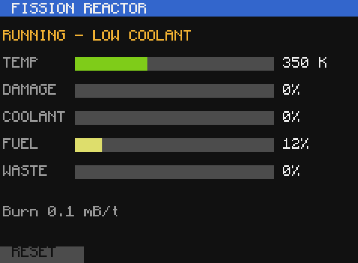

# craftos-mcp for VS Code

Run and test ComputerCraft (CC:Tweaked) Lua without Minecraft, right in VS Code, and give your AI agent the same
emulator as an MCP server so it can run, test and fix the code it writes.

[craftos-mcp](https://github.com/Akkiruk/craftos-mcp) is a CC:Tweaked emulator: real CC:Tweaked behaviour (it passes
1189 of 1190 of CC:Tweaked's own tests at 1.101.3 and 1361 of 1362 at 1.121.0), monitors with touch, several computers on rednet, turtles in a
block world, and peripherals from Create, Mekanism, Advanced Peripherals, Tom's Peripherals and more.



## Quick start

| You use                  | Do this                                                                                              |
| ------------------------ | ---------------------------------------------------------------------------------------------------- |
| VS Code with Copilot     | Install the extension. Agent mode in Chat has the craftos tools straight away.                       |
| Claude Code              | Run **craftos-mcp: Add to Claude Code** from the Command Palette.                                    |
| Cursor or Windsurf       | Install the extension and say yes when it offers to add craftos to the editor's MCP config.          |
| Any other MCP client     | **craftos-mcp: Copy MCP Server JSON**, then paste it into the client's config.                       |
| No agent, just your code | Right-click a `.lua` file, **Run in CraftOS**, or press F5 to debug it. Tests go in `*.test.lua`.    |
| vscode.dev or github.dev | Install it there too: **Run in CraftOS** runs in the browser. See [In the browser](#in-the-browser). |

**craftos-mcp: Get Started** walks through all of it.

## Features

- **An MCP server for VS Code's agents.** The extension registers `craftos-mcp` with VS Code, so agent mode in Chat
  sees its tools (`craftos_run`, `craftos_test`, `craftos_ui`, `craftos_sim_command` and the rest) with nothing to
  configure. It runs in your first workspace folder, or in `craftos-mcp.workspace`. If the server crashes it starts
  again by itself and the chat keeps its tools; after 3 crashes in 2 minutes it stops and offers Restart.
- **One status bar item.** `CraftOS 1.21.1` shows the Minecraft version computers start on, how many addons are on
  once you switch some off (`CraftOS 1.18.2 · 2/15 addons`), and whether the server is setting up (with the
  download's progress), restarting or stopped. Click it for a menu: Run, Debug, the version and addon pickers,
  Restart MCP Server, Show Log and the rest.
- **Pick the Minecraft version and the addons.** **Pick Minecraft Version** lists 1.21.1, 1.20.1 and 1.18.2 with
  the CC:Tweaked each one runs (1.18.2 is CC:Tweaked 1.101.3, which is Lua 5.1). **Pick Addons** is a checklist of
  the mods that have a release for that version; ticking one also ticks what it needs. Both are saved as workspace
  settings, and the MCP server and any open Run in CraftOS panel start again in the new pack. Moving to a version
  drops the listed addons it has no release of, and tells you which.
- **Run in CraftOS.** Right-click a `.lua` file (in the editor or the explorer) and pick **Run in CraftOS**, or use
  the Run button in the editor title. The emulator's app opens beside your code: the terminal takes the keyboard,
  monitors update live and a click is a touch, and the world panel adds players, moves the clock, fills chests and
  sends any sim command. If `name.world.json` sits next to `name.lua`, the computer runs in that world, with its
  monitors. F1, Ctrl+P, Ctrl+B and the other editor shortcuts still work while the terminal has the keyboard.
  Closing the panel stops the computers and the emulator.
- **Rerun on save.** While a Run in CraftOS panel is open, saving its program, another `.lua` file in the folder it
  runs in, or its world file runs the program over in the same panel. `craftos-mcp.rerunOnSave` turns it off.
- **A debugger.** Press F5 on a `.lua` file, or pick **Debug in CraftOS** from the Run button's menu. No
  `launch.json` needed. See [Debugging](#debugging).
- **Tests in the Testing view.** Every `*.test.lua` file shows up with its `ccunit.test` cases. Run them from the
  Testing view, the gutter, or **Run test** above each test in the file; a failure points at the line Lua named and
  that line stays marked until the file runs again. **Debug test** next to it (and Debug in the Testing view) runs
  the file under the debugger. `name.test.lua` runs in `name.world.json` when there is one.
- **The World Editor.** A `*.world.json` file opens as a picture of the computer and what is around it instead of
  raw JSON. See [The World Editor](#the-world-editor).
- **Warnings for what your pack can't do.** In `.lua` files: `goto` and labels when the computer runs Minecraft
  1.18.2 (that is Lua 5.1, and the file would not load), library functions only Lua 5.2 has, CraftOS-PC's own APIs such as `periphemu`, `os.shutdown` with an exit code (only the emulator has one), and
  `peripheral.find` or `wrap` on a peripheral from an addon that is switched off. A world file's `version` and
  `addons` count for the program next to it. Quick fixes where there is an obvious one: remove the exit code,
  target a newer Minecraft version, or switch the addon on. `craftos-mcp.diagnostics` turns them off.
- **New Test for This File / New World for This File** make `name.test.lua` or `name.world.json` next to the open
  program, filled in for it.
- **Add to Claude Code.** The command **craftos-mcp: Add to Claude Code** runs
  `claude mcp add craftos -- npx -y craftos-mcp serve` for you, at the scope you pick. On Windows it passes
  `cmd /c npx -y craftos-mcp serve`, which Claude Code needs there.
- **Cursor and Windsurf.** They don't let extensions add MCP servers, so the extension can't give their agents the
  server by itself. Instead it offers once (and **craftos-mcp: Add to Cursor / Windsurf MCP Config** any time) to
  add a `craftos` entry to `.cursor/mcp.json`, `~/.cursor/mcp.json` or `~/.codeium/windsurf/mcp_config.json`. It
  never overwrites an entry that is already there. Run in CraftOS and the Testing view work the same in both.
- **Copy MCP Server JSON** for Claude Desktop or any other MCP client.
- **Lua autocomplete for CC:Tweaked.** With the [Lua extension](https://marketplace.visualstudio.com/items?itemName=sumneko.lua)
  (`sumneko.lua`) installed, every CC:Tweaked API, the peripherals, the mod peripherals the emulator knows and
  `ccunit` complete, show their docs on hover and get type checked, instead of a wall of "Undefined global `term`".
  `peripheral.find("monitor")` knows it's a monitor. In a ComputerCraft workspace the extension asks once whether to
  set it up (or offers to install the Lua extension first); **craftos-mcp: Set Up Lua Types** does it any time. See
  [Lua types](#lua-types) for what it writes.
- **World files are checked as text too.** Open one with **Show Text** and it has completion for keys, peripheral
  types, addon ids and versions, hover docs, and a squiggle on a typo'd key or a bad value.
- **Snippets**: `cctest` writes a test file that reads a monitor back, `ccunit.test`, `ccunit.eq`, `ccunit.truthy` and
  `ccunit.raises` write single checks, and `ccworld` in a JSON file writes a world with monitors, a player, a chest
  and a battery.

## Requirements

- **Windows x64, Linux x64, or macOS 11+ (Apple silicon or Intel).**
- **Node.js 22 or newer** on your PATH. On first start the extension downloads `craftos-mcp@0.4.1` and its
  dependencies from npm into its own storage, each file checked against the registry's integrity hash, and runs it
  with `node` from then on. If that download fails it uses `npx -y craftos-mcp@0.4.1` instead.
- The debugger needs craftos-mcp 0.4.0 or newer, which is what extension 0.4.0 starts. With an older one the program
  still runs, and the Debug Console says the engine never connected.

The first start downloads the engine from the project's GitHub release and builds the CC:Tweaked ROM from the official
jar on your machine (CC:Tweaked's license does not allow shipping it). That takes about a minute, once per version, and
lands in `%LOCALAPPDATA%\craftos-mcp` or `~/.cache/craftos-mcp` (`CRAFTOS_HOME` moves it).

## Writing tests

A test file is plain Lua that calls the `ccunit` harness. It runs in a fresh computer whose files are your workspace
folder:

```lua
ccunit.test("addition", function() ccunit.eq(1 + 1, 2) end)
ccunit.test("tables compare deeply", function() ccunit.eq({ 1, { a = 2 } }, { 1, { a = 2 } }) end)
ccunit.test("raises on bad argument", function()
  ccunit.raises(function() error("boom") end, "boom")
end)
```

And a world next to it, `name.world.json`:

```json
{
  "addons": ["advanced-peripherals"],
  "monitors": [{ "name": "top", "blocksWide": 3, "blocksHigh": 2 }],
  "players": [{ "name": "Alice", "x": 2, "y": 64, "z": 0 }],
  "peripherals": [
    {
      "name": "playerDetector_0",
      "type": "playerDetector",
      "x": 0,
      "y": 64,
      "z": 0
    }
  ]
}
```

The same tests run from a terminal or CI with `npx craftos-mcp test`.

## Debugging

Click left of a line number to set a breakpoint, then press **F5** with the `.lua` file open. The program starts in
the Run in CraftOS panel and stops on your line. The keyboard stays in the editor while you debug.

- **Breakpoints** with a condition, a hit count (`5`, `> 5`, `% 2`) or a log message, in your program and in the
  files it loads.
- **Step** over, into and out, and **Pause**, also while the computer is waiting for an event. Step Into steps over
  the ROM's own Lua (`print`, `textutils`, the shell) unless the launch configuration sets `stepIntoRom`.
- **Variables**: Locals, Upvalues and Globals, with tables you can open. Double-click a value to change it. Hover a
  name in the editor (`config.screen.width` shows that field), add a Watch, or type an expression in the Debug
  Console.
- **The call stack** goes through every coroutine down to the BIOS. The ROM's frames are folded away until you ask
  for them.
- **Errors**: with **Uncaught Errors** ticked (the default) the program stops on the line that raised an error
  nothing catches with `pcall`. **All Errors** also stops on the caught ones.
- **Tests**: **Debug test** above a test, or Debug in the Testing view, runs the `*.test.lua` under `ccunit`; a
  failing assertion stops where it is raised.

While the program is stopped the computer's clock stands still, so timers don't all fire at once when you continue.
Saving a file does not restart a program that is being debugged.

A `launch.json` is optional. The `craftos` type takes:

| Attribute     | What it does                                                                       |
| ------------- | ---------------------------------------------------------------------------------- |
| `program`     | The `.lua` file: absolute, or relative to the workspace folder. Default `${file}`. |
| `test`        | Run it under `ccunit`, as the Testing view does. Default: true for a `*.test.lua`. |
| `stopOnEntry` | Stop on the program's first line.                                                  |
| `stepIntoRom` | Let Step Into go into the ROM's own Lua.                                           |

## The World Editor

A `*.world.json` file opens in the World Editor (desktop only; in the browser it opens as text).

- **The computer and its six sides**: what sits on top, bottom, left, right, front and back. Click an empty side to
  put a monitor, a modem or another block there, or drag a block from one side to another.
- **On the network**: the blocks the computer reaches by name through a wired modem, such as `minecraft:chest_0`.
- **Players**, and a **map** from above of everything that has a position. Drag things on it, or use the arrow keys
  (Shift moves 10 blocks).
- **Other computers here**: the world files next to this one are the other computers a network test can start, and
  the editor shows which modems reach which.
- **A form for whatever is selected**, made from the world schema, so every field the emulator knows is there with
  its description. The Minecraft version and the addon checklist are in it too.
- **Problems** are listed in the toolbar: what the schema refuses, a block from an addon that is off, two things on
  one side.

It is still a text file. Each change is the smallest edit to the JSON, so what you did not touch keeps its exact
text, and undo, the unsaved dot and source control diffs work as they always do. **Show Text** opens the JSON beside
it, and **Open in World Editor** in the editor title brings you back. A file that does not parse opens with the
error and a button to the text editor.

## In the browser

The extension also runs in VS Code for the Web (vscode.dev, github.dev), where there is no Node.js to start the
emulator with. There:

- **Run in CraftOS** runs the program's folder on a WebAssembly build of the engine, in a panel with the terminal and
  the monitors. It works on a GitHub repository opened on vscode.dev as well as on a local folder.
- The first run fetches CC:Tweaked's jar from Modrinth and builds the ROM in the browser, once.
- Every computer is Minecraft 1.18.2 (CC:Tweaked 1.101.3); a world file's `version` is ignored, and the panel says so.
  Turtles need the desktop.
- A folder over 2000 files or 32 MB is cut off there, so set `craftos-mcp.workspace` in a big repository.
- **New Test** and **New World**, the snippets and the world file checks work. World files open as text.
- The MCP server, the Testing view, the debugger and the World Editor need the desktop VS Code.

## Settings

| Setting                        | What it does                                                                                                                                     |
| ------------------------------ | ------------------------------------------------------------------------------------------------------------------------------------------------ |
| `craftos-mcp.minecraftVersion` | `1.21.1` (the default, the newest) or `1.20.1` (CC:Tweaked 1.121.0), or `1.18.2` (CC:Tweaked 1.101.3, the most complete simulation of the mods). |
| `craftos-mcp.addons`           | The mods your pack has (`CRAFTOS_ADDONS`): `all`, `none` or ids such as `create,mekanism`.                                                       |
| `craftos-mcp.workspace`        | The folder the computers see, relative to the workspace folder, such as `workspace` (see below).                                                 |
| `craftos-mcp.rerunOnSave`      | Run the program over in an open Run in CraftOS panel when you save it (default on).                                                              |
| `craftos-mcp.testCodeLens`     | **Run test** and **Debug test** above each test in `*.test.lua` files (default on).                                                              |
| `craftos-mcp.diagnostics`      | The warnings about what the computer's Minecraft version or pack lacks (default on).                                                             |
| `craftos-mcp.testTimeout`      | Seconds a test file may run (default 60).                                                                                                        |
| `craftos-mcp.registerServer`   | `auto` (default), `everywhere`, `always` or `never`: where the extension gives VS Code its own MCP server.                                       |
| `craftos-mcp.luaTypes`         | `ask` (default), `auto` or `off`: whether to add the CC:Tweaked Lua types to a CC workspace.                                                     |
| `craftos-mcp.command`          | Start craftos-mcp another way, such as `["node", "/path/to/craftos-mcp/apps/cli/dist/index.js"]`.                                                |

The version and the addons are easier to set from the status bar item; a world file's own `version` and `addons`
win over both.

### craftos.json

A `craftos.json` in your project (`npx craftos-mcp init` writes one) fills in `minecraftVersion`, `addons` and
`workspace` when you haven't set them: a setting you set wins, then craftos.json, then the default. The command line
and the MCP server read the same file, so the terminal, CI and the agent all get the same pack. It's checked as you
type against its schema, like world files are.

### Which folder the computers see

The emulator copies its workspace into every computer it starts, as a real computer has its own disk.

| What             | `craftos-mcp.workspace` empty | `craftos-mcp.workspace` set                  |
| ---------------- | ----------------------------- | -------------------------------------------- |
| The MCP server   | the first workspace folder    | that folder                                  |
| Run in CraftOS   | the program's own folder      | that folder, if the program is in it         |
| The Testing view | the test's workspace folder   | that folder; tests outside it are not listed |

So in a big repo (`node_modules`, thousands of files) set it to the folder your Lua lives in. When the extension
spots a repo like that with a `workspace/`, `lua/`, `src/` or similar folder full of Lua, it offers to set it, once.
It never sets it on its own.

### registerServer

`auto` registers the extension's server only in workspaces that look like ComputerCraft projects: a `.lua` or
`*.world.json` file somewhere, a `craftos.json`, or the CC:Tweaked Lua types in the settings. Your other projects'
agents don't carry the emulator's tools. The first Lua file you add to a folder turns it on. `auto` also leaves it out
when the workspace's `.vscode/mcp.json` already has a server with `craftos` in its name, command or arguments, so the
agent doesn't get two sets of the same tools. `everywhere` registers it in every workspace (still not next to a
craftos server in `.vscode/mcp.json`), `always` registers it even then, `never` never does (Run in CraftOS and the
tests still work).

### Lua types

The types are copied into the extension's own storage folder (so an update doesn't break the path) and **Set Up
Lua Types** writes this into the workspace's `.vscode/settings.json`:

- that folder's `library` is appended to `Lua.workspace.library`. Whatever you had there stays;
- `Lua.runtime.version` becomes `Lua 5.2`, but only if the workspace doesn't set it already;
- `Lua.runtime.builtin` gets `os`, `io`, `ffi` and `jit` switched off (CraftOS has its own `os` and `io`), again
  only for the keys you haven't set.

Once, it also adds the storage folder to your user-level `Lua.workspace.userThirdParty`. That on its own changes
nothing: it lets the Lua extension notice CC code in other folders and offer the types there itself.

On `ask` the extension asks once per ComputerCraft workspace (a `startup.lua`, a `*.test.lua`, a `*.world.json`, a
`.craftos` folder or Lua that calls `peripheral`, `os.pullEvent` and the like). **Not Here** leaves that workspace
alone, **Never** sets `craftos-mcp.luaTypes` to `off`. On `auto` it doesn't ask. **craftos-mcp: Remove Lua Types**
takes the library and the `userThirdParty` entry out again and leaves the runtime settings.

The settings file then has an absolute path from your machine in it. If you commit `.vscode/settings.json` and mind
that, pick **Not Here** and use a `.luarc.json` pointing at your own copy of the types instead.

## Commands

Run in CraftOS, Debug in CraftOS, New Test for This File, New World for This File, Open in World Editor, Pick
Minecraft Version, Pick Addons, Set Up Lua Types, Remove Lua Types, Watch the Agent's Computers, Restart MCP Server,
Show Log, Add to Claude Code, Add to Cursor / Windsurf MCP Config, Copy MCP Server JSON, Refresh Tests, Open
Settings, Show Menu and Get Started, all under `craftos-mcp:` in the Command Palette. Most are in the status bar
item's menu too.

**Watch the Agent's Computers** opens the MCP server's own viewer in a panel: every computer the agent has made, live,
and you can type and click monitors next to it. If 7878 is taken (another window's server) the server picks a free
port and the command finds it. A server another client started (Claude Code, say) works too while it has 7878.

## Troubleshooting

- **The first run failed.** The status bar says "setup failed", the notification has the reason and a **Try Again**
  button, and **Show Log** has the rest. Usually it's the network: the setup fetches the engine from GitHub and the
  CC:Tweaked jar. Behind a proxy, set `HTTPS_PROXY` for VS Code. `npx craftos-mcp setup` in a terminal shows the
  same thing outside VS Code.
- **The debugger starts the program but never stops.** The Debug Console says the engine never connected: the
  craftos-mcp it started is older than 0.4.0. Clear `craftos-mcp.command` if you set it, or point it at a newer
  build.
- **A breakpoint stays grey.** The file is not on the computer: it is outside the folder the program runs in (see
  [Which folder the computers see](#which-folder-the-computers-see)).
- **The emulator stopped** (the panel says so): **Start Again** in the panel starts it and the program over.
- **Tools time out or the server is slow to answer.** The workspace is probably huge. Set `craftos-mcp.workspace`.
- **The agent's craftos tools are gone after a crash.** The server restarts by itself and keeps its tools. If it
  stopped for good (3 crashes in 2 minutes, the status bar says "stopped"), click **Restart** on the notification,
  run **craftos-mcp: Restart MCP Server**, or use **MCP: List Servers** > craftos-mcp > Restart. A chat that was open
  while the server was down may need a new chat to see the tools again.
- **Two sets of craftos tools.** Your `.vscode/mcp.json` has its own craftos server. Leave
  `craftos-mcp.registerServer` on `auto` (it skips its own then), or remove one.
- **Claude Code on Windows says the server failed.** Its entry needs `cmd /c npx -y craftos-mcp serve`. **Add to
  Claude Code** writes it that way; an entry added by hand may not have it.
- **Cursor or Windsurf don't show the tools.** Run **craftos-mcp: Add to Cursor / Windsurf MCP Config**, then turn
  the server on in the editor's MCP settings.
- **Still "Undefined global `fs`".** The types need the Lua extension by sumneko. Run **craftos-mcp: Set Up Lua
  Types**; it offers to install it if it's missing. A `.luarc.json` in the folder wins over `settings.json`, so if
  you have one, add the library there.
- **macOS won't start the engine.** It is not signed or notarized. The extension downloads it itself, which leaves no
  quarantine mark; an engine zip you downloaded with a browser needs `xattr -dr com.apple.quarantine engine/build`
  once.

## Known limits

- `shell.run("lib/thing.lua")` in a test is relative to the computer's folder (see above), not to the test file.
- Run in CraftOS uses the emulator's app on 127.0.0.1 inside a webview. In a remote window (SSH, WSL, containers) it
  needs the emulator on the remote side, which means a Linux x64 or macOS remote.
- Only the mods listed in the [main README](https://github.com/Akkiruk/craftos-mcp#choose-your-mods) are simulated.
- The debugger debugs one computer: the one Run in CraftOS starts for the file. **Run Again** in the panel adds a
  computer without it.
- In the browser, computers run Minecraft 1.18.2 only, without turtles.

## License

MIT. CC:Tweaked is by SquidDev and contributors (<https://tweaked.cc>); craftos-mcp does not include it and builds its
ROM on your machine from the official jar. Not affiliated with Mojang or Microsoft.
