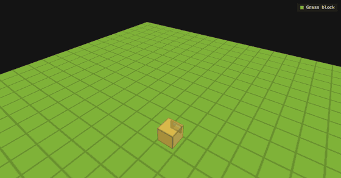

# The craftos-mcp guide

For people who write ComputerCraft programs and want to run and test them without starting Minecraft. No AI agent
needed for anything here.

Start with [Getting started](getting-started.md): install it, run a program, and take the tour (a monitor, a button, a
test, two computers on rednet, a turtle that builds, a mod's block, time controls and snapshots).

## The pages

| Page                                                   | What is in it                                                                          |
| ------------------------------------------------------ | -------------------------------------------------------------------------------------- |
| [Getting started](getting-started.md)                  | Install, your first program, and the tour                                              |
| [The desktop app](desktop-app.md)                      | CraftOS, the app you download: the home screen, Run, Run tests, settings, updates      |
| [The browser app](browser-app.md)                      | The page with computers, monitors, the World, Sim commands and Files panels, the views |
| [The window](window.md)                                | `craftos-mcp window`: a computer in a plain desktop window, like CraftOS-PC            |
| [Worlds and world files](worlds.md)                    | What stands around a computer: monitors, chests, modems, players, a turtle's blocks    |
| [Testing with ccunit](testing.md)                      | `*.test.lua` files, every check, tapping monitors in a test, running them              |
| [Mods](mods.md)                                        | Picking your Minecraft version and the mods your pack has, and using a mod's block     |
| [Time and snapshots](time-and-snapshots.md)            | Pause, step, speed, jump, time of day, and saving the whole world                      |
| [Coming from CraftOS-PC](../coming-from-craftos-pc.md) | Bring your computers over; what is the same and what is different                      |
| [Troubleshooting](troubleshooting.md)                  | The error messages you can meet, what each one means and how to fix it                 |

In VS Code? The extension has Run in CraftOS, a debugger, the Testing view and a World Editor. Its own page:
[apps/vscode/README.md](../../apps/vscode/README.md).

## Four ways in, one emulator

All four run the same computers with the same world files, so pick by taste and switch whenever you like.

| Way in           | Start it                                     | Good for                                                      |
| ---------------- | -------------------------------------------- | ------------------------------------------------------------- |
| The desktop app  | Download CraftOS and open it                 | No Node.js, no terminal. Pick a folder, press Run             |
| The browser app  | `npx craftos-mcp app`                        | Everything on one page: several computers, turtles, the world |
| The window       | `npx craftos-mcp window`                     | One computer in a plain window, your own editor beside it     |
| The command line | `npx craftos-mcp run` and `craftos-mcp test` | Scripts, a quick check, CI                                    |

Your programs live in a normal folder on your PC. That folder is the computer's disk: save a file in your editor and
the computer sees it at once.
