# The browser app

This page covers `craftos-mcp app`: a page in your web browser with your computers, their monitors, the world around
them and the clock. The desktop app ([desktop-app.md](desktop-app.md)) shows this same page when you press Run, so
everything here works there too.

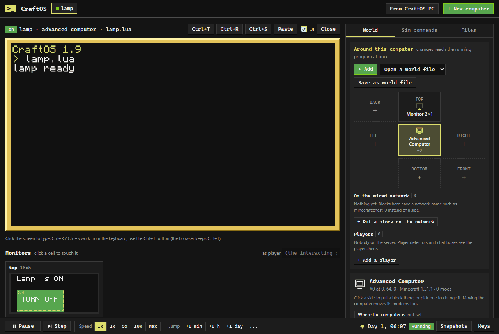

## Start it

Open a terminal in the folder with your Lua programs and run:

```sh
npx craftos-mcp app
```

It prints the address (`http://127.0.0.1:7878/`) and opens it in your browser. Ctrl+C in the terminal stops it.

| Option                   | What it does                                                                                                           |
| ------------------------ | ---------------------------------------------------------------------------------------------------------------------- |
| `--dir <folder>`         | Your Lua project. Default: the folder you are in                                                                       |
| `--port <n>`             | The port. Default 7878; `0` picks a free one                                                                           |
| `--mc <version>`         | The Minecraft version new computers start on (`1.21.1`, `1.20.1` or `1.18.2`). The form can change it                  |
| `--copy`                 | New computers get a scratch copy of the folder instead of the folder itself                                            |
| `--worlds <folder>`      | Where the saved worlds the form offers are. Default `worlds/`                                                          |
| `--snapshot <name/file>` | Open with a saved snapshot, or a `.craftos-world` file someone shared ([time-and-snapshots.md](time-and-snapshots.md)) |
| `--no-open`              | Only print the address, do not open the browser                                                                        |

The page listens on 127.0.0.1 only, so nobody else on your network can reach it.

## Make a computer

Press **+ New computer**.

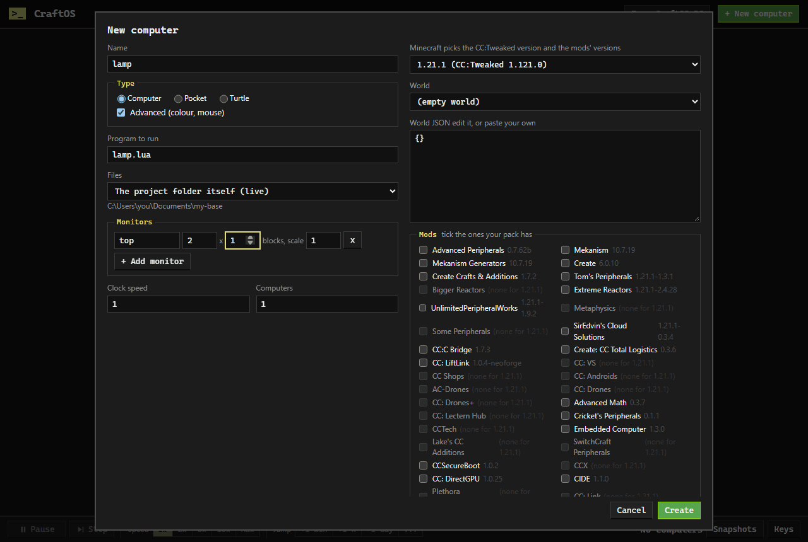

- **Name**: the name on its tab.
- **Type**: Computer, Pocket or Turtle. **Advanced** gives colour and the mouse, as an advanced computer has in the
  game.
- **Program to run**: a program from your folder that starts after boot. Leave it empty for just the shell.
- **Files**: where the computer's files are.
  - **The project folder itself (live)**: the default. What a program saves lands in your folder, and what you save
    there in your own editor the computer sees at once. It stays after you close the computer.
  - **Its own folder in it: computer/&lt;id&gt; (live)**: each computer gets `computer/0`, `computer/1` and so on
    inside your folder, the way CraftOS-PC keeps them. Handy for a network where each computer runs something else.
  - **A scratch copy, gone when it closes**: try things without touching your folder.
- **Monitors**: **+ Add monitor**, then the side, the size in blocks (up to 8 wide and 6 high) and the text scale.
- **Clock speed**: 1 is normal. You can change it later in the bar along the bottom.
- **Computers**: more than 1 makes a network. Each computer gets a modem on its back (**wireless** or **ender**) and
  its own tab.
- **Minecraft**: picks the CC:Tweaked version and which mods are there.
- **World**: a saved world from `worlds/`, and **World JSON** below it to edit it or paste your own. See
  [worlds.md](worlds.md).
- **Mods**: tick the ones your modpack has. A mod with no release for the chosen Minecraft version is greyed out. See
  [mods.md](mods.md).

**Create** boots it. If the world JSON has a mistake, the form says what is wrong and does not close.

## The computer

Each computer has a tab along the top. Under the tab bar:

- **on** (or **off**), the name, the type and the program.
- **Ctrl+T**, **Ctrl+R**, **Ctrl+S**: hold that key for a second, as CC needs, to stop the program, reboot or shut
  down. Ctrl+R and Ctrl+S also work from your keyboard. Ctrl+T needs the button, because the browser keeps Ctrl+T for
  a new tab.
- **Paste**: sends the text on your clipboard to the computer as a `paste` event (Ctrl+V on the screen does the
  same).
- **UI**: outlines what the screens show as buttons and panels, with the cell each one starts at. Useful to find the
  column and row to tap.
- **Close**: turns the computer off and removes it. With a live folder your files stay where they are.

Click the screen, then type. The mouse works on an advanced computer.

### Monitors

Monitors show under the screen and update live. Click a cell to touch it: the computer gets `monitor_touch` with that
column and row. **as player** sets the name of the player who touches, for programs that check it.

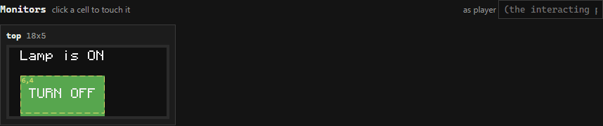

Tom's Peripherals GPU screens show under **GPU screens** the same way, and a click is a touch on that pixel.

### Printers

A computer with a printer shows each page it printed under its screen, newest first, with the printer's ink and paper.

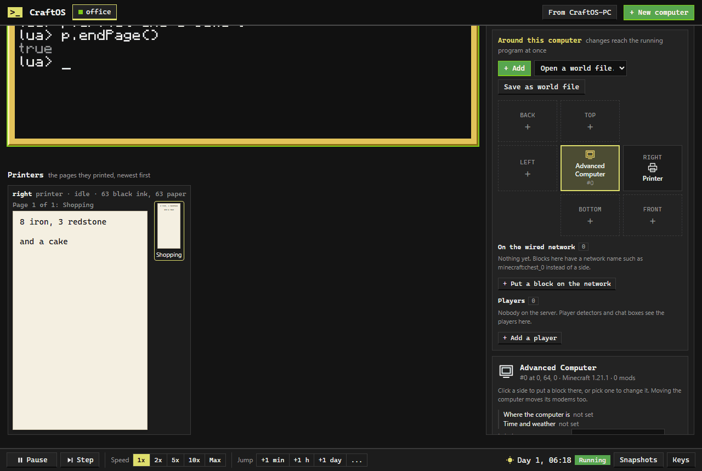

That page came from this in the `lua` prompt, with a printer on the right
(`{ "name": "right", "type": "printer", "ink": 64, "paper": 64 }` in the world):

```lua
p = peripheral.wrap("right")
p.newPage()
p.setPageTitle("Shopping")
p.write("8 iron, 3 redstone")
p.setCursorPos(1, 3)
p.write("and a cake")
p.endPage()
```

## The side panels

### World

**Around this computer** shows the computer and its six sides. Click a side to put something there (a monitor, a
chest, a modem, a mod's block) or pick what is there to change it: a monitor's size, a chest's items slot by slot, a
player's place. The running program sees each change as it would in the game: a `peripheral` event when a block is
placed, `peripheral_detach` when it is broken. **On the wired network** holds blocks with a network name such as
`minecraft:chest_0`, and **Players** the players on the server. The panel also follows what changes elsewhere:
`attach top monitor` or `sim join Alice` typed in the computer, a **Sim commands** form, or a program, shows up in
it within a couple of seconds.

**Save as world file** writes it all to a `.world.json`; **Open a world file** loads one from your project or your
PC. [worlds.md](worlds.md) has the details.

Lower down: **Players** (add, join, leave, say something in chat), **Clock** (move the clock on by some seconds),
**Inventory slot** (put an item in a slot of a chest), and **Sim state**, the whole simulated world as a tree.

### Sim commands

**Change the world** has small forms that need no JSON: players join, leave and move, an item goes into a chest slot,
a block is placed or broken next to the computer, rain and thunder, and a time jump.

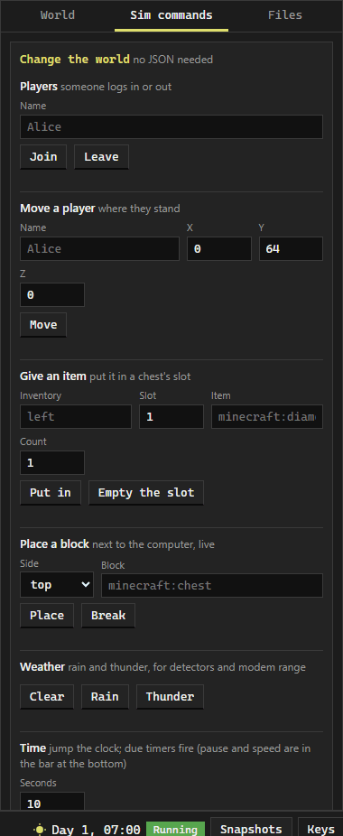

Below them, **Send a sim command** takes any command as JSON (`{"cmd": "advance", "seconds": 5}`), and **Commands
this world knows** lists every command the world and its mods offer. Click one to fill the box.

The same commands work from inside the computer with the `sim` program: `sim join Alice`, `sim chat Alice hello`,
`sim state`, `sim help`. A real CC:Tweaked computer has no `sim`; it is only here.

### Files

The computer's files, with **Refresh** and **Reboot**. Click a file to edit it, then **Save** or **Save + reboot**.

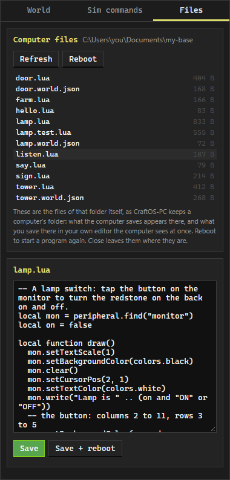

With a live folder these are the files of your folder itself. With a scratch copy, changes stay on the computer and
go when you close it; **Copy project in + reboot** copies your folder onto it again.

## Views

Above the screen a bar picks what you look at. A view shows up when the computer has something for it.

- **Screen**: one computer, its screen and monitors.
- **Side by side**: every computer at once, each with its monitors. Click one to type on it, drag a tile's right
  edge to resize it, and hide or show computers with the buttons under **Show**.
- **Blocks** (a turtle): the world around the turtle, live. **3D**: drag to turn, wheel to zoom, Shift+drag or
  right-drag to slide. **Layers**: one layer at a time from above, with **Layer down**, **Layer up** (Page Down and
  Page Up) and **Turtle's layer**. **Follow turtle** keeps it in the middle, **Trail** draws its last 300 steps,
  **See through** draws blocks like glass to find a turtle underground, **Cut above turtle** hides what is over it,
  and **Whole build** stands back to show everything it built and dug. Point at a block to read its name and place.
- **Network** (more than one computer): the computers with their modems (wireless, ender, wired) and which can reach
  which. Each message runs along its link as it is sent. The list below has every message: the time, who sent it,
  who heard it, the channel or rednet target, the protocol and the start of the message. Click a row for the whole
  message (**Copy** copies it as JSON). Type in the filter to narrow the list, **Pause** to read it while the
  computers keep talking, **Clear** to empty it. rednet sends every message a second time on channel 65533 for
  repeaters; tick **Copies for repeaters** to list those too.

## Tour: two computers on rednet

The folder has two small programs. `listen.lua`:

```lua
rednet.open("back")
print("Computer " .. os.getComputerID() .. " is listening")
while true do
  local from, message = rednet.receive()
  print(from .. " says: " .. tostring(message))
end
```

and `say.lua`:

```lua
rednet.open("back")
rednet.broadcast(table.concat({ ... }, " "))
print("sent")
```

1. **+ New computer**, name `base`, **Computers** 2, **Create**. You get two tabs, **base 1** and **base 2**, each
   with a wireless modem on its back.
2. On **base 1** type `listen`.
3. On **base 2** type `say hello from the mine`.
4. **base 1** prints `1 says: hello from the mine`. Pick **Network** to see it go across.

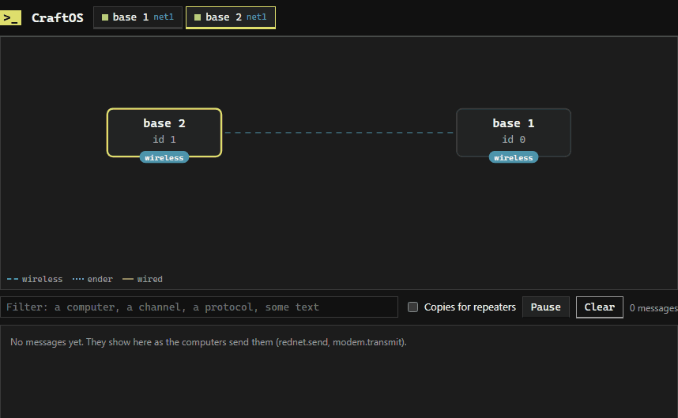

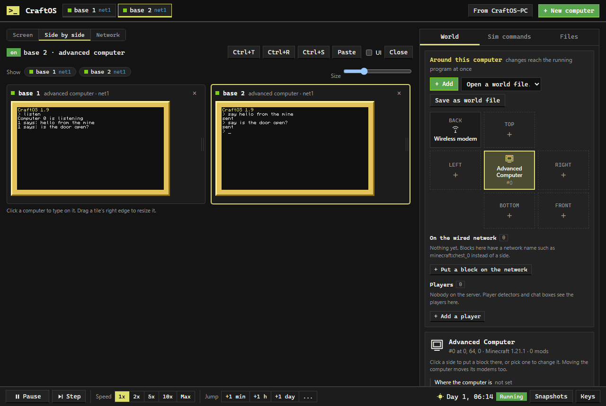

## Tour: a turtle that builds

`tower.lua` builds a ring of 3 by 3 blocks, 4 high:

```lua
local HEIGHT = 4

turtle.select(1)
for layer = 1, HEIGHT do
  turtle.up()
  for side = 1, 4 do
    for step = 1, 2 do
      turtle.placeDown()
      turtle.forward()
    end
    turtle.turnRight()
  end
  print("layer " .. layer .. " done")
end
print("tower built, " .. turtle.getFuelLevel() .. " fuel left")
```

A turtle needs a world: somewhere to stand, fuel, and the blocks to place. `tower.world.json`:

```json
{
  "turtle": {
    "x": 0,
    "y": 64,
    "z": 0,
    "facing": "north",
    "fuel": 100,
    "inventory": {
      "1": { "name": "minecraft:stone_bricks", "count": 32 }
    }
  },
  "ground": {
    "y": 63,
    "name": "minecraft:dirt",
    "top": "minecraft:grass_block"
  }
}
```

1. **+ New computer**, type **Turtle**, and paste `tower.world.json` into **World JSON**. **Create**.
2. Pick **Blocks** above the screen.
3. Type `tower`. A turtle move takes a moment, as in the game, so the whole tower takes about half a minute (press
   **2x** in the bottom bar to hurry it).

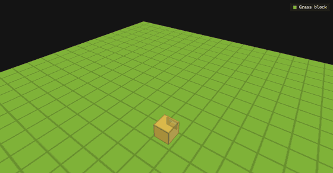

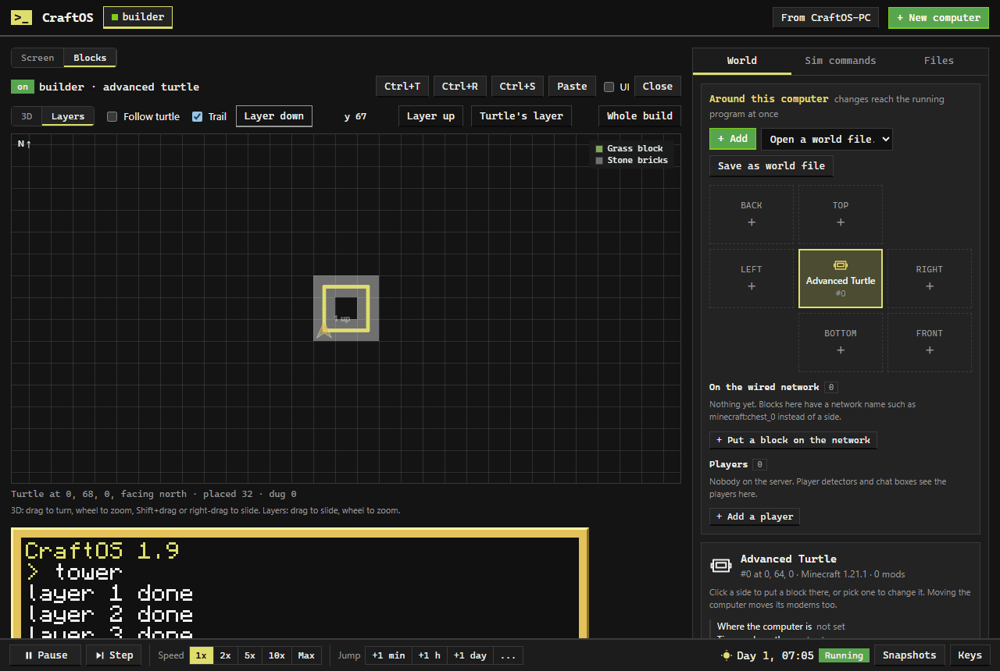

## From CraftOS-PC

**From CraftOS-PC** at the top brings your CraftOS-PC computers over. It finds your CraftOS-PC folder (or type where
it is and press **Look**), lists the computers in it, and **Bring them over** copies the ones you tick into a project
folder: their files, label, colour, screen size, and the peripherals their startup attaches. Each one then has a
**Start** button. Your CraftOS-PC folder is only read, never changed.

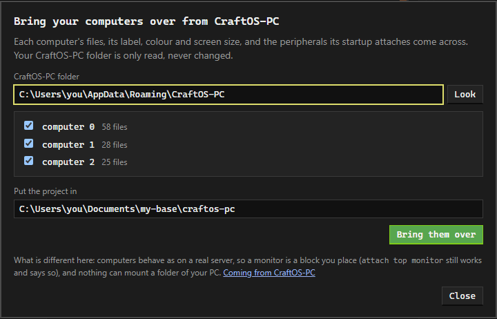

`attach`, `detach`, `config` and `mount` still work in the shell and say what the game does instead:

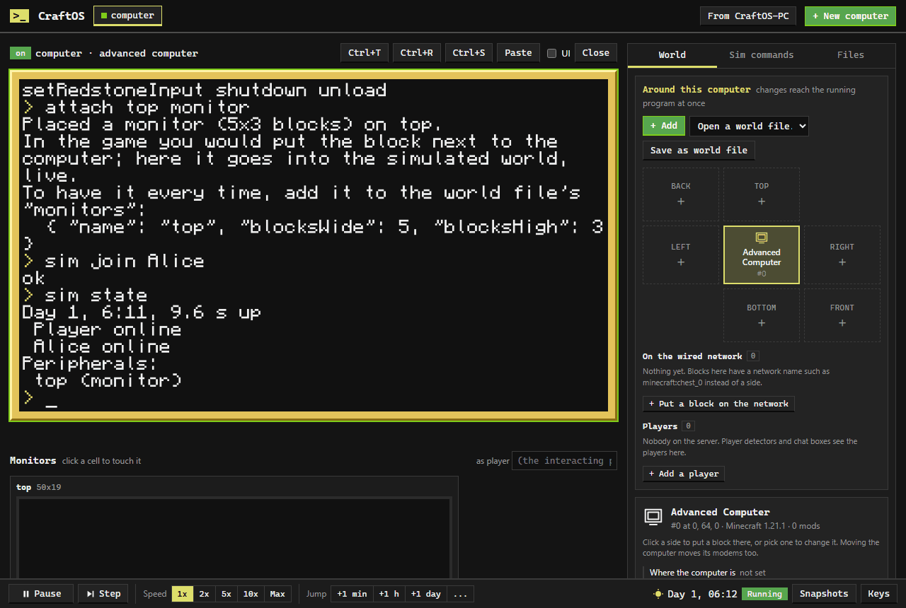

More in [Coming from CraftOS-PC](../coming-from-craftos-pc.md).

## The clock

The bar along the bottom pauses, steps, speeds up and jumps the clock of every computer at once, shows the time of
day, and saves snapshots of the whole world. It has its own page: [time-and-snapshots.md](time-and-snapshots.md).

## See also

- [The window](window.md): one computer in a plain desktop window, like CraftOS-PC.
- [Testing with ccunit](testing.md), and [troubleshooting.md](troubleshooting.md) when something goes wrong.
- [Getting started](getting-started.md).
