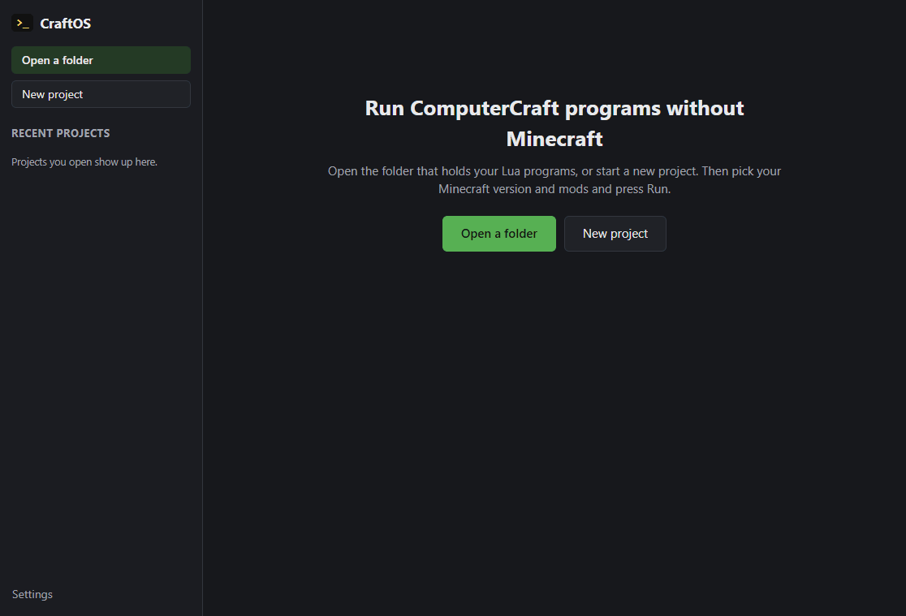
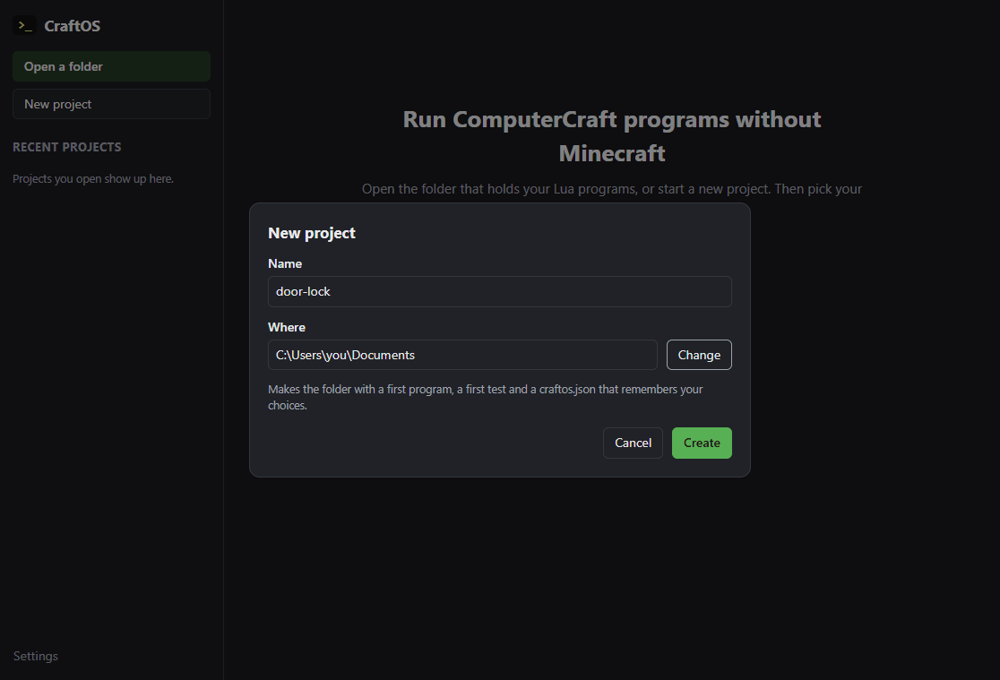
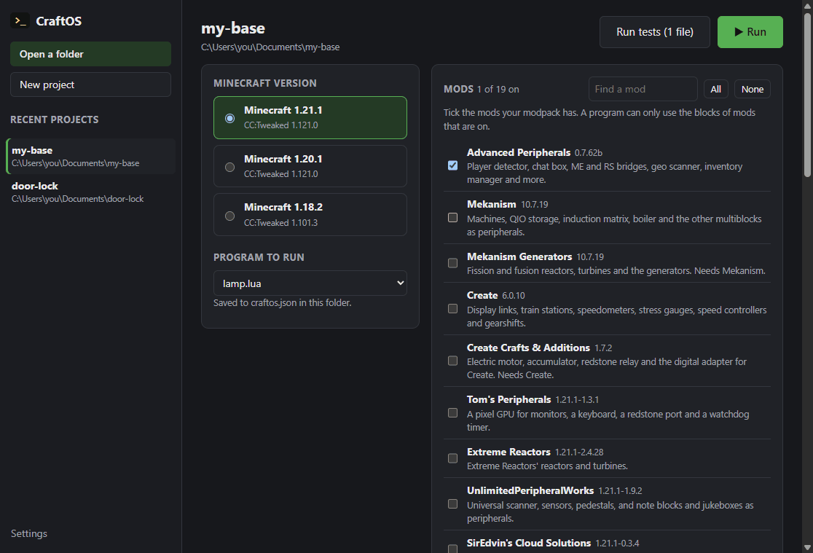
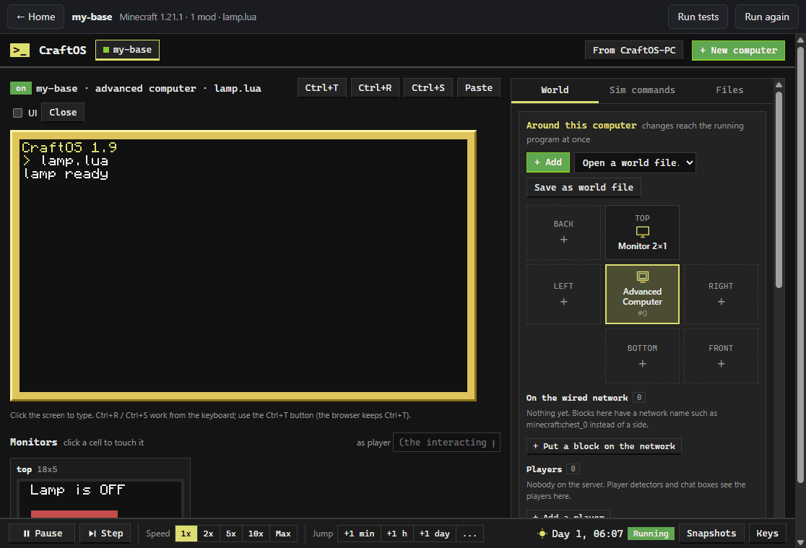
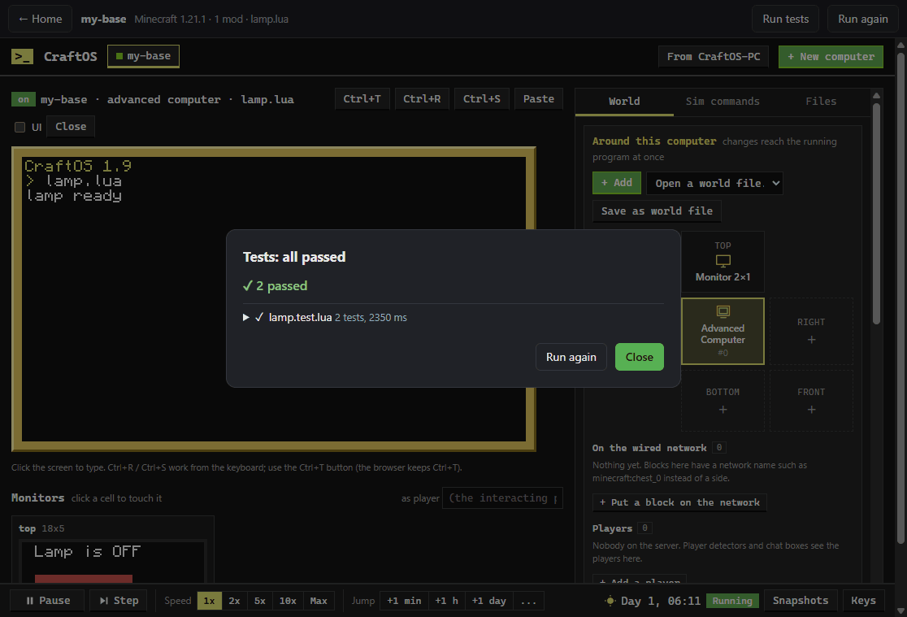

# The desktop app

This page covers CraftOS, the app you download and open like any other: no Node.js and no terminal. It has the
emulator inside, so there is nothing else to install.



## Install it

Get the file for your computer from the [latest release](https://github.com/Akkiruk/craftos-mcp/releases/latest):

| Your computer                 | Download                                  | Then                                                                     |
| ----------------------------- | ----------------------------------------- | ------------------------------------------------------------------------ |
| Windows 10 or 11              | `CraftOS-<version>-windows-x64-setup.exe` | Run it. It installs for you alone (no admin rights), into the Start menu |
| Mac, Apple silicon (M1 on)    | `CraftOS-<version>-macos-arm64.dmg`       | Open it and drag CraftOS onto Applications                               |
| Mac, Intel                    | `CraftOS-<version>-macos-x64.dmg`         | The same                                                                 |
| Linux, any distribution       | `CraftOS-<version>-linux-x64.AppImage`    | `chmod +x CraftOS-*.AppImage`, then run it                               |
| Linux, Debian, Ubuntu or Mint | `CraftOS-<version>-linux-x64.deb`         | `sudo apt install ./CraftOS-*.deb`; CraftOS is then in your apps menu    |

**Windows says it does not know the app.** Press **More info**, then **Run anyway**. It only asks the first time.

**A Mac will not open it.** The app is not signed with a paid Apple developer id, so macOS stops it once. Right-click
(or Control-click) CraftOS in Applications, choose **Open**, then **Open** again. On macOS 15 and newer: open it once
and close the warning, then go to System Settings, Privacy & Security, find "CraftOS was blocked" near the bottom and
click **Open Anyway**. After that it opens like any app.

**Uninstall.** Windows: Settings, Apps, CraftOS, Uninstall. macOS: drag CraftOS from Applications to the Bin. Linux:
delete the AppImage, or `sudo apt remove craftos-desktop`. Your projects are never touched.

## Open a project

A project is a normal folder with your Lua programs in it. That folder is the computer's disk: what you save there in
your editor, the computer sees, and what a program saves lands there.

- **Open a folder** picks a folder you already have.
- **New project** asks for a name and where to put it, and makes a folder with `hello.lua`, `hello.test.lua` and a
  `craftos.json` that remembers your choices. The name cannot have `\ / : * ? " < > |` in it.



Projects you have opened are listed on the left under **Recent projects**. The **×** next to one takes it off the
list; the folder stays where it is.

## Choose the version, the program and the mods



- **Minecraft version**: 1.21.1, 1.20.1 or 1.18.2, each with the CC:Tweaked version that goes with it. Pick the one
  your server or modpack runs.
- **Program to run**: a `.lua` file from the folder that starts when the computer boots, or **No program: open the
  computer's prompt**.
- **Mods**: tick the mods your modpack has. A program can only use the blocks of mods that are on, so it cannot come
  to need something your server does not have. **Find a mod** filters the list; **All** and **None** tick or clear
  them all. A mod that needs another one switches that one on too, and a mod with no release for the chosen
  Minecraft version is not in the list. [Mods](mods.md) says more.

Your choices are saved in `craftos.json` in the folder. Opening a folder writes nothing until you change a choice or
press **Run**. The command line, the VS Code extension and an AI agent read the same file, so they all start the
computer the same way.

## Run

**Run** starts the computer with your folder's files and shows it in the window: the screen, its monitors, the world
around it and the time bar. It is the same page as the browser app, so everything on
[the browser app page](browser-app.md) works here too: more computers, turtles, the World, Sim commands and Files
panels, the views and snapshots.



Along the top:

- **Home** shuts the computers down and goes back to the home screen.
- The project's name, its Minecraft version, how many mods are on, and the program.
- **Run tests** runs the tests without leaving the computer.
- **Run again** starts over with the files as they are now.

**Monitors and blocks on Run.** To start with a monitor, a chest, a turtle's world or anything else around the
computer, keep it in a world file in the project and name it in `craftos.json`:

```json
{
  "minecraft": "1.21.1",
  "run": "lamp.lua",
  "world": "lamp.world.json"
}
```

Leave the other lines the app wrote as they are. `world` can also be the name of a saved world, such as
`create-demo`. [Worlds and world files](worlds.md) has what a world file can hold. You can also build the world with
the mouse while it runs (the World panel's **Around this computer**) and keep it with **Save as world file**.

## Run tests

**Run tests** (on the home screen it says how many test files there are) runs every `*.test.lua` in the folder, or
the files the `tests` list in `craftos.json` names, each in a fresh computer. The box lists each file with what passed
and failed. A file with a failure is open already, with the reason under the test; click any other file to see its
tests.



How to write them: [Testing with ccunit](testing.md).

## Settings

**Settings** at the bottom left:

- **Look**: Same as my computer, Light or Dark.
- **Look for a new version when CraftOS starts**, and **Look for a new version now**. On Windows and from the
  AppImage, a new version downloads by itself and the app offers **Restart to update**. On macOS and from the .deb it
  tells you a new version is out and opens the download page.
- **CC:Tweaked's files**: CraftOS downloads CC:Tweaked's own files from its official download the first time you use
  a Minecraft version (they cannot come inside the app). **Get every version now** gets them all at once, so you can
  work without internet later.

They are kept in your user folder: `%LOCALAPPDATA%\craftos-mcp` on Windows, `~/.cache/craftos-mcp` on macOS and
Linux.

## When something goes wrong

The app shows the message on the home screen. The common ones are in
[Troubleshooting](troubleshooting.md#the-desktop-app). If the first Run cannot download CC:Tweaked's files, check your
internet connection and press **Run** again.

## See also

- [Getting started](getting-started.md): a tour of what you can do once it runs.
- [The browser app](browser-app.md): the same page from `npx craftos-mcp app`, if you have Node.js.
- [The window](window.md): one computer in a plain window, like CraftOS-PC.
