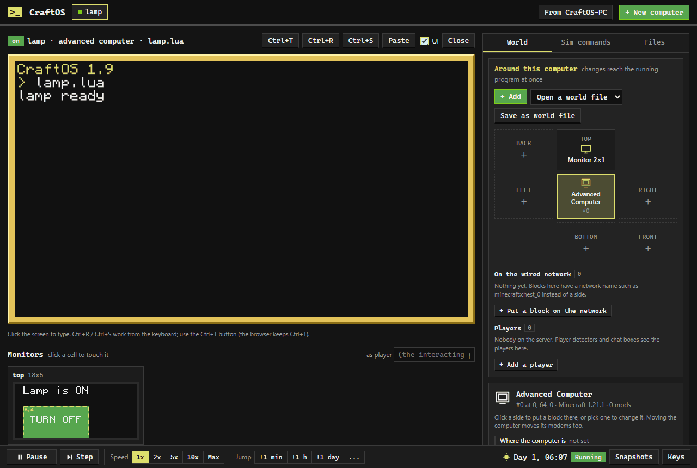
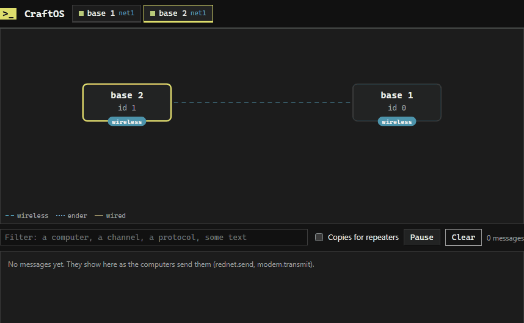
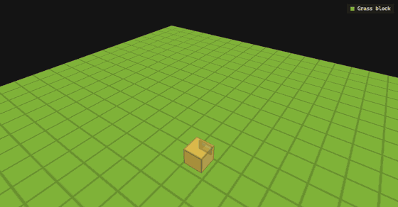
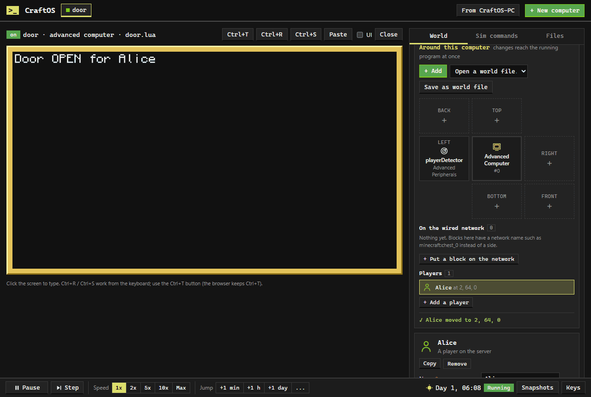
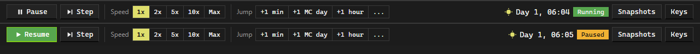
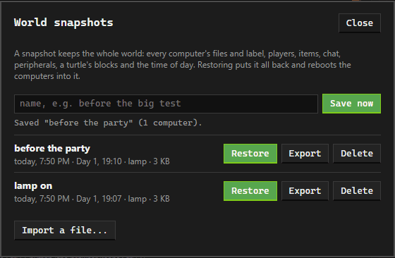

# Getting started

This page gets craftos-mcp running on your PC and then walks you through the main things it does, one small program at
a time. No Minecraft and no AI needed.

## 1. Install it

Pick one. Both run the same computers.

**The desktop app (no Node.js, no terminal).** Download CraftOS for your system from the
[latest release](https://github.com/Akkiruk/craftos-mcp/releases/latest):

| Your computer                | File                                      |
| ---------------------------- | ----------------------------------------- |
| Windows 10 or 11             | `CraftOS-<version>-windows-x64-setup.exe` |
| Mac with Apple silicon       | `CraftOS-<version>-macos-arm64.dmg`       |
| Mac with Intel               | `CraftOS-<version>-macos-x64.dmg`         |
| Linux (any)                  | `CraftOS-<version>-linux-x64.AppImage`    |
| Linux (Debian, Ubuntu, Mint) | `CraftOS-<version>-linux-x64.deb`         |

On Windows, if SmartScreen says it does not know the app, press **More info**, then **Run anyway**. On a Mac the first
start needs a right-click, **Open** (the [desktop app page](desktop-app.md#install-it) has the steps for macOS 15).

**With Node.js 22 or newer.** Open a terminal in the folder with your Lua programs and run:

```sh
npx craftos-mcp window
```

The first start downloads the engine and builds CC:Tweaked's ROM from the official CC:Tweaked jar, once. That takes
about a minute. After that it opens in a second or two. `npm install -g craftos-mcp` lets you type `craftos-mcp`
without `npx`.

## 2. Your first program

Make a folder (say `my-base`) and put `hello.lua` in it:

```lua
print("Hello from " .. os.version())
print("I am computer " .. os.getComputerID())
```

That folder is the computer's disk. Save a file in your own editor and the computer sees it at once.

- **Desktop app**: **Open a folder**, pick `my-base`, choose `hello.lua` under **Program to run**, press **Run**.
- **Window**: `npx craftos-mcp window` in that folder, then type `hello` in the computer.
- **Command line**: `npx craftos-mcp run hello.lua` runs it once and prints the screen as text:

```text
hello.lua: completed (exit 0, 263 ms)
--- terminal (51x19) ---
CraftOS 1.9
Hello from CraftOS 1.9
I am computer 0
```

The desktop app's **New project** makes a folder like this for you, with a first program and a first test.

## 3. A monitor

`sign.lua`:

```lua
local mon = peripheral.find("monitor")
mon.setTextScale(1)
mon.setBackgroundColor(colors.blue)
mon.clear()
mon.setCursorPos(2, 2)
mon.setTextColor(colors.yellow)
mon.write("Welcome to my base")
print("sign is up")
```

A monitor needs to be there first. Give the computer one on top, 3 blocks wide and 2 high:

```sh
npx craftos-mcp window --monitor top:3x2      # the monitor opens in its own window
npx craftos-mcp run sign.lua --monitor top:3x2
```

```text
sign.lua: completed (exit 0, 308 ms)
--- terminal (51x19) ---
CraftOS 1.9
sign is up
--- monitor top (29x12) ---

 Welcome to my base
```

To keep the monitor without typing it every time, put it in a world file next to your program. `lamp.world.json`:

```json
{
  "monitors": [{ "name": "top", "blocksWide": 2, "blocksHigh": 1 }]
}
```

A world file can hold chests, modems, players, a turtle's blocks and more: [Worlds and world files](worlds.md).

## 4. A button

`lamp.lua` draws a button on the monitor and turns the redstone on its back on and off when you tap it:

```lua
local mon = peripheral.find("monitor")
local on = false

local function draw()
  mon.setTextScale(1)
  mon.setBackgroundColor(colors.black)
  mon.clear()
  mon.setCursorPos(2, 1)
  mon.setTextColor(colors.white)
  mon.write("Lamp is " .. (on and "ON" or "OFF"))
  -- the button: columns 2 to 11, rows 3 to 5
  mon.setBackgroundColor(on and colors.green or colors.red)
  for row = 3, 5 do
    mon.setCursorPos(2, row)
    mon.write("          ")
  end
  mon.setCursorPos(3, 4)
  mon.write(on and "TURN OFF" or "TURN ON")
end

draw()
print("lamp ready")
while true do
  local _, _, x, y = os.pullEvent("monitor_touch")
  if x >= 2 and x <= 11 and y >= 3 and y <= 5 then
    on = not on
    redstone.setOutput("back", on)
    draw()
  end
end
```

Open the browser app with `npx craftos-mcp app`, press **+ New computer**, type `lamp.lua` as the program, add a
monitor on `top`, 2 by 1, and press **Create**. Click the button on the monitor: a click is a player tapping it.



In the desktop app, add `"world": "lamp.world.json"` to the `craftos.json` in your folder and **Run** starts the
computer with that monitor. In the window, `npx craftos-mcp window lamp.world.json` does the same, and a click on the
monitor's window is a tap.

Tick **UI** above the screen to see what the screens show as buttons, with the column and row each one starts at.

## 5. Test it

A test file is any `*.test.lua`. `lamp.test.lua`:

```lua
ccunit.test("starts off", function()
  local r = ccunit.run("lamp.lua", { seconds = 1 })
  ccunit.contains(r.screen, "lamp ready")
  ccunit.contains(ccunit.screen("top"), "Lamp is OFF")
end)

ccunit.test("a tap turns it on", function()
  ccunit.run("lamp.lua", { script = function()
    sleep(0.5)                  -- let the program draw
    ccunit.touch("top", 4, 4)   -- monitor, column, row
    sleep(0.5)                  -- let it react
  end })
  ccunit.contains(ccunit.screen("top"), "Lamp is ON")
  ccunit.truthy(redstone.getOutput("back"))
end)
```

```sh
npx craftos-mcp test --monitor top:2x1
```

```text
PASS lamp.test.lua (2 tests, 2284 ms)
  ok   starts off
  ok   a tap turns it on

1 file, 2 tests: 2 passed, 0 failed
```

In the desktop app it is the **Run tests** button. Every check ccunit has, and what a failure looks like:
[Testing with ccunit](testing.md).

## 6. Two computers on rednet

`listen.lua`:

```lua
rednet.open("back")
print("Computer " .. os.getComputerID() .. " is listening")
while true do
  local from, message = rednet.receive()
  print(from .. " says: " .. tostring(message))
end
```

`say.lua`:

```lua
rednet.open("back")
rednet.broadcast(table.concat({ ... }, " "))
print("sent")
```

In the browser app: **+ New computer**, name it `base`, set **Computers** to 2, **Create**. Each computer gets a
wireless modem on its back and a tab. Type `listen` on **base 1** and `say hello from the mine` on **base 2**. Pick
**Network** above the screen to watch the messages go across.



`npx craftos-mcp window --computers 2` gives you the same two computers, each in its own window.

## 7. A turtle that builds

`tower.lua` builds a ring of 3 by 3 blocks, 4 high:

```lua
turtle.select(1)
for layer = 1, 4 do
  turtle.up()
  for side = 1, 4 do
    for step = 1, 2 do
      turtle.placeDown()
      turtle.forward()
    end
    turtle.turnRight()
  end
  print("layer " .. layer .. " done")
end
print("tower built, " .. turtle.getFuelLevel() .. " fuel left")
```

A turtle needs ground to stand on, fuel, and blocks to place. `tower.world.json`:

```json
{
  "turtle": {
    "x": 0,
    "y": 64,
    "z": 0,
    "facing": "north",
    "fuel": 100,
    "inventory": { "1": { "name": "minecraft:stone_bricks", "count": 32 } }
  },
  "ground": {
    "y": 63,
    "name": "minecraft:dirt",
    "top": "minecraft:grass_block"
  }
}
```

In the browser app: **+ New computer**, type **Turtle**, paste the world into **World JSON**, **Create**. Pick
**Blocks** above the screen and type `tower`. Turtle moves take as long as in the game, so the tower takes about half
a minute (press **2x** in the bottom bar to hurry it).



On the command line, `--timescale 5` runs the clock five times faster:

```sh
npx craftos-mcp run tower.lua --world tower.world.json --timescale 5
```

```text
tower.lua: completed (exit 0, 7091 ms)
--- terminal (39x13) ---
CraftOS 1.9
layer 1 done
layer 2 done
layer 3 done
layer 4 done
tower built, 64 fuel left
```

`run` stops a program after 30 seconds (`--timeout` changes that). At normal speed the tower takes about 35
seconds, so without `--timescale` give it more time: `npx craftos-mcp run tower.lua --world tower.world.json
--timeout 60`. A run that is stopped this way says so, and how to give it longer.

## 8. A block from a mod

Blocks from other mods work the same way. This door opens while a player stands within 5 blocks, using Advanced
Peripherals' player detector. `door.lua`:

```lua
local detector = peripheral.find("playerDetector")
while true do
  local names = detector.getPlayersInRange(5)
  term.clear()
  term.setCursorPos(1, 1)
  if #names > 0 then
    print("Door OPEN for " .. table.concat(names, ", "))
  else
    print("Door closed")
  end
  redstone.setOutput("back", #names > 0)
  sleep(1)
end
```

`door.world.json` puts the detector on the left and Alice 30 blocks away:

```json
{
  "addons": ["advanced-peripherals"],
  "peripherals": [{ "name": "left", "type": "playerDetector" }],
  "players": [{ "name": "Alice", "x": 30, "y": 64, "z": 0 }]
}
```

Start it with that world (World JSON in the browser app), and the screen says `Door closed`. In the World panel, pick
Alice and set her X to 2: the door opens.



Switch on only the mods your modpack has, so a program cannot come to need a block your server does not have:
[Mods](mods.md).

## 9. Pause and jump time

The bar along the bottom of the browser app (and the desktop app) runs the clock for every computer at once:
**Pause** and **Step** (one tick), **2x** to **10x** and **Max**, and **Jump** a minute, an hour or a Minecraft day
ahead. A program that sleeps for ten minutes is done in a click.



Keys: Alt+P pause, Alt+. one tick, Alt+J / Alt+H / Alt+N jump. [Time and snapshots](time-and-snapshots.md) has the
rest.

## 10. Snapshots

**Snapshots** in the same bar saves the whole world under a name: players, items, peripherals, a turtle's blocks,
the time of day, and the files of computers on a scratch copy. **Restore** puts it all back and reboots the computers.
**Export** gives you a `.craftos-world` file to share.



Computers that use your project folder itself keep their files there, so a restore does not undo your edits. Keep
the folder in git if you want that.

## Where next

- [The desktop app](desktop-app.md), [the browser app](browser-app.md) and [the window](window.md), in full.
- [Worlds and world files](worlds.md): everything that can stand around a computer.
- [Coming from CraftOS-PC](../coming-from-craftos-pc.md): bring your computers over.
- [Troubleshooting](troubleshooting.md): error messages and what to do about them.
