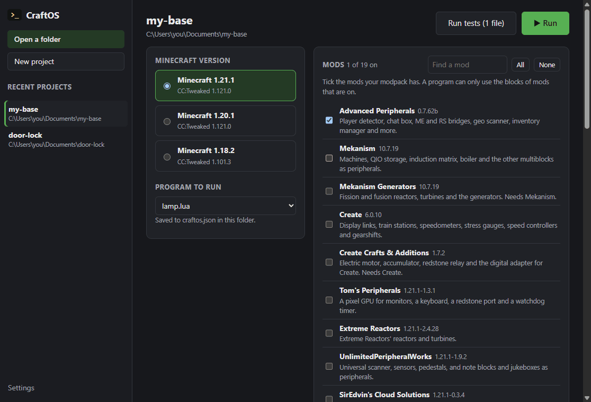
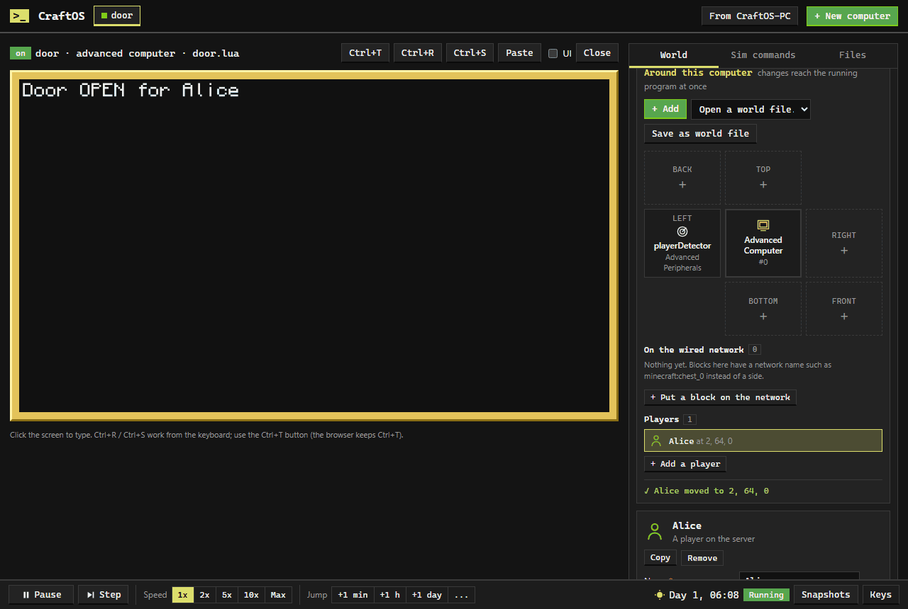

# Mods

This page covers picking the Minecraft version your server runs, switching on the mods your modpack has, and using a
mod's blocks from your program.

## Pick your Minecraft version

The Minecraft version decides which CC:Tweaked you get, and so which Lua and which APIs your program sees.

| Minecraft          | CC:Tweaked | Lua                             |
| ------------------ | ---------- | ------------------------------- |
| `1.21.1` (default) | 1.121.0    | Lua 5.2 features such as `goto` |
| `1.20.1`           | 1.121.0    | the same                        |
| `1.18.2`           | 1.101.3    | Lua 5.1, no `goto`              |

Use the version your server runs. A program that works on 1.21.1 can still fail on a 1.18.2 server, for example
when it uses `goto` or an API newer than 1.101.3.

| Where            | How                                                |
| ---------------- | -------------------------------------------------- |
| The desktop app  | **Minecraft version** on the project screen        |
| The browser app  | the version list at the top of **New computer**    |
| The command line | `--mc 1.18.2` on `run`, `test`, `window` and `app` |
| A project        | `"minecraft": "1.18.2"` in `craftos.json`          |
| One world        | `"version": "1.18.2"` in the world file            |

The first time you use a version, craftos-mcp builds that version's CC:Tweaked files from the official CC:Tweaked
download, once (about 20 seconds). `craftos-mcp setup --all` builds every version at once, so you can work offline
later.

On 1.20.1 and 1.21.1, CC:Tweaked itself is that version's, and the mods act as their release for your version too,
each checked against that version's jar:

- Advanced Peripherals: 0.7.48r on 1.20.1, 0.7.62b on 1.21.1. On 1.21.1 its blocks are `player_detector`,
  `chat_box` and so on, and there is no Redstone Integrator
  ([advanced-peripherals-versions.md](../advanced-peripherals-versions.md)).
- Mekanism and Mekanism Generators: 10.4.16 and 10.7.19 ([mekanism-versions.md](../mekanism-versions.md)).
- Create: 6.0.8 and 6.0.10, with 6.0's new peripherals ([create-versions.md](../create-versions.md)).
- Tom's Peripherals, Bigger Reactors and Extreme Reactors: each version's release (the Versions section of each mod's
  doc).

A world may name a renamed block by either name; the computer sees the name your version's mod reports, and a block
your version's mod does not have is refused before the computer starts. One mod still acts as its 1.18.2 release on
every version: Create Crafts & Additions (1.0.0). The mods list says so ("1.7.2, acts as 1.0.0" on 1.21.1), and
`craftos-mcp info` prints the same. See
[Choose your Minecraft version](../../README.md#choose-your-minecraft-version) in the README.

## Switch on your pack's mods

Every mod besides CC:Tweaked is an **addon** you switch on or off. Switch on only the ones your pack has. Then a
program cannot come to depend on a block your server does not have: a world that uses a block from a mod that is off
is refused before the computer starts.



| Where              | How                                                                                                                                                                                                  |
| ------------------ | ---------------------------------------------------------------------------------------------------------------------------------------------------------------------------------------------------- |
| The desktop app    | tick the mods in the **Mods** list. A mod that needs another (Create Crafts & Additions needs Create) switches that one on too. A mod with no release for your Minecraft version is not in the list. |
| The browser app    | the **Mods** checkboxes in **New computer**, greyed out with "none for 1.21.1" where a mod has no release                                                                                            |
| A project          | `"addons": ["advanced-peripherals", "create"]` in `craftos.json`                                                                                                                                     |
| One world          | `"addons": ["advanced-peripherals"]` in the world file                                                                                                                                               |
| The command line   | `--addons advanced-peripherals,create` (or `all`, or `none`)                                                                                                                                         |
| Everything at once | the `CRAFTOS_ADDONS` environment variable, with the same values                                                                                                                                      |

With no setting anywhere, every mod your Minecraft version has is on (19 on 1.21.1, 33 on 1.20.1, 15 on 1.18.2).
When several are set, `--addons` wins over the world's `addons`, which wins over `CRAFTOS_ADDONS`, which wins over
`craftos.json`.

The ids, the mod versions and which Minecraft versions each mod has are in the README's
[Choose your mods](../../README.md#choose-your-mods) table.

## Use a mod's block

A mod's block goes in a world file's `"peripherals"` like any other, with the mod's type. Here is a door that opens
while a player is near, with Advanced Peripherals' player detector.

`door.world.json`:

```json
{
  "addons": ["advanced-peripherals"],
  "peripherals": [{ "name": "left", "type": "playerDetector" }],
  "players": [{ "name": "Alice", "x": 30, "y": 64, "z": 0 }]
}
```

`door.lua`:

```lua
-- Opens the door (redstone on the back) while a player stands within 5 blocks.
local detector = peripheral.find("playerDetector")
while true do
  local names = detector.getPlayersInRange(5)
  term.clear()
  term.setCursorPos(1, 1)
  if #names > 0 then
    print("Door OPEN for " .. table.concat(names, ", "))
  else
    print("Door closed")
  end
  redstone.setOutput("back", #names > 0)
  sleep(1)
end
```

```sh
craftos-mcp run door.lua --world door.world.json --timeout 3
```

```text
door.lua: timed_out (no exit code, 3020 ms)
--- terminal (51x19) ---
Door closed
```

Alice stands 30 blocks away, so the door stays shut. The program loops forever, so `--timeout 3` stops it after three
seconds. Move her to `"x": 2` and run it again: `Door OPEN for Alice`.

To watch it live, open the folder in the [browser app](browser-app.md) or the [desktop app](desktop-app.md), make a
computer with this world and `door.lua` as its program, then pick Alice in the **World** panel and change her X to 2.
The door opens within a second:



To check it in a test, [Testing](testing.md#changing-the-world-while-a-test-runs) moves Alice with the `sim`
program.

## Each mod's blocks

Each mod has a page with its block types, their fields, what each method returns, and what is not simulated:

- [Advanced Peripherals](../advanced-peripherals.md)
- [Mekanism QIO](../mekanism-qio.md) and [Mekanism multiblocks](../mekanism-multiblocks.md)
- [Create](../create.md), [Create Crafts & Additions](../create-additions.md), [CC:C Bridge](../cccbridge.md),
  [Create: CC Total Logistics](../create-cc-logistics.md), [CC: LiftLink](../cc-liftlink.md)
- [Tom's Peripherals](../toms-peripherals.md)
- [Bigger Reactors](../bigger-reactors.md), [Extreme Reactors](../extreme-reactors.md)
- [UnlimitedPeripheralWorks](../unlimited-peripheral-works.md), [Metaphysics](../metaphysics.md),
  [Some Peripherals](../some-peripherals.md), [SirEdvin's Cloud Solutions](../cloud-solutions.md)
- [CC: VS](../cc-vs.md), [CC Shops](../cc-shops.md)
- [CC: Androids](../cc-androids.md), [CC: Drones and CC: Drones+](../cc-drones.md), [AC-Drones](../ac-drones.md)
- [Advanced Math](../advanced-math.md), [CC: Lectern Hub](../lectern-hub.md),
  [Cricket's Peripherals](../crickets-peripherals.md), [CCTech](../cctech.md),
  [Embedded Computer](../embedded-computer.md), [Lake's CC Additions](../lakes-cc-additions.md),
  [SwitchCraft Peripherals](../sc-peripherals.md), [CCSecureBoot](../ccsecureboot.md), [CCX](../ccx.md),
  [CC: DirectGPU](../directgpu.md), [CIDE](../cide.md)
- [Plethora Peripherals](../plethora.md), [CC: Link](../cc-link.md), [Finer Peripherals](../finer-peripherals.md),
  [Ducky Peripherals](../ducky-peripherals.md), [More Peripherals](../more-peripherals.md),
  [Classic Peripherals](../classic-peripherals.md)
- Chests, tanks and batteries from any mod: [generic storage](../generic-storage.md)

Ready-made worlds with one of every block of a mod come with craftos-mcp. Use them by name:

```sh
craftos-mcp window advanced-peripherals-demo
craftos-mcp run my-program.lua --world create-demo
```

The others are `generic-storage-demo`, `ap-extra-demo`, `mekanism-qio-demo`, `mekanism-multiblocks-demo`,
`toms-peripherals-demo`, `bigger-reactors-demo` (it runs on 1.18.2) and `extreme-reactors-demo`. In the browser
app they are in the **World** list of **New computer**.

## When a mod is off, or not on your version

The world is refused before the computer starts, and the message says what to do.

A block from a mod that is switched off:

```text
--world d.world.json: peripheral "left" is a playerDetector from Advanced Peripherals (addon "advanced-peripherals"), which is switched off. Enabled addons: create. The mods come from world.addons: add it there, or leave the peripheral out.
```

The message names the place the mod list came from: `world.addons`, `--addons`, `"addons" in` your `craftos.json`,
or `CRAFTOS_ADDONS`. Fix: tick the mod (desktop app, browser app), or add its id there.

A mod that has no release for your Minecraft version:

```text
--world t4.json: Bigger Reactors (addon "bigger-reactors") has no release for Minecraft 1.21.1; it has 1.18.2 (...), 1.20.1 (...). Run this world on one of those: world.version "1.20.1", --mc 1.20.1 on the command line, or CRAFTOS_VERSION=1.20.1 for every computer; or leave Bigger Reactors out.
```

A mod switched on without the mod it needs:

```text
--world n.world.json: addon create-additions needs create: add create to world.addons too
```

A misspelt id suggests the one you meant and lists every id there is:

```text
--world t5.json: unknown addon "advanced-perifs" in world.addons. Did you mean "advanced-peripherals"? Known: advanced-peripherals, mekanism, mekanism-generators, create, ...
```

In `craftos.json` the key is `addons`, with an s: `"addon"` is refused with `unknown key "addon" (did you mean "addons"?)`.

More messages are in [Troubleshooting](troubleshooting.md).

## Your own modpack's blocks for turtles

A turtle knows the blocks, items, recipes and loot of vanilla Minecraft and CC:Tweaked. A modded block a turtle
digs or places can be added in a world file's `gameData`, or generated from your own modpack: see
[Your own modpack](../../README.md#your-own-modpack) in the README.
