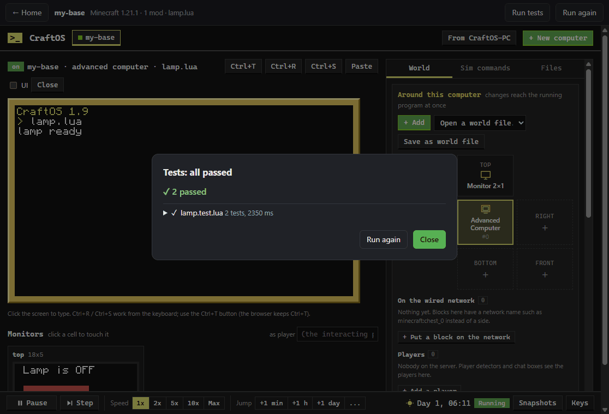

# Testing with ccunit

This page shows how to write tests for your CC:Tweaked programs and run them, from the command line, the desktop app
or VS Code.

A test is a Lua file whose name ends in `.test.lua`. It runs on a fresh computer with your files on it, starts your
program, taps its monitor, reads what is on the screens and checks the result. No Minecraft, no one clicking around.

## A first test

Take the lamp switch from [Getting started](getting-started.md): `lamp.lua` draws a button on a monitor and turns
the redstone on the back on and off when you tap it. Next to it, `lamp.test.lua`:

```lua
ccunit.test("starts off", function()
  local r = ccunit.run("lamp.lua", { seconds = 1 })
  ccunit.contains(r.screen, "lamp ready")
  ccunit.contains(ccunit.screen("top"), "Lamp is OFF")
end)

ccunit.test("a tap turns it on", function()
  ccunit.run("lamp.lua", { script = function()
    sleep(0.5)                  -- let the program draw
    ccunit.touch("top", 4, 4)   -- monitor, column, row
    sleep(0.5)                  -- let it react
  end })
  ccunit.contains(ccunit.screen("top"), "Lamp is ON")
  ccunit.truthy(redstone.getOutput("back"))
end)
```

The program needs a monitor on top. Give it one with `--monitor` (name, then blocks wide x blocks high):

```sh
craftos-mcp test --monitor top:2x1
```

```text
PASS lamp.test.lua (2 tests, 2358 ms)
  ok   starts off
  ok   a tap turns it on

1 file, 2 tests: 2 passed, 0 failed
```

`craftos-mcp test` with no file names runs every `*.test.lua` in the folder and the folders under it. It exits with 0
when everything passed, 1 when a test failed, and 2 when it could not run at all (a bad flag, a missing file, a world
it refuses).

## When a test fails

Each failed test says the file and line of the check that failed and what it got. When a file fails, the computer's
terminal is printed under it too. Here a third test expects the lamp to stay on after two taps:

```text
FAIL extra.test.lua (4 tests, 3974 ms)
  FAIL a second tap turns it off again
         /extra.test.lua:9: {" Lamp is OFF","","","  TURN ON",} does not contain "Lamp is ON"
  FAIL hangs
         timed out after 2 s
  skip a test for later
  ok   math
  terminal:
    | lamp ready
    |  Lamp is OFF
    |   TURN ON
```

The same lamp test without its monitor fails like this, because `peripheral.find("monitor")` finds nothing:

```text
FAIL lamp.test.lua (2 tests, 398 ms)
  FAIL starts off
         /lamp.test.lua:3: {"/lamp.lua:6: attempt to index a nil value","Line 6","  mon.setTextScale(1)","",} does not contain "lamp ready"
  FAIL a tap turns it on
         /lamp.test.lua:13: no monitor "top" is attached: give the test one (--monitor top:2x1 on the command line, or "monitors" in the world file)
```

`no monitor "top" is attached` means the test's computer has no monitor of that name: give it one (see
[Monitors and the world in a test](#monitors-and-the-world-in-a-test)). If the monitor is there but the program never
wrapped it, the message is `no screen "top" captured: the program never wrapped the monitor "top"`: check the name the
program uses, and that the test calls `ccunit.run` before `ccunit.screen`.

A file with a syntax error stops before any test runs. The report shows it as a failed test named `load` and the file,
with the file and line of the error:

```text
FAIL bad.test.lua (1 test, 236 ms)
  FAIL load bad.test.lua
         syntax error in bad.test.lua:3: unexpected symbol near 'end'
```

The summary line counts every test, skipped ones too: `2 files, 4 tests: 1 passed, 2 failed, 1 skipped`.

## Everything ccunit has

Every test file has a global `ccunit`. You do not `require` it.

### Tests

| Call                                     | What it does                                                                                                       |
| ---------------------------------------- | ------------------------------------------------------------------------------------------------------------------ |
| `ccunit.test(name, fn)`                  | One test. It passes when `fn` returns without an error.                                                            |
| `ccunit.test(name, fn, { timeout = 5 })` | The same, but if it is still running after 5 seconds it fails with `timed out after 5 s` and the next test starts. |
| `ccunit.skip(name)`                      | A test you have not written yet. It is listed as `skip` and counts as neither passed nor failed.                   |

Tests run in the order they are written, one after the other, on the same computer. Each test file gets its own
fresh computer, so files never see each other's changes, but tests in one file do: a redstone output one test sets
is still set in the next.

### Checks

Each check raises an error when it fails, which fails the test. The last argument, where there is one, is a message
put in front of the error.

| Check                                       | Passes when                                                                                                                              |
| ------------------------------------------- | ---------------------------------------------------------------------------------------------------------------------------------------- |
| `ccunit.eq(actual, expected [, msg])`       | they are equal. Tables are compared key by key, all the way down.                                                                        |
| `ccunit.neq(actual, other [, msg])`         | they are not equal (compared the same way).                                                                                              |
| `ccunit.near(actual, expected [, within])`  | two numbers are within `within` of each other (default 0.000001). Good for decimals.                                                     |
| `ccunit.truthy(value [, msg])`              | the value is anything but `nil` or `false`.                                                                                              |
| `ccunit.contains(haystack, needle [, msg])` | a string has the text in it (plain text, not a pattern), a list has the value, or a list of screen lines has a line with the text in it. |
| `ccunit.raises(fn [, pattern])`             | calling `fn` raises an error, and with a pattern, the error message matches it.                                                          |

```lua
ccunit.test("checks", function()
  ccunit.eq({ 1, 2 }, { 1, 2 })
  ccunit.near(0.1 + 0.2, 0.3)
  ccunit.raises(function() error("boom") end, "boom")
  ccunit.neq(1, 2)
end)
```

### Running your program

`ccunit.run(program [, options])` runs a program from your folder the way the shell would, while the test watches
the terminal and every monitor the program wraps. It returns a table:

| Field    | Means                                                                                                 |
| -------- | ----------------------------------------------------------------------------------------------------- |
| `ok`     | `true` if the program finished without an error, `false` if it errored, `nil` if it was still running |
| `done`   | `true` if the program finished by itself                                                              |
| `screen` | the terminal's lines, trailing spaces and empty lines at the bottom left out                          |

The options:

| Option    | Means                                                                                                          |
| --------- | -------------------------------------------------------------------------------------------------------------- |
| `args`    | a list of arguments for the program: `{ args = { "north", "5" } }`                                             |
| `seconds` | how long to let it run before the test carries on (default 1). A program that ends sooner ends the run sooner. |
| `script`  | a function that runs next to the program: tap, wait, change the world. The run ends when the function returns. |

Most programs that drive a monitor never end, so the run stops after `seconds`, or when your `script` returns. The
program is stopped then, so do your taps inside the script, not after `run` returns.

| Call                        | What it does                                                                        |
| --------------------------- | ----------------------------------------------------------------------------------- |
| `ccunit.screen()`           | the terminal's lines, as the last `run` left them                                   |
| `ccunit.screen("top")`      | a monitor's lines, as the last `run` left them                                      |
| `ccunit.touch("top", x, y)` | a player right-clicks that monitor at column `x`, row `y` (a `monitor_touch` event) |

Inside a `script` you can also use any CC:Tweaked API: `os.queueEvent("key", keys.enter)`, `redstone.setInput`, read
a chest with `peripheral.wrap`, and so on.

## Monitors and the world in a test

A test gets the same surroundings as `craftos-mcp run`. Pick one of these:

- `--monitor top:2x1` on the command line (blocks wide x blocks high; add `@0.5` for a text scale, as in
  `top:3x2@0.5`). Give `--monitor` more than once for more monitors.
- `--world lamp.world.json`: a [world file](worlds.md) with `"monitors"`, peripherals, players and more.
- `"world": "lamp.world.json"` in your project's `craftos.json`, so plain `craftos-mcp test` uses it every time.
- In VS Code, `lamp.test.lua` runs in `lamp.world.json` next to it when there is one.

`lamp.world.json`:

```json
{
  "monitors": [{ "name": "top", "blocksWide": 2, "blocksHigh": 1 }]
}
```

### Changing the world while a test runs

A world with `"simProgram": true` gives the computer the emulator's `sim` program, and a test can call it from its
`script` to move players, chat, put items in chests or move the clock on. This test checks a door that opens for
nearby players, from [Mods](mods.md):

```json
{
  "simProgram": true,
  "addons": ["advanced-peripherals"],
  "peripherals": [{ "name": "left", "type": "playerDetector" }],
  "players": [{ "name": "Alice", "x": 30, "y": 64, "z": 0 }]
}
```

```lua
ccunit.test("closed while nobody is near", function()
  ccunit.run("door.lua", { seconds = 2 })
  ccunit.contains(ccunit.screen(), "Door closed")
  ccunit.eq(redstone.getOutput("back"), false)
end)

ccunit.test("opens when Alice walks up", function()
  ccunit.run("door.lua", { script = function()
    sleep(1)
    shell.run("sim setPlayerPos player=Alice x=2 y=64 z=0")
    sleep(2)
  end })
  ccunit.contains(ccunit.screen(), "Door OPEN for Alice")
  ccunit.truthy(redstone.getOutput("back"))
end)
```

```text
PASS door.test.lua (2 tests, 5677 ms)
  ok   closed while nobody is near
  ok   opens when Alice walks up
```

`sim join Bob`, `sim chat Alice hello`, `sim item left 1 minecraft:diamond 5` and `sim advance 60` work the same way.
Type `sim help` on a computer in the [browser app](browser-app.md) or the [window](window.md) to see every command a
world knows. A real CC:Tweaked computer has no `sim`, so keep it in tests, not in the program.

## Time limits

There are two:

- **A whole file** gets 30 seconds by default. `--timeout 60` changes it. A file that runs out keeps the tests it
  finished and names the one it was in:

  ```text
  FAIL hang.test.lua (2 tests, 3023 ms)
    ok   quick
    FAIL waits forever
           timed out in this test (the file had 3000 ms)
    the file did not finish before the timeout
  ```

- **One test** gets a limit with `{ timeout = seconds }` as the third argument of `ccunit.test`. It fails alone and
  the rest of the file carries on.

Programs that wait a long time (a farm that harvests every ten minutes, a reactor that heats up) can run on a faster
clock: `--timescale 10` makes every `sleep` and timer ten times shorter. See
[Time and snapshots](time-and-snapshots.md).

## Which files run

- `craftos-mcp test` runs every `*.test.lua` under the current folder (`--dir` picks another folder).
- `craftos-mcp test lamp.test.lua tests/` runs the files and folders you name.
- A `"tests"` list in `craftos.json` picks the files when you name none:

  ```json
  { "tests": ["tests/**/*.test.lua"] }
  ```

`node_modules`, `.git` and other folders that are never copied onto a computer are skipped. With no test files at all
the command says `no *.test.lua files found under <folder>` and exits with 2.

## Run them again on every save

```sh
craftos-mcp test --watch
```

It runs the tests, then waits. When you save a `.lua` file it runs the test files you changed, and the ones that load
the file you changed (all of them when none does). Ctrl+C stops it.

```text
[20:16:55] PASS 2 tests: 2 passed, 0 failed (1 of 1 file for lamp.lua). Watching for changes; Ctrl+C stops.
```

## Reports for other tools

| Flag                                 | Gives                                                                                                |
| ------------------------------------ | ---------------------------------------------------------------------------------------------------- |
| (none)                               | the report above                                                                                     |
| `--json`                             | the whole result as JSON: every file, test, error, file and line                                     |
| `--reporter junit --out results.xml` | JUnit XML, which most CI systems show as a test list. The normal report stays on the screen.         |
| `--reporter github`                  | `::error` lines that mark the failing line on a GitHub pull request. On by itself in GitHub Actions. |

To run your tests on every push in GitHub Actions, copy the workflow in the README's
[In CI](../../README.md#in-ci) section.

## Other options

`craftos-mcp test` takes the same flags as `craftos-mcp run`: `--mc 1.18.2` for another Minecraft version,
`--addons create,mekanism` for the mods (see [Mods](mods.md)), `--world`, `--monitor`, `--timeout`, `--timescale` and
`--dir`. `craftos-mcp help test` lists them.

## From the desktop app and VS Code

In the [desktop app](desktop-app.md), **Run tests** on a project runs every test file in its folder (or the `tests`
list in its `craftos.json`) with the project's Minecraft version and mods, and shows what passed:



In VS Code, the extension lists every `*.test.lua` in the Testing view, with a run button on each file.
