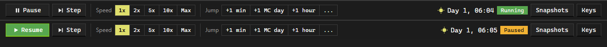
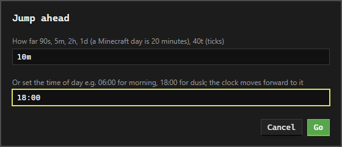
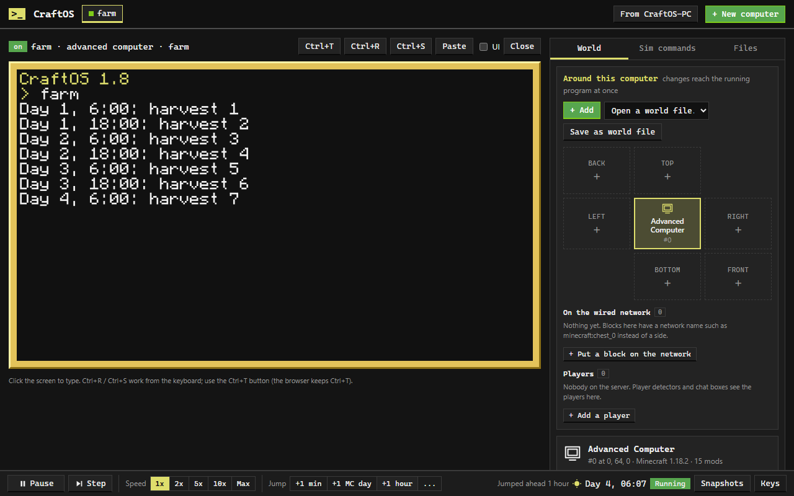
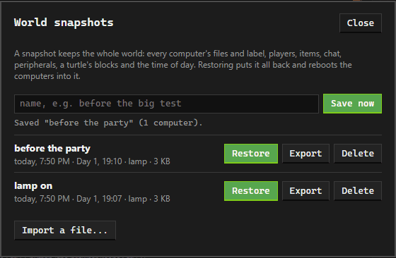

# Time and snapshots

This page covers the clock (pause, step, speed up, jump ahead, the time of day) and snapshots that save the whole
world and put it back. Both live in the bar along the bottom of the browser app ([browser-app.md](browser-app.md))
and the desktop app ([desktop-app.md](desktop-app.md)).



The bar works on every computer at once, so a network stays in step.

## Pause and step

**Pause** stops every computer and the clock. A computer that is in the middle of something finishes that piece
first, so a pause never ends in "Too long without yielding". While it waits, the state shows **Pausing...**, then
**Paused**. **Resume** carries on where it stood: a timer that was due in 3 seconds is still due 3 seconds later.
That is how the game behaves when the server is paused or lagging, since CC's timers count server ticks.

**Step** runs one tick (1/20 of a second) and stops again. The timers due in that tick fire and every computer handles
its events. Use it to watch a program one tick at a time.

## Speed

**1x** is normal. **2x**, **5x** and **10x** run the clock that many times faster: `sleep`, timers, `os.clock`,
`os.time` and turtle moves all go faster. **Max** goes as fast as it can: whenever every computer is waiting, the
clock skips straight to the next timer, so a `sleep(600)` passes at once.

The state in the bar says **Running**, the speed (**5x**) or **Max speed**.

## Jump ahead

The **Jump** buttons move the clock ahead. Two clocks are worth telling apart: computer time (`os.clock`, `sleep`,
timers) runs like real time, and the in-game clock (`os.time`, `os.day`) goes round once every 20 minutes of it, as
in Minecraft.

| Button        | Computer time (`os.clock`, `sleep`) | In-game time (`os.time`, `os.day`) |
| ------------- | ----------------------------------- | ---------------------------------- |
| **+1 min**    | 1 minute                            | 1200 ticks, a bit over a game hour |
| **+1 MC day** | 20 minutes                          | one Minecraft day                  |
| **+1 hour**   | 1 hour                              | three Minecraft days               |

**...** opens a box for any amount: `90s`, `5m`, `2h`, `1d` (a Minecraft day), `40t` (ticks). A jump is at most 30
Minecraft days. The same box sets the time of day instead: `06:00` for morning, `18:00` for dusk. The clock moves
forward to the next time it is that o'clock, as `/time set` in the game does not go back.



What a jump does to a program: the clock moves from one timer to the next, and every computer handles each timer
before the clock moves on. A program that sleeps in a loop runs every round that fits in the jump: a loop of
`sleep(1)` prints ten lines in a 10 second jump, as it would in ten seconds of a running world. Paused, the
computers run through the jump and stand still again at its end. A jump that would take more than 30 seconds (a
very busy loop over a long jump) does the rest at once: the timers still due fire in order, but a loop then runs
one more round only.

`farm.lua` harvests every 600 seconds, half a Minecraft day:

```lua
local harvests = 0
while true do
  harvests = harvests + 1
  print("Day " .. os.day() .. ", " .. textutils.formatTime(os.time(), true) .. ": harvest " .. harvests)
  sleep(600) -- ten minutes: half a Minecraft day
end
```



One **+1 hour** is three Minecraft days, and the program harvests six times in it, twice every Minecraft day, as it
would in a world left running. **Max** does the same without a set end.

`os.day()` counts from 06:00, as in the game: the day number goes up at 06:00, not at midnight.

### Time of day

The right of the bar shows the world's day and time (`Day 1, 06:13`) with a sun or a moon. All the app's computers
share it, as in the game: a computer made later, or rebooted, keeps the world's time of day.

## Keys

In the browser app and the desktop app:

| Key             | Does                                 |
| --------------- | ------------------------------------ |
| Alt+P           | Pause or resume                      |
| Alt+.           | One tick                             |
| Alt+] and Alt+[ | Faster and slower                    |
| Alt+\           | Normal speed                         |
| Alt+J           | A minute ahead                       |
| Alt+N           | A Minecraft day (20 minutes) ahead   |
| Alt+H           | An hour (three Minecraft days) ahead |
| Alt+S           | Snapshots                            |

**Keys** in the bar lists them. These keys never reach the computer.

`craftos-mcp window` has the same keys, except Alt+S, in a single computer's window, and its title shows `[Paused]` or
the speed ([window.md](window.md)). `--speed 5` starts it five times faster.

## Snapshots

**Snapshots** (or Alt+S) saves the whole world under a name: players, items, chat, peripherals, a turtle's blocks,
every computer's label and the time of day.



- **Save now** saves it. With no name it is named by the date and time.
- **Restore** puts it all back and reboots the computers into it. Computers you made after the snapshot are closed,
  and ones you closed since are made again.
- **Export** downloads it as a `.craftos-world` file to share or keep.
- **Import a file...** takes in a `.craftos-world` file. Then press **Restore** on it.
- **Delete** removes it.

To open the app with a snapshot already loaded:

```sh
npx craftos-mcp app --snapshot "before the party"      # a saved snapshot, by name
npx craftos-mcp app --snapshot setup.craftos-world     # a file someone shared
```

**Files and snapshots.** A snapshot keeps every computer's files, and a restore puts them back exactly. For a
computer whose files are your project folder itself (the default) that means your real project files: a restore
writes back the files that changed since the snapshot and removes the files made since, so the folder is as it was.
Before it does, the **Restore** box says which folder it will change, and a copy of every file it overwrites or
removes goes to `runtime/restore-backups/<snapshot> <date>` under craftos-mcp's own folder (below). Folders the
computer cannot see, such as `.git` and `node_modules`, are not saved and not touched. A snapshot made with an older
craftos-mcp has no project files in it and leaves the folder alone.

A snapshot name is letters, digits, spaces, `-`, `_` and `.`, at most 64 characters. Snapshots are kept in the
`runtime/snapshots` folder under craftos-mcp's own folder (`%LOCALAPPDATA%\craftos-mcp` on Windows,
`~/.cache/craftos-mcp` elsewhere).

## Time in a program run or a test

The command line has no time bar, but it can speed the clock up:

```sh
npx craftos-mcp run farm.lua --timescale 100 --timeout 20   # 100 times faster, stop after 20 real seconds
npx craftos-mcp test --timescale 10
```

The first prints four harvests, two Minecraft days, from 20 seconds of waiting. `--timeout` counts real seconds.

Inside the computer, `sim advance 60` jumps that computer 60 seconds the same way the bar's jump does: every timer
on the way fires and the program runs between them. A world file can pin `math.random`
with `"seed": 42`, so dice and shuffles come out the same every run ([worlds.md](worlds.md)).

## See also

- [Testing with ccunit](testing.md)
- [Troubleshooting](troubleshooting.md)
- [Getting started](getting-started.md)
