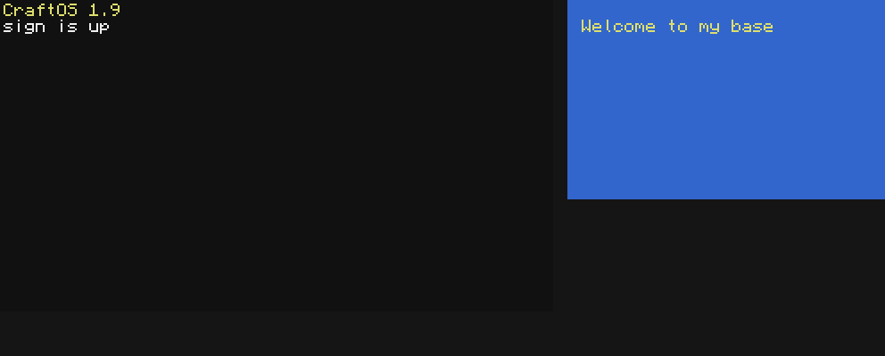

# The window

This page covers `craftos-mcp window`: a computer in a plain desktop window, like CraftOS-PC, with your own editor
beside it. For more than one computer, turtles in 3D and the side panels, the browser app
([browser-app.md](browser-app.md)) is often easier.

## Open it

In a terminal, in the folder with your Lua programs:

```sh
npx craftos-mcp window
```

A computer boots in a window. That folder is its disk, live: what you save there in your editor the computer sees at
once, and what a program saves shows up in the folder. Run a program by typing its name, as in the game. Hold Ctrl+R
to start over after an edit.

Closing the window turns the computer off and ends the command. The terminal it started from prints which folder the
computer uses and that `sim help` changes the world.

## With a world and monitors

What stands around the computer comes from a world file ([worlds.md](worlds.md)), or a monitor from `--monitor`:

```sh
npx craftos-mcp window --monitor top:3x2              # a monitor on top, 3 blocks wide and 2 high
npx craftos-mcp window --monitor top:3x2@0.5          # the same at text scale 0.5
npx craftos-mcp window lamp.world.json                # the world in that file
npx craftos-mcp window create-demo                    # a saved world from worlds/, by name
```

Each monitor opens as a window of its own. Click it to touch it: the computer gets `monitor_touch` with that column
and row. A world can list its monitors under `"monitors"`:

```json
{ "monitors": [{ "name": "top", "blocksWide": 2, "blocksHigh": 1 }] }
```

A monitor is a wall of blocks, 1x1 to 8x6, as in the game. A world's speakers play real sound.



_The computer's screen and its monitor after `sign`, from `craftos-mcp run sign.lua --monitor top:3x2 --screenshot
shot.png`. In the window each of these is its own window._

## Options

| Option                               | What it does                                                                                      |
| ------------------------------------ | ------------------------------------------------------------------------------------------------- |
| `[world...]` or `--world`            | A world JSON file, or the name of one in `worlds/`. Two or more open a network, one computer each |
| `--monitor <name>:<w>x<h>[@<scale>]` | A monitor wall in its own window. Give it more than once for more monitors                        |
| `--dir <folder>`                     | The computer's files. Default: the folder you are in                                              |
| `--copy`                             | A scratch copy of the folder instead: nothing reaches your folder, and the copy goes on close     |
| `--computers <n>`                    | This many computers on one network (1 to 16), all in the same world                               |
| `--own-folders`                      | On a network, each computer gets its own folder, `<dir>/computer/<id>`                            |
| `--mc <version>`                     | `1.21.1`, `1.20.1` or `1.18.2`. Beats the world's version                                         |
| `--addons <ids>`                     | `all`, `none`, or mod ids with commas ([mods.md](mods.md)). Beats the world's list                |
| `--speed <x>`                        | Start the clock this many times faster (0.1 to 1000)                                              |
| `--browser` / `--no-browser`         | Also open the browser app on these computers. On by default for a turtle                          |
| `--keep`                             | Keep the scratch folder (the world's state and a trace) after the window closes                   |

The computer's `.git`, `node_modules` and `.runtime` folders show as empty, and the computer cannot change them.

## Keys

The same keys as CraftOS-PC:

| Key         | Does                               |
| ----------- | ---------------------------------- |
| Hold Ctrl+T | Stop the running program           |
| Hold Ctrl+R | Reboot                             |
| Hold Ctrl+S | Shut down                          |
| F12         | Copy a screenshot to the clipboard |
| F2          | Save a screenshot                  |
| F3          | Start or stop a recording (a GIF)  |
| F11         | Full screen                        |

F2 and F3 save into `Pictures\craftos-mcp` in your user folder (your home folder when it has no Pictures folder),
and the command prints where each one went, for example
`screenshot saved: C:\Users\you\Pictures\craftos-mcp\2026-11-17_14.05.31.png`. Set `CRAFTOS_SCREENSHOTS` to another
folder to keep them there instead.

The clock, in a single computer's window:

| Key                 | Does                                     |
| ------------------- | ---------------------------------------- |
| Alt+P               | Pause or resume                          |
| Alt+.               | One tick (1/20 of a second)              |
| Alt+] and Alt+[     | Faster and slower                        |
| Alt+\               | Normal speed                             |
| Alt+J, Alt+H, Alt+N | A minute, an hour, a Minecraft day ahead |

The window's title shows `[Paused]` or the speed. A turtle's or a network's clock is in the browser app (`--browser`).
[time-and-snapshots.md](time-and-snapshots.md) says what each of these does to timers.

## A turtle

A world with a `"turtle"` entry (or blocks) opens the turtle in the window:

```sh
npx craftos-mcp window tower.world.json
```

The browser app opens beside it on the turtle's blocks in 3D, so you can watch it build (`--no-browser` to skip
that). Every computer or turtle it places and turns on gets a window of its own. A turtle world opens on its own, not
as part of a network.

## Several computers

Several computers on one network open a window each, and rednet works between them:

```sh
npx craftos-mcp window --computers 2                           # computer1 and computer2
npx craftos-mcp window sender.world.json receiver.world.json   # windows named sender and receiver
```

Each gets a wireless modem on its back, or on the first free side, unless its world already has a modem. They share
your folder (a file one saves, the others see), except a computer that already has a `computer/<id>` folder there,
as CraftOS-PC lays them out. `--own-folders` makes one for each. The command prints which folder each computer uses.

Closing a computer's window turns that one off, and closing the last one ends the command. `--browser` opens the
browser app on them too, with the Network view of the messages flying between them, the world and the clock.

## Changing the world while it runs

Type `sim help` in the computer for the list. For example:

```text
sim join Alice                      sim leave Alice
sim chat Alice hello                sim advance 60
sim item chest_0 1 minecraft:diamond 5
sim state
```

`attach top monitor` (from CraftOS-PC) works too: it places the monitor, live, and prints the world file line that
keeps it there. See [Coming from CraftOS-PC](../coming-from-craftos-pc.md).

## See also

- [Getting started](getting-started.md)
- [Troubleshooting](troubleshooting.md)
