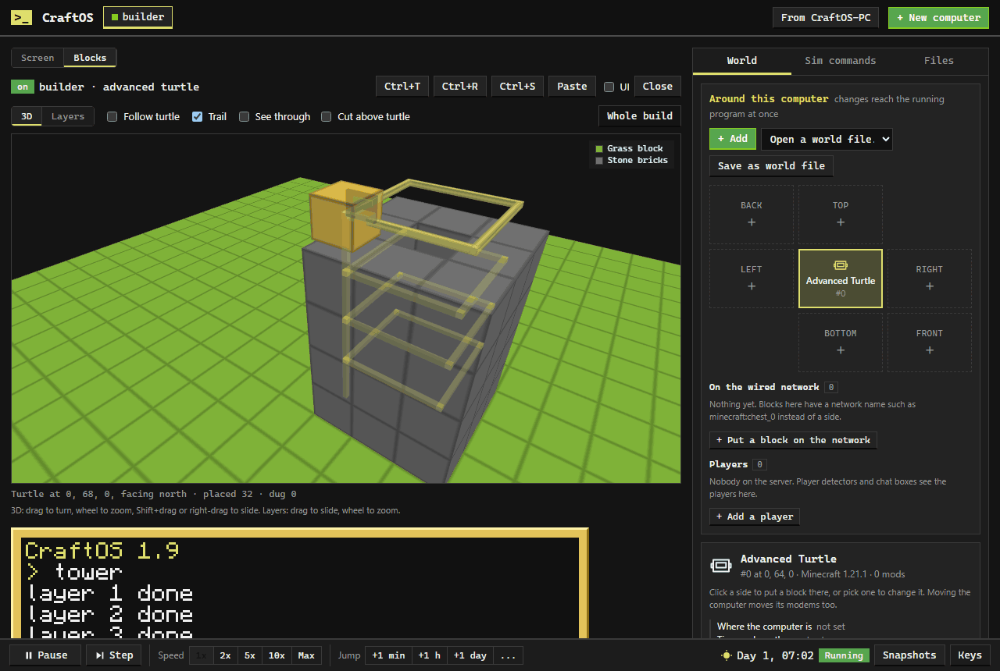
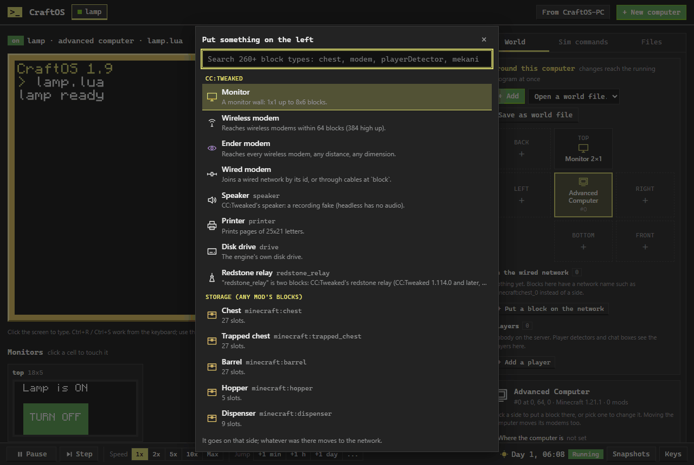
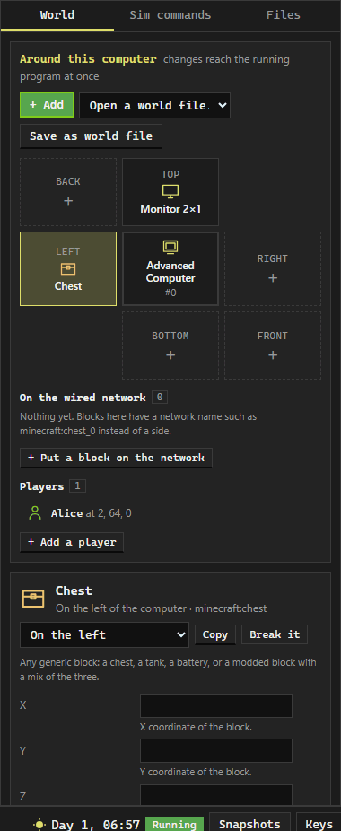

# Worlds and world files

This page covers what stands around a computer (monitors, chests, modems, players, a turtle's blocks) and how to
describe it in a world file.

In Minecraft your program talks to the blocks next to the computer. Here those blocks come from a **world file**: a
small JSON file you keep next to your program. Without one, the computer stands alone with nothing attached.

## A first world file

`base.world.json`, with a monitor wall on top, a chest with coal in it, a wireless modem, a disk drive, a speaker, a
printer, and a player standing nearby:

```json
{
  "$schema": "https://raw.githubusercontent.com/Akkiruk/craftos-mcp/main/schemas/world.schema.json",
  "label": "base",
  "monitors": [{ "name": "top", "blocksWide": 3, "blocksHigh": 2 }],
  "peripherals": [
    {
      "name": "left",
      "type": "minecraft:chest",
      "items": { "1": { "name": "minecraft:coal", "count": 16 } }
    },
    { "name": "back", "type": "modem" },
    { "name": "right", "type": "drive" },
    { "name": "bottom", "type": "speaker" },
    { "name": "front", "type": "printer", "ink": 64, "paper": 64 }
  ],
  "players": [{ "name": "Alice", "x": 3, "y": 64, "z": 0 }]
}
```

A program that looks around, `look.lua`:

```lua
print("label: " .. tostring(os.getComputerLabel()))
for _, name in ipairs(peripheral.getNames()) do
  print(name .. ": " .. table.concat({ peripheral.getType(name) }, ", "))
end
local item = peripheral.wrap("left").getItemDetail(1)
print("slot 1: " .. item.count .. " " .. item.name)
print("wireless: " .. tostring(peripheral.wrap("back").isWireless()))
```

```sh
craftos-mcp run look.lua --world base.world.json
```

```text
look.lua: completed (exit 0, 404 ms)
--- terminal (51x19) ---
CraftOS 1.9
label: base
top: monitor
bottom: speaker
left: minecraft:chest, inventory
right: drive
front: printer
back: modem
slot 1: 16 minecraft:coal
wireless: true
--- monitor top (29x12) ---
```

## Where a world comes from

The same file works everywhere:

| Where                        | How                                                                                              |
| ---------------------------- | ------------------------------------------------------------------------------------------------ |
| `craftos-mcp run` and `test` | `--world base.world.json`                                                                        |
| `craftos-mcp window`         | `craftos-mcp window base.world.json` (see [The window](window.md))                               |
| Every command, every time    | `"world": "base.world.json"` in your project's `craftos.json`                                    |
| The desktop app              | the `world` in `craftos.json`: Run and Run tests use it (see [The desktop app](desktop-app.md))  |
| The browser app              | **New computer**: pick a world in **World**, or paste yours into **World JSON**                  |
| While a computer runs        | the browser app's **World** panel (below): add and change blocks with the mouse                  |
| VS Code                      | a `*.world.json` opens in the World Editor; `lamp.test.lua` runs in `lamp.world.json` next to it |

A name without `.json` picks one of the example worlds that come with craftos-mcp, such as
`--world generic-storage-demo` or `--world create-demo`. A misspelt name lists the ones there are.

## Monitors

```json
"monitors": [{ "name": "top", "blocksWide": 3, "blocksHigh": 2, "textScale": 1 }]
```

A monitor is a wall of blocks, 1x1 up to 8x6, as in the game. One block is 7 characters wide and 5 high at text
scale 1, less the border, so a 3x2 wall is 29x12. `"advanced": false` makes a normal monitor: greys only and no
touches. On the command line, `--monitor top:3x2` does the same without a file.

## Peripherals

Everything else goes in `"peripherals"`. Each entry has a `name` and a `type`. The name is a side (`top`, `bottom`,
`left`, `right`, `front`, `back`) or, for blocks on a wired network, a network name such as `minecraft:chest_0`.

| Block          | Entry                                                                                                        |
| -------------- | ------------------------------------------------------------------------------------------------------------ |
| Chest          | `{ "name": "left", "type": "minecraft:chest", "items": { "1": { "name": "minecraft:coal", "count": 16 } } }` |
| Barrel, hopper | `"type": "minecraft:barrel"`, `"minecraft:hopper"`, ... with `items` the same way                            |
| Wireless modem | `{ "name": "back", "type": "modem" }`                                                                        |
| Ender modem    | `{ "name": "back", "type": "modem", "kind": "ender" }`: reaches every wireless modem, any distance           |
| Wired modem    | `{ "name": "back", "type": "modem", "kind": "wired" }`                                                       |
| Disk drive     | `{ "name": "right", "type": "drive" }`                                                                       |
| Speaker        | `{ "name": "bottom", "type": "speaker" }`                                                                    |
| Printer        | `{ "name": "front", "type": "printer", "ink": 64, "paper": 64 }`                                             |

Any block with your own type name, such as `{ "name": "right", "type": "mymod:crusher", "size": 9, "energy": 1000 }`,
becomes a generic inventory, tank or energy store when you give it `size` or `items`, `tanks` or `fluid`, or
`energy`, as modded machines are in the game (a warning says it is not a type the emulator knows). The printer's pages come out as
`computercraft:printed_page` items, and the browser app shows each page under the computer's screen.

### A wired network

A wired modem on the computer, and blocks named like `minecraft:chest_0`, are on one network, as if cables joined
them:

```json
{
  "peripherals": [
    { "name": "back", "type": "modem", "kind": "wired" },
    {
      "name": "minecraft:chest_0",
      "type": "minecraft:chest",
      "items": { "1": { "name": "minecraft:iron_ingot", "count": 8 } }
    },
    { "name": "minecraft:chest_1", "type": "minecraft:chest" }
  ]
}
```

```lua
print(table.concat(peripheral.getNames(), ", "))
local from = peripheral.wrap("minecraft:chest_0")
print("moved " .. from.pushItems("minecraft:chest_1", 1) .. " items")
```

```text
back, minecraft:chest_0, minecraft:chest_1
moved 8 items
```

Mod blocks go in the same list with the mod's type, such as `playerDetector` or `Create_Station`. See
[Mods](mods.md).

## Players

```json
"players": [
  { "name": "Alice", "x": 3, "y": 64, "z": 0 },
  { "name": "Bob", "x": 90, "y": 64, "z": 0, "online": false }
]
```

Player detectors, chat boxes and inventory managers see these players. The computer stands at 0, 64, 0 unless
`"position"` says otherwise.

## The computer itself

| Key          | Example                           | Means                                                                      |
| ------------ | --------------------------------- | -------------------------------------------------------------------------- |
| `label`      | `"base"`                          | `os.getComputerLabel()`                                                    |
| `computerId` | `7`                               | `os.getComputerID()`                                                       |
| `kind`       | `"pocket"`                        | a pocket computer, with its 26x20 screen                                   |
| `advanced`   | `false`                           | a normal (not advanced) computer: no colour, no mouse                      |
| `position`   | `{ "x": 100, "y": 70, "z": -20 }` | where the computer stands                                                  |
| `seed`       | `42`                              | `math.random` gives the same numbers every run                             |
| `motd`       | `true`                            | show the tip of the day at boot (off by default, so screens repeat)        |
| `version`    | `"1.18.2"`                        | the Minecraft version, and so the CC:Tweaked version (see [Mods](mods.md)) |
| `addons`     | `["create"]`                      | the mods this world has (see [Mods](mods.md))                              |
| `simProgram` | `true`                            | give the computer the `sim` program, to change the world by typing (below) |

## A turtle and its blocks

A `"turtle"` entry makes the computer a turtle. It needs blocks around it, or it floats in empty air with nothing to
dig. `mine.world.json`:

```json
{
  "turtle": {
    "x": 0,
    "y": 64,
    "z": 0,
    "facing": "north",
    "fuel": 500,
    "right": "minecraft:diamond_pickaxe"
  },
  "ground": {
    "y": 63,
    "name": "minecraft:stone",
    "top": "minecraft:grass_block"
  },
  "fills": [
    { "from": [-2, 64, -5], "to": [2, 66, -1], "name": "minecraft:stone" }
  ],
  "blocks": [{ "x": 0, "y": 64, "z": -2, "name": "minecraft:coal_ore" }]
}
```

- `ground`: everything at or below `y` is `name`, with a top layer of `top`.
- `fills`: boxes of one block, corner to corner. A later fill covers an earlier one.
- `blocks`: single blocks. They cover fills and ground.
- In the turtle: `facing`, `fuel`, `inventory` (slot to item, as a chest's `items`), `left` and `right` upgrades
  (`minecraft:diamond_pickaxe`, `computercraft:wireless_modem_normal`, `minecraft:crafting_table`, ...), `advanced`.

`dig.lua`:

```lua
for i = 1, 3 do
  local ok, block = turtle.inspect()
  print(i .. ": " .. (ok and block.name or "air"))
  turtle.dig()
  turtle.forward()
end
for slot = 1, 16 do
  local item = turtle.getItemDetail(slot)
  if item then print("slot " .. slot .. ": " .. item.count .. " " .. item.name) end
end
```

```sh
craftos-mcp run dig.lua --world mine.world.json
```

```text
1: minecraft:stone
2: minecraft:coal_ore
3: minecraft:stone
slot 1: 2 minecraft:cobblestone
slot 2: 1 minecraft:coal
```

Stone drops cobblestone and coal ore drops coal, as in the game. Turtles move at game speed, so a long build takes a
while: `--timescale 5` runs the clock five times faster. In the browser app the **Blocks** view
shows the turtle and its blocks in 3D as it works (see [The browser app](browser-app.md)).



## Several computers

A world file describes one computer and what stands around it. For a network of computers:

- The browser app: set **Computers** to 2 or more in **New computer**. Each gets a modem and a tab of its own.
- The window: `craftos-mcp window sender.world.json receiver.world.json` opens one computer per world file, or
  `craftos-mcp window --computers 2` opens two in the same world, each with a wireless modem on its back.

Give each one its own `computerId` if your programs care which is which. Rednet works between them.

## Editor help

With `"$schema"` set as in the first example, VS Code and other editors that read JSON Schema complete every key,
show what it means when you hover it, and underline a wrong one. The schema is
[schemas/world.schema.json](../../schemas/world.schema.json).

## Mistakes are caught before the computer starts

A wrong key or block type is refused with the nearest real one, before anything boots:

```text
--world t1.json: world.peripheral is not a world field. Did you mean "peripherals"?
```

```text
--world t2.json: world.peripherals[0].type "minecraft:chets" is not a peripheral the sim can build. Did you mean "minecraft:chest" (CC:Tweaked)?
```

More messages and their fixes are in [Troubleshooting](troubleshooting.md).

## Changing the world while it runs

### The World panel

In the [browser app](browser-app.md), the **World** tab on the right builds the world with the mouse while your
program runs. **Around this computer** shows its six sides. Click a side to put something there: the search finds
any block the emulator knows, CC:Tweaked's first, then chests, tanks and batteries, then each mod's blocks.



Click a block to change it: a monitor's size, a chest's slots, a tank's fluid, where a player stands. **Put a block
on the network** adds a block on the wired network, and **Add a player** adds a player to the server. Each change
reaches the running program at once, the way the game sends it: a `peripheral` event when a block is placed,
`peripheral_detach` when it is broken, `monitor_resize` when a wall grows. It works the other way too: a monitor
attached or a player who joined by typing in the computer (`attach top monitor`, `sim join Alice`) shows in the panel
within a couple of seconds, and the panel's next change starts from there.



**Save as world file** writes all of it to a `.world.json`, so you can use it with `--world` or in `craftos.json`.
**Open a world file** loads one, from your PC or from your project folder, and the computer gets every block in it.

### The sim program

In the browser app and the window, the computer has a `sim` program that changes the world by typing:

```text
sim join Alice                      sim leave Alice
sim chat Alice hello                sim advance 60       (move the clock 60 seconds on)
sim item left 1 minecraft:diamond 5 sim state            (players, peripherals, chat)
sim setPlayerPos player=Alice x=2 y=64 z=0
sim help                            (every command this world knows)
```

A real CC:Tweaked computer has no `sim`. In `craftos-mcp run` and tests it is there only when the world has
`"simProgram": true`; [Testing](testing.md#changing-the-world-while-a-test-runs) shows a test that uses it.

## Every key

[schemas/world.schema.json](../../schemas/world.schema.json) lists every key with a line on what it does.
[docs/turtle.md](../turtle.md) covers the turtle's world in full, and each mod's page covers its blocks.
